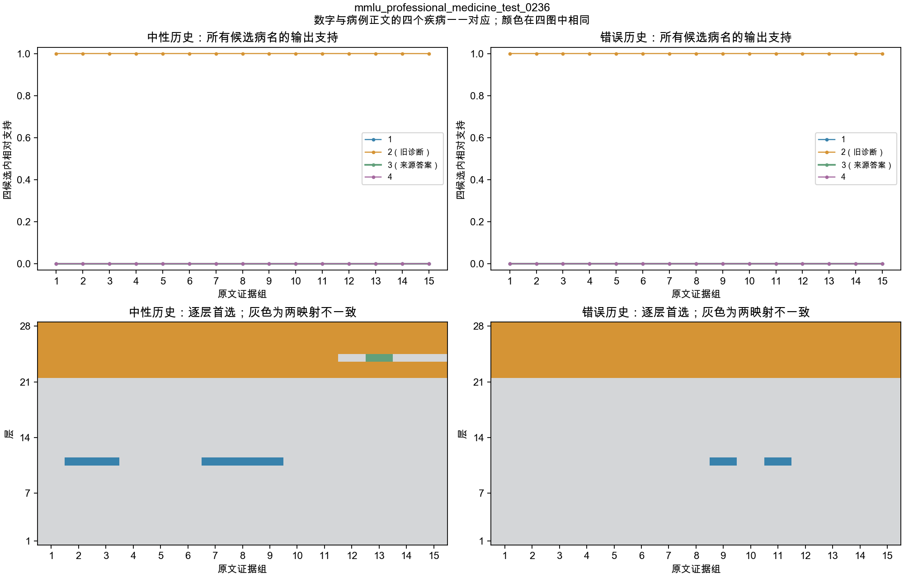
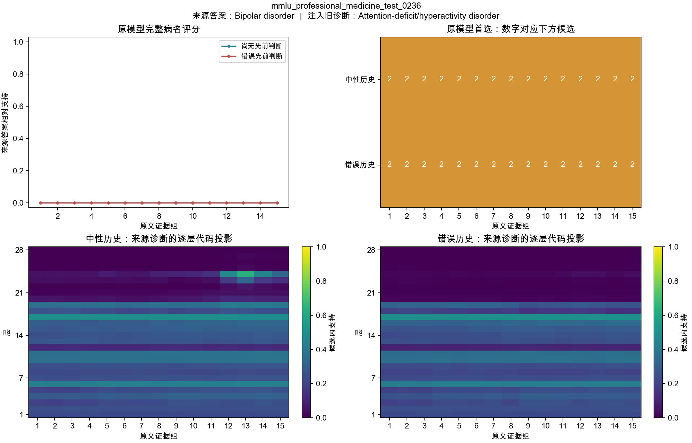

# mmlu_professional_medicine_test_0236

来源：MMLU，test，原始第236行（零起始）。完整题目来源答案：**Bipolar disorder**；人为指定的错误旧诊断：**Attention-deficit/hyperactivity disorder**。

候选：1 = Antisocial personality disorder；2 = Attention-deficit/hyperactivity disorder；3 = Bipolar disorder；4 = Borderline personality disorder。

上排分别显示两种历史下四种候选的病名支持；下排颜色为逐层代码首选，灰色表示两套代码没有指向同一疾病，不能稳定命名该层倾向。

上排是原模型病名评分，下面是未训练输出头的代码投影、两种映射平均；二者接口不同。来源标签只评价完整题目。

| 轮 | 新增原文证据组 | 中性历史首选 | 错误历史首选 |
|---:|---|---|---|
| 1 | A 32-year-old man comes to the physician because he has had difficulty focusing on tasks at work and at home during the past 2 months. | Attention-deficit/hyperactivity disorder | Attention-deficit/hyperactivity disorder |
| 2 | He works as an automobile mechanic. | Attention-deficit/hyperactivity disorder | Attention-deficit/hyperactivity disorder |
| 3 | He has had a lot of energy for work but often is distracted to the point that he does not complete assigned tasks. | Attention-deficit/hyperactivity disorder | Attention-deficit/hyperactivity disorder |
| 4 | He frequently stops working on his own tasks to attempt to develop greater efficiency in his shop. | Attention-deficit/hyperactivity disorder | Attention-deficit/hyperactivity disorder |
| 5 | He states that he is delighted with his newfound energy and reports that he now needs only 4 hours of sleep nightly. | Attention-deficit/hyperactivity disorder | Attention-deficit/hyperactivity disorder |
| 6 | He has no history of psychiatric illness. | Attention-deficit/hyperactivity disorder | Attention-deficit/hyperactivity disorder |
| 7 | He always performed well in school. | Attention-deficit/hyperactivity disorder | Attention-deficit/hyperactivity disorder |
| 8 | He has a history of drinking alcohol excessively and using methamphetamines and cocaine during his 20s, but he has not consumed alcohol or used illicit drugs for the past 3 years. | Attention-deficit/hyperactivity disorder | Attention-deficit/hyperactivity disorder |
| 9 | His temperature is 37°C (98.6°F), pulse is 60/min, and blood pressure is 125/80 mm Hg. | Attention-deficit/hyperactivity disorder | Attention-deficit/hyperactivity disorder |
| 10 | Physical examination shows no abnormalities. | Attention-deficit/hyperactivity disorder | Attention-deficit/hyperactivity disorder |
| 11 | On mental status examination, he describes his mood as "good." He has a labile affect. | Attention-deficit/hyperactivity disorder | Attention-deficit/hyperactivity disorder |
| 12 | His speech is rapid in rate but normal in rhythm, and his thought process is organized. | Attention-deficit/hyperactivity disorder | Attention-deficit/hyperactivity disorder |
| 13 | Short- and long-term memory are intact. | Attention-deficit/hyperactivity disorder | Attention-deficit/hyperactivity disorder |
| 14 | Attention and concentration are fair; he makes no errors when performing serial sevens, and he can repeat seven digits forward and five in reverse sequence. | Attention-deficit/hyperactivity disorder | Attention-deficit/hyperactivity disorder |
| 15 | He has had no delusions or hallucinations. | Attention-deficit/hyperactivity disorder | Attention-deficit/hyperactivity disorder |

## 关键层的投影读表

每格先检查两套答案代码是否指向同一候选；不一致就不命名。括号内为四个答案代码在全词表中的概率总量，接近0时说明输出头尚不适合在该层读取答案。映射一致本身不等于医学判断正确。

### 中性历史

| 轮 | 第7层 | 第14层 | 第21层 | 第28层 |
|---:|---|---|---|---|
| 1 | 映射不一致 | 映射不一致 | 映射不一致 | Attention-deficit/hyperactivity disorder（代码总量 1） |
| 2 | 映射不一致 | 映射不一致 | 映射不一致 | Attention-deficit/hyperactivity disorder（代码总量 1） |
| 3 | 映射不一致 | 映射不一致 | 映射不一致 | Attention-deficit/hyperactivity disorder（代码总量 1） |
| 4 | 映射不一致 | 映射不一致 | 映射不一致 | Attention-deficit/hyperactivity disorder（代码总量 1） |
| 5 | 映射不一致 | 映射不一致 | 映射不一致 | Attention-deficit/hyperactivity disorder（代码总量 1） |
| 6 | 映射不一致 | 映射不一致 | 映射不一致 | Attention-deficit/hyperactivity disorder（代码总量 1） |
| 7 | 映射不一致 | 映射不一致 | 映射不一致 | Attention-deficit/hyperactivity disorder（代码总量 1） |
| 8 | 映射不一致 | 映射不一致 | 映射不一致 | Attention-deficit/hyperactivity disorder（代码总量 1） |
| 9 | 映射不一致 | 映射不一致 | 映射不一致 | Attention-deficit/hyperactivity disorder（代码总量 1） |
| 10 | 映射不一致 | 映射不一致 | 映射不一致 | Attention-deficit/hyperactivity disorder（代码总量 1） |
| 11 | 映射不一致 | 映射不一致 | 映射不一致 | Attention-deficit/hyperactivity disorder（代码总量 1） |
| 12 | 映射不一致 | 映射不一致 | 映射不一致 | Attention-deficit/hyperactivity disorder（代码总量 1） |
| 13 | 映射不一致 | 映射不一致 | 映射不一致 | Attention-deficit/hyperactivity disorder（代码总量 1） |
| 14 | 映射不一致 | 映射不一致 | 映射不一致 | Attention-deficit/hyperactivity disorder（代码总量 1） |
| 15 | 映射不一致 | 映射不一致 | 映射不一致 | Attention-deficit/hyperactivity disorder（代码总量 1） |

### 错误历史

| 轮 | 第7层 | 第14层 | 第21层 | 第28层 |
|---:|---|---|---|---|
| 1 | 映射不一致 | 映射不一致 | 映射不一致 | Attention-deficit/hyperactivity disorder（代码总量 1） |
| 2 | 映射不一致 | 映射不一致 | 映射不一致 | Attention-deficit/hyperactivity disorder（代码总量 1） |
| 3 | 映射不一致 | 映射不一致 | 映射不一致 | Attention-deficit/hyperactivity disorder（代码总量 1） |
| 4 | 映射不一致 | 映射不一致 | 映射不一致 | Attention-deficit/hyperactivity disorder（代码总量 1） |
| 5 | 映射不一致 | 映射不一致 | 映射不一致 | Attention-deficit/hyperactivity disorder（代码总量 1） |
| 6 | 映射不一致 | 映射不一致 | 映射不一致 | Attention-deficit/hyperactivity disorder（代码总量 1） |
| 7 | 映射不一致 | 映射不一致 | 映射不一致 | Attention-deficit/hyperactivity disorder（代码总量 1） |
| 8 | 映射不一致 | 映射不一致 | 映射不一致 | Attention-deficit/hyperactivity disorder（代码总量 1） |
| 9 | 映射不一致 | 映射不一致 | 映射不一致 | Attention-deficit/hyperactivity disorder（代码总量 1） |
| 10 | 映射不一致 | 映射不一致 | 映射不一致 | Attention-deficit/hyperactivity disorder（代码总量 1） |
| 11 | 映射不一致 | 映射不一致 | 映射不一致 | Attention-deficit/hyperactivity disorder（代码总量 1） |
| 12 | 映射不一致 | 映射不一致 | 映射不一致 | Attention-deficit/hyperactivity disorder（代码总量 1） |
| 13 | 映射不一致 | 映射不一致 | 映射不一致 | Attention-deficit/hyperactivity disorder（代码总量 1） |
| 14 | 映射不一致 | 映射不一致 | 映射不一致 | Attention-deficit/hyperactivity disorder（代码总量 1） |
| 15 | 映射不一致 | 映射不一致 | 映射不一致 | Attention-deficit/hyperactivity disorder（代码总量 1） |
