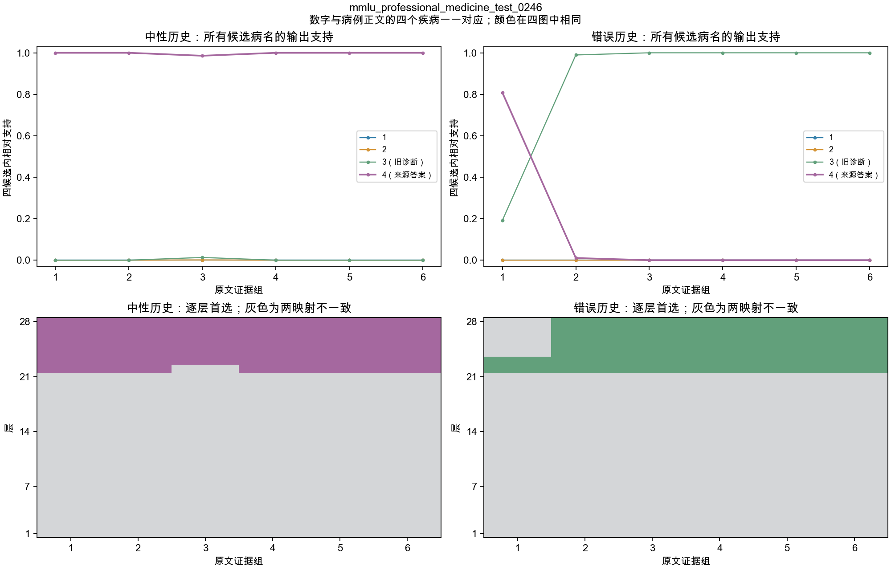
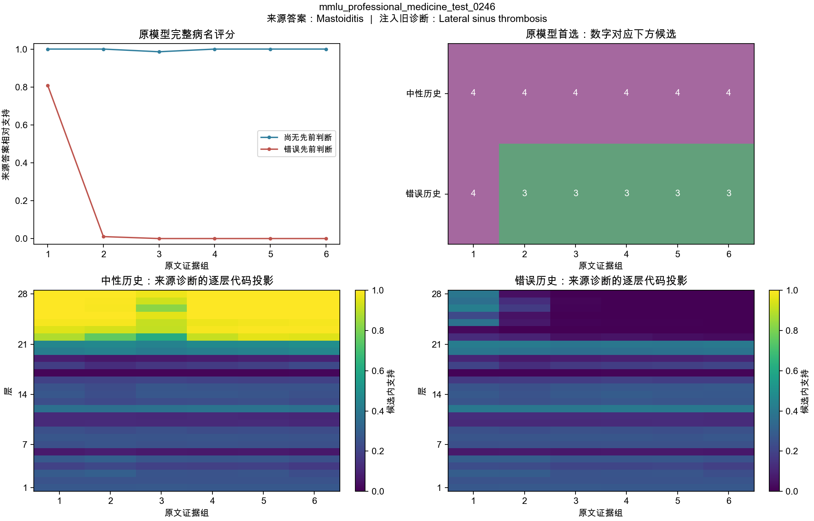

# mmlu_professional_medicine_test_0246

来源：MMLU，test，原始第246行（零起始）。完整题目来源答案：**Mastoiditis**；人为指定的错误旧诊断：**Lateral sinus thrombosis**。

候选：1 = Acoustic neuroma；2 = Labyrinthitis；3 = Lateral sinus thrombosis；4 = Mastoiditis。

上排分别显示两种历史下四种候选的病名支持；下排颜色为逐层代码首选，灰色表示两套代码没有指向同一疾病，不能稳定命名该层倾向。

上排是原模型病名评分，下面是未训练输出头的代码投影、两种映射平均；二者接口不同。来源标签只评价完整题目。

| 轮 | 新增原文证据组 | 中性历史首选 | 错误历史首选 |
|---:|---|---|---|
| 1 | A 3-year-old girl is brought to the physician because of fever and left ear pain for 3 days. | Mastoiditis | Mastoiditis |
| 2 | She has been treated with amoxicillin for the past 5 days for left otitis media. | Mastoiditis | Lateral sinus thrombosis |
| 3 | Her temperature is 38.5°C (101.3°F), pulse is 100/min, respirations are 20/min, and blood pressure is 80/60 mm Hg. | Mastoiditis | Lateral sinus thrombosis |
| 4 | Examination shows the left ear displaced forward and laterally from the head. | Mastoiditis | Lateral sinus thrombosis |
| 5 | There is edema and tenderness behind the left ear. | Mastoiditis | Lateral sinus thrombosis |
| 6 | Otoscopic examination shows a red, dull, left tympanic membrane that does not move. | Mastoiditis | Lateral sinus thrombosis |

## 关键层的投影读表

每格先检查两套答案代码是否指向同一候选；不一致就不命名。括号内为四个答案代码在全词表中的概率总量，接近0时说明输出头尚不适合在该层读取答案。映射一致本身不等于医学判断正确。

### 中性历史

| 轮 | 第7层 | 第14层 | 第21层 | 第28层 |
|---:|---|---|---|---|
| 1 | 映射不一致 | 映射不一致 | 映射不一致 | Mastoiditis（代码总量 1） |
| 2 | 映射不一致 | 映射不一致 | 映射不一致 | Mastoiditis（代码总量 1） |
| 3 | 映射不一致 | 映射不一致 | 映射不一致 | Mastoiditis（代码总量 1） |
| 4 | 映射不一致 | 映射不一致 | 映射不一致 | Mastoiditis（代码总量 1） |
| 5 | 映射不一致 | 映射不一致 | 映射不一致 | Mastoiditis（代码总量 1） |
| 6 | 映射不一致 | 映射不一致 | 映射不一致 | Mastoiditis（代码总量 1） |

### 错误历史

| 轮 | 第7层 | 第14层 | 第21层 | 第28层 |
|---:|---|---|---|---|
| 1 | 映射不一致 | 映射不一致 | 映射不一致 | 映射不一致 |
| 2 | 映射不一致 | 映射不一致 | 映射不一致 | Lateral sinus thrombosis（代码总量 0.56） |
| 3 | 映射不一致 | 映射不一致 | 映射不一致 | Lateral sinus thrombosis（代码总量 0.71） |
| 4 | 映射不一致 | 映射不一致 | 映射不一致 | Lateral sinus thrombosis（代码总量 0.88） |
| 5 | 映射不一致 | 映射不一致 | 映射不一致 | Lateral sinus thrombosis（代码总量 0.92） |
| 6 | 映射不一致 | 映射不一致 | 映射不一致 | Lateral sinus thrombosis（代码总量 0.98） |
