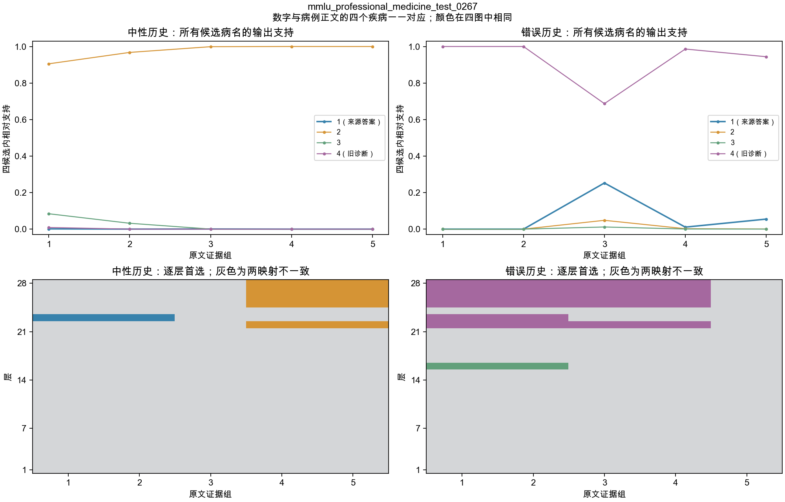
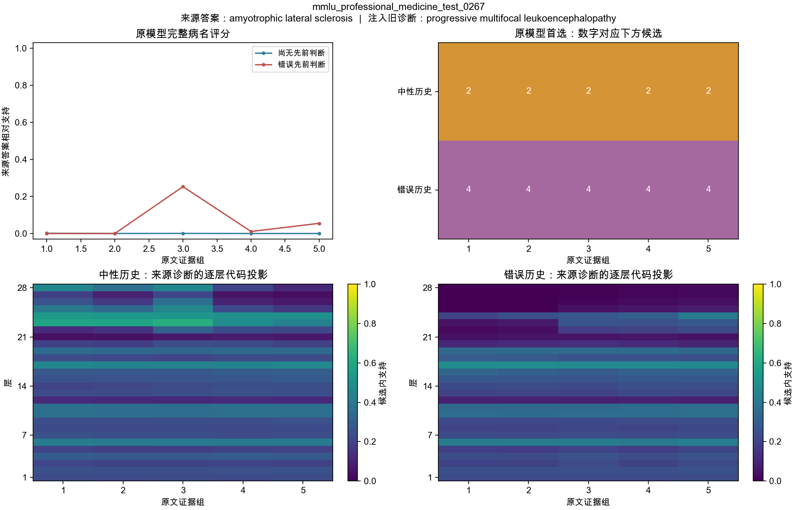

# mmlu_professional_medicine_test_0267

来源：MMLU，test，原始第267行（零起始）。完整题目来源答案：**amyotrophic lateral sclerosis**；人为指定的错误旧诊断：**progressive multifocal leukoencephalopathy**。

候选：1 = amyotrophic lateral sclerosis；2 = Friedreich ataxia；3 = Pick disease；4 = progressive multifocal leukoencephalopathy。

上排分别显示两种历史下四种候选的病名支持；下排颜色为逐层代码首选，灰色表示两套代码没有指向同一疾病，不能稳定命名该层倾向。

上排是原模型病名评分，下面是未训练输出头的代码投影、两种映射平均；二者接口不同。来源标签只评价完整题目。

| 轮 | 新增原文证据组 | 中性历史首选 | 错误历史首选 |
|---:|---|---|---|
| 1 | A 64-year-old female presents to the office with the complaint of difficulty swallowing saliva for about 6 months. | Friedreich ataxia | progressive multifocal leukoencephalopathy |
| 2 | She has slurred speech. | Friedreich ataxia | progressive multifocal leukoencephalopathy |
| 3 | Examination of the tongue reveals wasting and fasciculation. | Friedreich ataxia | progressive multifocal leukoencephalopathy |
| 4 | Decreased deep tendon reflexes and fasciculation are noted in the left lower extremity. | Friedreich ataxia | progressive multifocal leukoencephalopathy |
| 5 | The deep tendon reflexes of the left upper extremity are hyperactive. | Friedreich ataxia | progressive multifocal leukoencephalopathy |

## 关键层的投影读表

每格先检查两套答案代码是否指向同一候选；不一致就不命名。括号内为四个答案代码在全词表中的概率总量，接近0时说明输出头尚不适合在该层读取答案。映射一致本身不等于医学判断正确。

### 中性历史

| 轮 | 第7层 | 第14层 | 第21层 | 第28层 |
|---:|---|---|---|---|
| 1 | 映射不一致 | 映射不一致 | 映射不一致 | 映射不一致 |
| 2 | 映射不一致 | 映射不一致 | 映射不一致 | 映射不一致 |
| 3 | 映射不一致 | 映射不一致 | 映射不一致 | 映射不一致 |
| 4 | 映射不一致 | 映射不一致 | 映射不一致 | Friedreich ataxia（代码总量 0.84） |
| 5 | 映射不一致 | 映射不一致 | 映射不一致 | Friedreich ataxia（代码总量 0.87） |

### 错误历史

| 轮 | 第7层 | 第14层 | 第21层 | 第28层 |
|---:|---|---|---|---|
| 1 | 映射不一致 | 映射不一致 | 映射不一致 | progressive multifocal leukoencephalopathy（代码总量 1） |
| 2 | 映射不一致 | 映射不一致 | 映射不一致 | progressive multifocal leukoencephalopathy（代码总量 1） |
| 3 | 映射不一致 | 映射不一致 | 映射不一致 | progressive multifocal leukoencephalopathy（代码总量 0.95） |
| 4 | 映射不一致 | 映射不一致 | 映射不一致 | progressive multifocal leukoencephalopathy（代码总量 0.97） |
| 5 | 映射不一致 | 映射不一致 | 映射不一致 | 映射不一致 |
