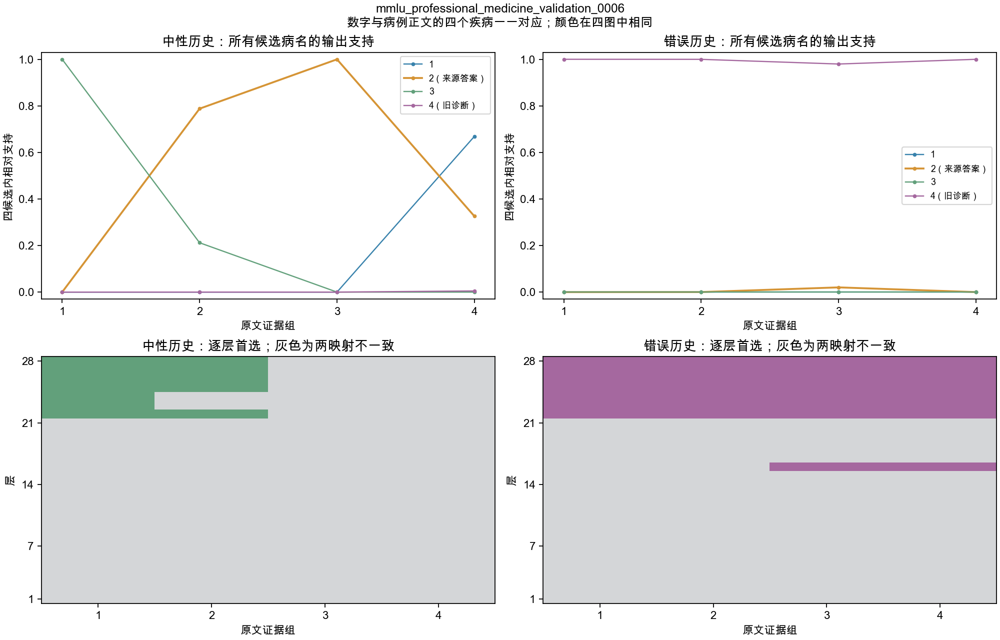
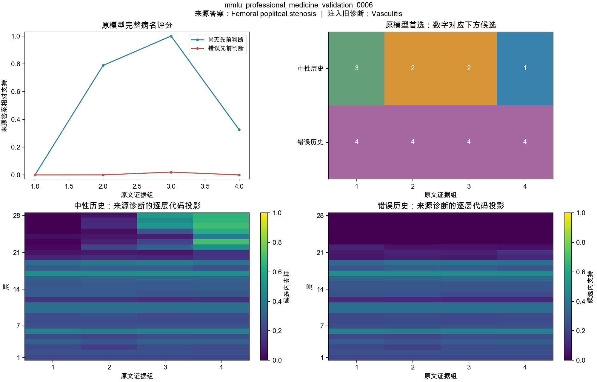

# mmlu_professional_medicine_validation_0006

来源：MMLU，validation，原始第6行（零起始）。完整题目来源答案：**Femoral popliteal stenosis**；人为指定的错误旧诊断：**Vasculitis**。

候选：1 = Aortoiliac stenosis；2 = Femoral popliteal stenosis；3 = Mononeuropathy；4 = Vasculitis。

上排分别显示两种历史下四种候选的病名支持；下排颜色为逐层代码首选，灰色表示两套代码没有指向同一疾病，不能稳定命名该层倾向。

上排是原模型病名评分，下面是未训练输出头的代码投影、两种映射平均；二者接口不同。来源标签只评价完整题目。

| 轮 | 新增原文证据组 | 中性历史首选 | 错误历史首选 |
|---:|---|---|---|
| 1 | For 8 weeks, a 52-year-old man with a 5-year history of type 2 diabetes mellitus has had deep burning pain in the ball of his right foot and big toe when the foot is raised above chest concentration. | Mononeuropathy | Vasculitis |
| 2 | He also has cramping in his right calf when he walks more than 50 feet. | Femoral popliteal stenosis | Vasculitis |
| 3 | He has smoked two packs of cigarettes daily for 30 years. | Femoral popliteal stenosis | Vasculitis |
| 4 | Femoral pulses are palpable; pedal pulses are absent. | Aortoiliac stenosis | Vasculitis |

## 关键层的投影读表

每格先检查两套答案代码是否指向同一候选；不一致就不命名。括号内为四个答案代码在全词表中的概率总量，接近0时说明输出头尚不适合在该层读取答案。映射一致本身不等于医学判断正确。

### 中性历史

| 轮 | 第7层 | 第14层 | 第21层 | 第28层 |
|---:|---|---|---|---|
| 1 | 映射不一致 | 映射不一致 | 映射不一致 | Mononeuropathy（代码总量 1） |
| 2 | 映射不一致 | 映射不一致 | 映射不一致 | Mononeuropathy（代码总量 1） |
| 3 | 映射不一致 | 映射不一致 | 映射不一致 | 映射不一致 |
| 4 | 映射不一致 | 映射不一致 | 映射不一致 | 映射不一致 |

### 错误历史

| 轮 | 第7层 | 第14层 | 第21层 | 第28层 |
|---:|---|---|---|---|
| 1 | 映射不一致 | 映射不一致 | 映射不一致 | Vasculitis（代码总量 1） |
| 2 | 映射不一致 | 映射不一致 | 映射不一致 | Vasculitis（代码总量 1） |
| 3 | 映射不一致 | 映射不一致 | 映射不一致 | Vasculitis（代码总量 1） |
| 4 | 映射不一致 | 映射不一致 | 映射不一致 | Vasculitis（代码总量 1） |
