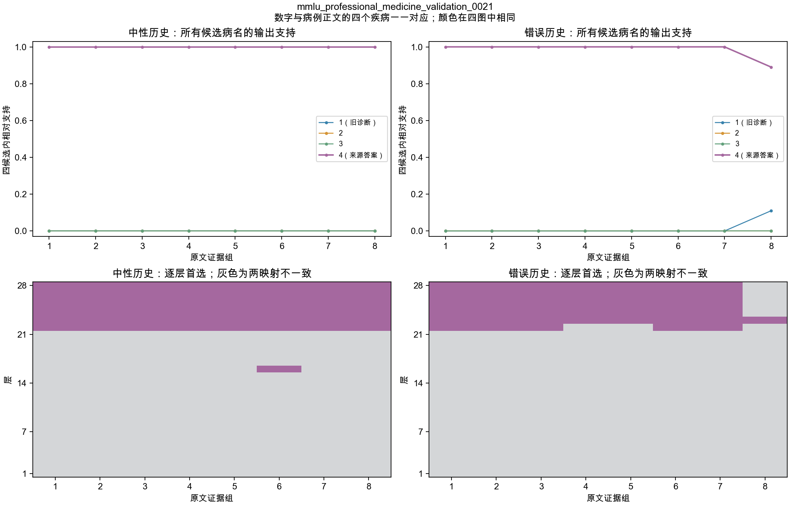
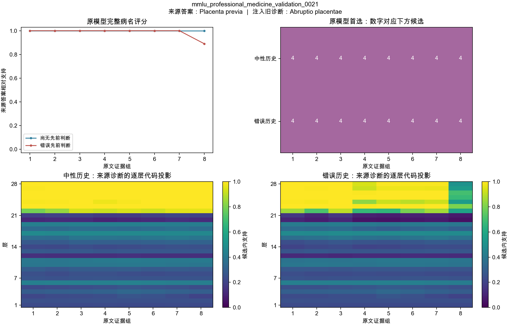

# mmlu_professional_medicine_validation_0021

来源：MMLU，validation，原始第21行（零起始）。完整题目来源答案：**Placenta previa**；人为指定的错误旧诊断：**Abruptio placentae**。

候选：1 = Abruptio placentae；2 = Amniotic fluid embolism；3 = Latent phase of labor；4 = Placenta previa。

上排分别显示两种历史下四种候选的病名支持；下排颜色为逐层代码首选，灰色表示两套代码没有指向同一疾病，不能稳定命名该层倾向。

上排是原模型病名评分，下面是未训练输出头的代码投影、两种映射平均；二者接口不同。来源标签只评价完整题目。

| 轮 | 新增原文证据组 | 中性历史首选 | 错误历史首选 |
|---:|---|---|---|
| 1 | A 37-year-old woman, gravida 5, para 4, at 34 weeks' gestation comes to the emergency department because of vaginal bleeding for 2 hours. | Placenta previa | Placenta previa |
| 2 | She has had no prenatal care. | Placenta previa | Placenta previa |
| 3 | Her second child was delivered by lower segment transverse cesarean section because of a nonreassuring fetal heart rate; her other three children were delivered vaginally. | Placenta previa | Placenta previa |
| 4 | Her pulse is 92/min, respirations are 18/min, and blood pressure is 134/76 mm Hg. | Placenta previa | Placenta previa |
| 5 | The abdomen is nontender, and no contractions are felt. | Placenta previa | Placenta previa |
| 6 | There is blood on the vulva, the introitus, and on the medial aspect of each thigh. | Placenta previa | Placenta previa |
| 7 | The fetus is in a transverse lie presentation. | Placenta previa | Placenta previa |
| 8 | The fetal heart rate is 144/min. | Placenta previa | Placenta previa |

## 关键层的投影读表

每格先检查两套答案代码是否指向同一候选；不一致就不命名。括号内为四个答案代码在全词表中的概率总量，接近0时说明输出头尚不适合在该层读取答案。映射一致本身不等于医学判断正确。

### 中性历史

| 轮 | 第7层 | 第14层 | 第21层 | 第28层 |
|---:|---|---|---|---|
| 1 | 映射不一致 | 映射不一致 | 映射不一致 | Placenta previa（代码总量 1） |
| 2 | 映射不一致 | 映射不一致 | 映射不一致 | Placenta previa（代码总量 1） |
| 3 | 映射不一致 | 映射不一致 | 映射不一致 | Placenta previa（代码总量 1） |
| 4 | 映射不一致 | 映射不一致 | 映射不一致 | Placenta previa（代码总量 1） |
| 5 | 映射不一致 | 映射不一致 | 映射不一致 | Placenta previa（代码总量 1） |
| 6 | 映射不一致 | 映射不一致 | 映射不一致 | Placenta previa（代码总量 1） |
| 7 | 映射不一致 | 映射不一致 | 映射不一致 | Placenta previa（代码总量 1） |
| 8 | 映射不一致 | 映射不一致 | 映射不一致 | Placenta previa（代码总量 1） |

### 错误历史

| 轮 | 第7层 | 第14层 | 第21层 | 第28层 |
|---:|---|---|---|---|
| 1 | 映射不一致 | 映射不一致 | 映射不一致 | Placenta previa（代码总量 1） |
| 2 | 映射不一致 | 映射不一致 | 映射不一致 | Placenta previa（代码总量 1） |
| 3 | 映射不一致 | 映射不一致 | 映射不一致 | Placenta previa（代码总量 1） |
| 4 | 映射不一致 | 映射不一致 | 映射不一致 | Placenta previa（代码总量 1） |
| 5 | 映射不一致 | 映射不一致 | 映射不一致 | Placenta previa（代码总量 1） |
| 6 | 映射不一致 | 映射不一致 | 映射不一致 | Placenta previa（代码总量 1） |
| 7 | 映射不一致 | 映射不一致 | 映射不一致 | Placenta previa（代码总量 1） |
| 8 | 映射不一致 | 映射不一致 | 映射不一致 | 映射不一致 |
