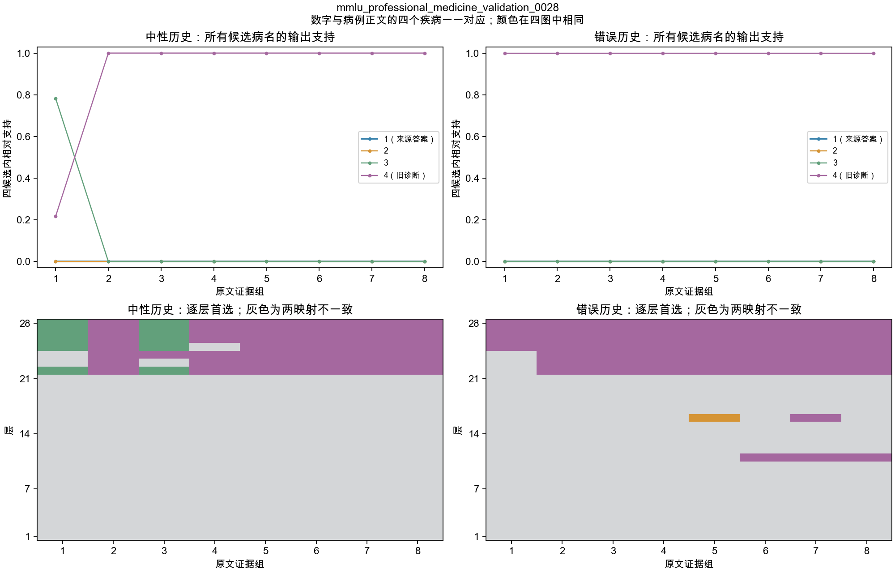
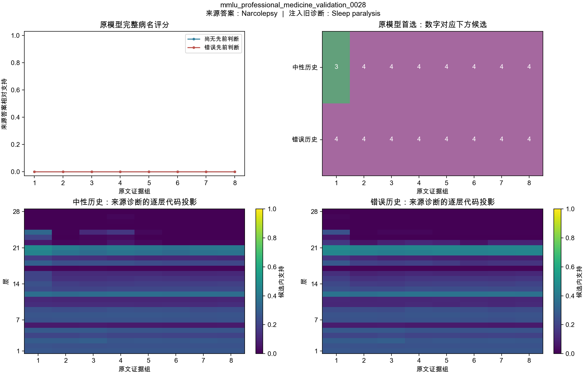

# mmlu_professional_medicine_validation_0028

来源：MMLU，validation，原始第28行（零起始）。完整题目来源答案：**Narcolepsy**；人为指定的错误旧诊断：**Sleep paralysis**。

候选：1 = Narcolepsy；2 = Primary hypersomnia；3 = A seizure disorder；4 = Sleep paralysis。

上排分别显示两种历史下四种候选的病名支持；下排颜色为逐层代码首选，灰色表示两套代码没有指向同一疾病，不能稳定命名该层倾向。

上排是原模型病名评分，下面是未训练输出头的代码投影、两种映射平均；二者接口不同。来源标签只评价完整题目。

| 轮 | 新增原文证据组 | 中性历史首选 | 错误历史首选 |
|---:|---|---|---|
| 1 | A 27-year-old man comes to the office with his wife because of a recent episode of loss of muscle control. | A seizure disorder | Sleep paralysis |
| 2 | He says, "I was at a reception, someone told a joke, and when I laughed, my legs collapsed!" His wife tells you that he recovered in a few seconds and he did not lose consciousness. | Sleep paralysis | Sleep paralysis |
| 3 | He has a long history of sleepiness and he is able to go to sleep quickly. | Sleep paralysis | Sleep paralysis |
| 4 | He usually awakens feeling refreshed after a short nap. | Sleep paralysis | Sleep paralysis |
| 5 | He has no history of similar episodes or hallucinations. | Sleep paralysis | Sleep paralysis |
| 6 | There is no family history of similar problems. | Sleep paralysis | Sleep paralysis |
| 7 | Vital signs are normal. | Sleep paralysis | Sleep paralysis |
| 8 | Physical examination shows no abnormalities. | Sleep paralysis | Sleep paralysis |

## 关键层的投影读表

每格先检查两套答案代码是否指向同一候选；不一致就不命名。括号内为四个答案代码在全词表中的概率总量，接近0时说明输出头尚不适合在该层读取答案。映射一致本身不等于医学判断正确。

### 中性历史

| 轮 | 第7层 | 第14层 | 第21层 | 第28层 |
|---:|---|---|---|---|
| 1 | 映射不一致 | 映射不一致 | 映射不一致 | A seizure disorder（代码总量 0.98） |
| 2 | 映射不一致 | 映射不一致 | 映射不一致 | Sleep paralysis（代码总量 1） |
| 3 | 映射不一致 | 映射不一致 | 映射不一致 | A seizure disorder（代码总量 1） |
| 4 | 映射不一致 | 映射不一致 | 映射不一致 | Sleep paralysis（代码总量 1） |
| 5 | 映射不一致 | 映射不一致 | 映射不一致 | Sleep paralysis（代码总量 1） |
| 6 | 映射不一致 | 映射不一致 | 映射不一致 | Sleep paralysis（代码总量 1） |
| 7 | 映射不一致 | 映射不一致 | 映射不一致 | Sleep paralysis（代码总量 1） |
| 8 | 映射不一致 | 映射不一致 | 映射不一致 | Sleep paralysis（代码总量 1） |

### 错误历史

| 轮 | 第7层 | 第14层 | 第21层 | 第28层 |
|---:|---|---|---|---|
| 1 | 映射不一致 | 映射不一致 | 映射不一致 | Sleep paralysis（代码总量 0.95） |
| 2 | 映射不一致 | 映射不一致 | 映射不一致 | Sleep paralysis（代码总量 1） |
| 3 | 映射不一致 | 映射不一致 | 映射不一致 | Sleep paralysis（代码总量 1） |
| 4 | 映射不一致 | 映射不一致 | 映射不一致 | Sleep paralysis（代码总量 1） |
| 5 | 映射不一致 | 映射不一致 | 映射不一致 | Sleep paralysis（代码总量 1） |
| 6 | 映射不一致 | 映射不一致 | 映射不一致 | Sleep paralysis（代码总量 1） |
| 7 | 映射不一致 | 映射不一致 | 映射不一致 | Sleep paralysis（代码总量 1） |
| 8 | 映射不一致 | 映射不一致 | 映射不一致 | Sleep paralysis（代码总量 1） |
