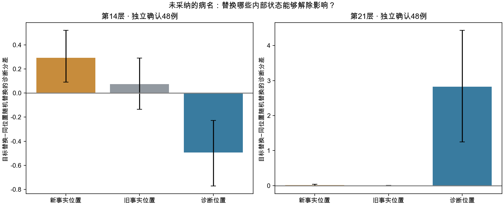

# 未采纳的病名，也值得单独检验

开发集出现提及效应后追加本阶段。使用事先选定的48例内部确认病例，供体为中性历史，受体为“诊断尚未确定、仅提到一个未采纳候选病名”。三类位置、两个层、目标/随机/自身对照共960个干预，另有48次受体状态重捕捉。

| 层 | 位置 | 目标−随机分差，95%CI | 六项Holm校正p | 来源答案命中变化 | 首选改变比例 |
|---|---|---|---:|---|---|
| 14 | 新事实位置 | 0.29 [0.09, 0.52] | 0.03050 | 0.00% [0.00, 0.00] | 0.00% [0.00, 0.00] |
| 14 | 旧事实位置 | 0.07 [-0.13, 0.29] | 1.00000 | 2.08% [0.00, 6.25] | 2.08% [0.00, 6.25] |
| 14 | 诊断位置 | -0.49 [-0.77, -0.23] | 0.00450 | 0.00% [0.00, 0.00] | 0.00% [0.00, 0.00] |
| 21 | 新事实位置 | 0.01 [-0.01, 0.04] | 0.51594 | 0.00% [0.00, 0.00] | 0.00% [0.00, 0.00] |
| 21 | 旧事实位置 | 0.00 [-0.01, 0.01] | 1.00000 | 0.00% [0.00, 0.00] | 0.00% [0.00, 0.00] |
| 21 | 诊断位置 | 2.82 [1.25, 4.44] | 0.00687 | 6.25% [-2.08, 16.67] | 18.75% [8.33, 31.25] |

该对照把“曾做出错误诊断”与“上下文里出现了病名”分开。状态替换可以检验影响传播的位置，但不自动说明模型相信了这个病名，更不能仅据分差变化说它曲解了医学证据。提及条件的代码作答对照见[逐层与跨配置报告](../34_multisource_depth/RESULTS.md)，患者级记录见[干预表](patient_interventions.csv)。
