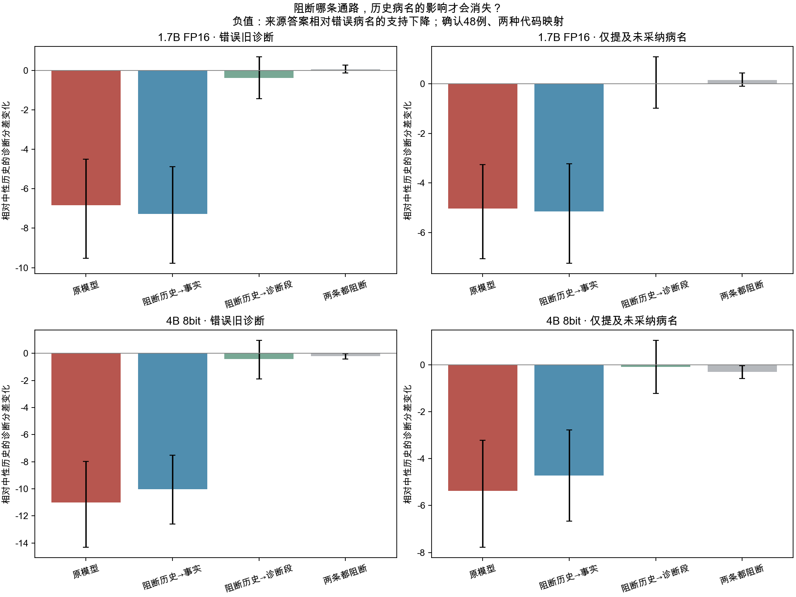
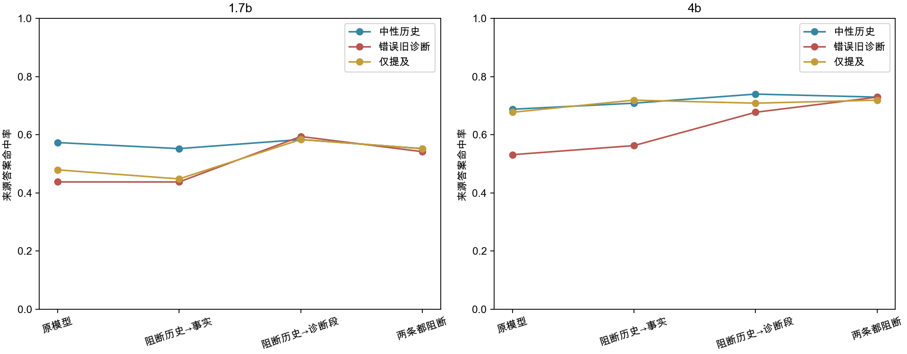

# 旧病名怎样影响最终诊断：两条路径的拆解

固定48例确认病例，每来源16例。两个模型配置，各1152个条件，总2304个。每个病例、每种历史和遮挡都使用两种预定代码映射；先在患者内平均，再计算患者级95%区间。测量第一个答案代码词元。

历史可以先进入患者事实的内部计算，也可以被后面的诊断任务和输出位置直接读取。我们在所有层分别阻断这两类注意力连接。

## 每种通路设置下，历史仍有多少影响

| 模型 | 历史 | 设置 | 来源病−错误病的历史影响，95%CI | 准确率历史影响 |
|---|---|---|---|---|
| 1.7b | wrong | 原模型 | -6.84 [-9.53, -4.50] | -13.54% [-23.96, -4.17] |
| 1.7b | mention | 原模型 | -5.04 [-7.06, -3.26] | -9.38% [-20.83, 1.04] |
| 1.7b | wrong | 阻断历史→事实 | -7.27 [-9.78, -4.89] | -11.46% [-22.92, 0.00] |
| 1.7b | mention | 阻断历史→事实 | -5.15 [-7.25, -3.22] | -10.42% [-22.92, 1.04] |
| 1.7b | wrong | 阻断历史→诊断段 | -0.37 [-1.43, 0.69] | 1.04% [-5.21, 7.29] |
| 1.7b | mention | 阻断历史→诊断段 | 0.01 [-0.98, 1.10] | 0.00% [-6.25, 5.21] |
| 1.7b | wrong | 两条都阻断 | 0.06 [-0.13, 0.26] | -1.04% [-3.12, 0.00] |
| 1.7b | mention | 两条都阻断 | 0.15 [-0.10, 0.44] | 0.00% [-3.12, 3.12] |
| 4b | wrong | 原模型 | -11.00 [-14.31, -7.97] | -15.62% [-27.08, -5.21] |
| 4b | mention | 原模型 | -5.38 [-7.77, -3.22] | -1.04% [-10.42, 7.29] |
| 4b | wrong | 阻断历史→事实 | -10.02 [-12.61, -7.53] | -14.58% [-26.04, -4.17] |
| 4b | mention | 阻断历史→事实 | -4.71 [-6.67, -2.79] | 1.04% [-7.29, 9.38] |
| 4b | wrong | 阻断历史→诊断段 | -0.43 [-1.88, 0.94] | -6.25% [-14.58, 1.04] |
| 4b | mention | 阻断历史→诊断段 | -0.09 [-1.22, 1.03] | -3.12% [-9.38, 2.08] |
| 4b | wrong | 两条都阻断 | -0.21 [-0.42, -0.03] | 0.00% [0.00, 0.00] |
| 4b | mention | 两条都阻断 | -0.30 [-0.59, -0.04] | -1.04% [-3.12, 0.00] |

## 阻断是否破坏了正常作答

| 模型 | 设置 | 中性历史命中 | 四代码概率总量 | 全词表首选属于代码的比例 |
|---|---|---|---|---|
| 1.7b | 原模型 | 57.29% [44.79, 69.79] | 0.97 [0.94, 1.00] | 96.88% [91.67, 100.00] |
| 1.7b | 阻断历史→事实 | 55.21% [41.67, 68.75] | 0.98 [0.95, 1.00] | 96.88% [92.71, 100.00] |
| 1.7b | 阻断历史→诊断段 | 58.33% [44.79, 71.88] | 1.00 [1.00, 1.00] | 100.00% [92.60, 100.00] |
| 1.7b | 两条都阻断 | 55.21% [41.67, 68.75] | 1.00 [1.00, 1.00] | 100.00% [92.60, 100.00] |
| 4b | 原模型 | 68.75% [56.25, 80.21] | 1.00 [1.00, 1.00] | 100.00% [92.60, 100.00] |
| 4b | 阻断历史→事实 | 70.83% [59.38, 82.29] | 1.00 [1.00, 1.00] | 100.00% [92.60, 100.00] |
| 4b | 阻断历史→诊断段 | 73.96% [62.50, 85.42] | 1.00 [1.00, 1.00] | 100.00% [92.60, 100.00] |
| 4b | 两条都阻断 | 72.92% [61.46, 84.38] | 0.99 [0.98, 1.00] | 98.96% [96.88, 100.00] |

## 配对通路比较

正值表示该阻断削弱了历史带来的负向分差。四项比较在每个模型×历史内做Holm校正；交互项单独解释为非加性，不是消除效应。

| 模型 | 历史 | 比较 | 分差，95%CI | 校正p |
|---|---|---|---|---:|
| 1.7b | wrong | block_to_facts_minus_full | -0.43 [-1.60, 0.68] | 0.46157 |
| 1.7b | wrong | block_to_decision_minus_full | 6.47 [4.00, 9.05] | 0.00050 |
| 1.7b | wrong | block_both_minus_full | 6.90 [4.53, 9.58] | 0.00050 |
| 1.7b | wrong | factorial_interaction | 0.87 [-0.45, 2.13] | 0.39870 |
| 1.7b | mention | block_to_facts_minus_full | -0.11 [-0.86, 0.62] | 1.00000 |
| 1.7b | mention | block_to_decision_minus_full | 5.05 [3.24, 7.01] | 0.00050 |
| 1.7b | mention | block_both_minus_full | 5.19 [3.41, 7.20] | 0.00050 |
| 1.7b | mention | factorial_interaction | 0.25 [-0.94, 1.32] | 1.00000 |
| 4b | wrong | block_to_facts_minus_full | 0.98 [-1.25, 3.44] | 0.86289 |
| 4b | wrong | block_to_decision_minus_full | 10.56 [7.50, 13.89] | 0.00050 |
| 4b | wrong | block_both_minus_full | 10.78 [7.76, 14.06] | 0.00050 |
| 4b | wrong | factorial_interaction | -0.76 [-2.93, 1.13] | 0.86289 |
| 4b | mention | block_to_facts_minus_full | 0.67 [-0.79, 2.08] | 0.36883 |
| 4b | mention | block_to_decision_minus_full | 5.29 [3.13, 7.60] | 0.00050 |
| 4b | mention | block_both_minus_full | 5.08 [2.79, 7.55] | 0.00075 |
| 4b | mention | factorial_interaction | -0.88 [-1.88, 0.05] | 0.16798 |

## 测量边界

两条都阻断时仍可能有历史长度导致的位置距离差。历史经事实路径传播，说明其影响经过患者事实的计算表示；这一步还没有证明某一症状的医学含义被曲解。干预不是线性中介分解，不计算“多少百分比来自某路径”。1.7B与4B还同时不同精度，因此跨配置差异不单归于模型大小。

[患者条件](patient_conditions.csv) · [患者历史效应](patient_history_effects.csv) · [配对通路比较](patient_path_contrasts.csv) · [完整汇总](summary.json) · [预先记录的路径设计](../../research_v4/ROUTE_PROTOCOL.md)
