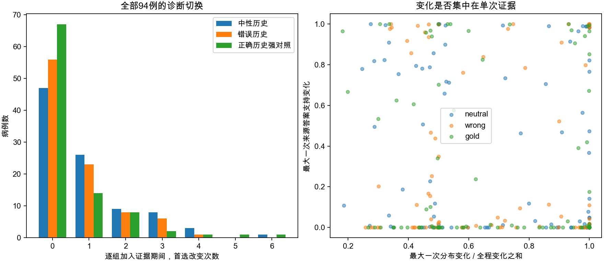

# 回到实际答案：生成、评分与逐步变化

## 自由生成复核

所有540例的中性/错误历史均实际贪心生成答案。先完成统一JSON前缀，再由模型生成病名。未解析或不在原选项中的输出计为未命中，另列覆盖率。

| 来源 | 例数 | 中性：完整病名评分 | 错误：完整病名评分 | 中性：实际生成 | 错误：实际生成 | 生成准确率变化，95%CI |
|---|---:|---:|---:|---:|---:|---|
| MedQA | 300 | 177 | 128 | 173 | 127 | -15.33% [-21.00, -9.33] |
| MedMCQA | 200 | 105 | 86 | 104 | 84 | -10.00% [-16.50, -4.00] |
| MMLU | 40 | 20 | 18 | 20 | 18 | -5.00% [-17.50, 7.50] |
| all | 540 | 302 | 232 | 297 | 229 | -12.59% [-16.67, -8.52] |

## 错误答案得到多大支持

高支持错误定义为：模型首选错误，且该首选占四候选相对支持的至少90%。它描述模型输出分布，不是模型自报信心或临床患病概率。

| 来源 | 中性高支持错误 | 错误历史高支持错误 | 配对比例变化，95%CI |
|---|---:|---:|---|
| MedQA | 89 / 300 | 143 / 300 | 18.00% [12.33, 23.67] |
| MedMCQA | 70 / 200 | 100 / 200 | 15.00% [8.50, 21.50] |
| MMLU | 14 / 40 | 20 / 40 | 15.00% [0.00, 30.00] |
| all | 173 / 540 | 263 / 540 | 16.67% [12.41, 20.93] |

## 逐步加证据，模型是在平滑更新还是突然换病

| 历史 | 病例数 | 全程不换首选 | 曾选来源答案后又离开 | 来源答案支持有升也有降 | 最终命中 |
|---|---:|---:|---:|---:|---:|
| neutral | 94 | 47 | 29 | 30 | 48 |
| wrong | 94 | 56 | 14 | 27 | 39 |
| gold | 94 | 67 | 18 | 25 | 73 |

首选可以突然换病，而候选支持仍是连续数值。这里同时报告二者：切换次数和最大单步变化，不能仅看折线外观就声称内部发生离散相变。每轮是重新输入累计原文证据、固定历史条件；没有把上一轮生成诊断回填。部分证据没有独立诊断标签，因此“离开最终来源答案”不直接等于当轮医学判断错误。

## 顺序对照

完整病例的原文证据组全部倒序，题目与候选不变。该对照检验文本顺序敏感性，不模拟真实病程倒流。

| 来源 | 首选改变比例 | 最终准确率变化，95%CI |
|---|---|---|
| MedQA | 18.67% [14.33, 23.00] | -0.33% [-5.00, 4.00] |
| MedMCQA | 15.50% [11.00, 21.00] | 0.50% [-3.50, 5.00] |
| MMLU | 15.00% [5.00, 27.50] | 0.00% [-10.00, 10.00] |
| all | 17.22% [14.07, 20.37] | 0.00% [-2.96, 3.15] |

[患者回答接口](patient_answer_interfaces.csv) · [每次证据转移](all_evidence_transitions.csv) · [患者完整轨迹](patient_trajectories.json) · [全部区间](summary.json)
