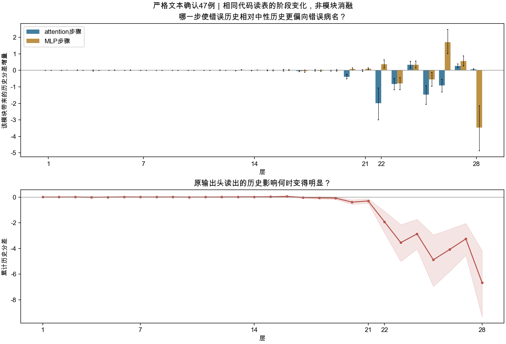

# 从整层再拆到attention与MLP

对既有94例×两种历史×两种代码映射的最终输入状态重新读表，没有新增模型前向，也没有训练探针。每层比较三个位置：整层输入、attention之后、MLP之后。用同一个输出头读取来源病相对固定错误病的代码logit分差。

上图每个柱表示该步骤使“错误历史减去中性历史”的分差改变多少。负值意味着向错误病名偏移；下图是每层结束时的累计差距。区间按患者计算，展示47例严格文本确认病例。

这是计算过程中可直接复核的读表轨迹，不能把柱高当作模块独立的因果贡献。层归一化与输出头是非线性读表的一部分；真正的因果证据来自[状态替换](../33_multisource_causality/RESULTS.md)和[通路阻断](../36_history_routes/RESULTS.md)。

| 层 | attention历史增量，95%CI | MLP历史增量，95%CI | 整层末历史分差 |
|---|---|---|---|
| 7 | -0.01 [-0.01, 0.00] | -0.00 [-0.01, 0.01] | 0.00 [-0.01, 0.02] |
| 14 | -0.01 [-0.03, 0.01] | 0.02 [0.00, 0.03] | 0.02 [0.00, 0.04] |
| 20 | -0.38 [-0.52, -0.26] | 0.07 [0.00, 0.14] | -0.39 [-0.57, -0.21] |
| 21 | -0.01 [-0.07, 0.05] | 0.10 [0.05, 0.15] | -0.30 [-0.47, -0.13] |
| 22 | -2.00 [-2.99, -1.07] | 0.38 [0.15, 0.64] | -1.92 [-2.78, -1.10] |
| 23 | -0.83 [-1.18, -0.49] | -0.79 [-1.18, -0.44] | -3.54 [-5.02, -2.14] |
| 24 | 0.33 [0.15, 0.55] | 0.34 [0.14, 0.56] | -2.87 [-4.05, -1.73] |
| 25 | -1.47 [-2.06, -0.93] | -0.54 [-0.96, -0.13] | -4.88 [-6.95, -2.94] |
| 26 | -0.91 [-1.31, -0.54] | 1.71 [1.01, 2.47] | -4.08 [-5.80, -2.51] |
| 27 | 0.27 [0.17, 0.39] | 0.56 [0.27, 0.87] | -3.25 [-4.54, -2.05] |
| 28 | 0.06 [0.01, 0.10] | -3.47 [-4.88, -2.15] | -6.66 [-9.33, -4.17] |

两种代码映射先在患者内平均。全部层、开发/确认、严格/完整队列均保留于[summary.json](summary.json)，[患者级阶段分差](patient_module_increments.csv)可复算。
