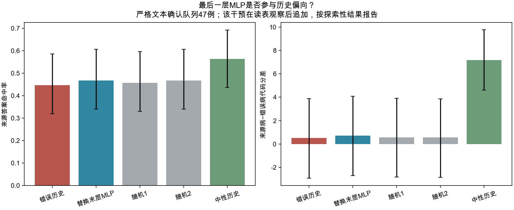

# 最后一层MLP的直接检验

逐模块读表提示末层MLP会加强错误历史的分差，因此追加该检验。把同患者中性历史下的末层MLP输出移入错误历史的诊断位置，其他状态保持。供体不含正确答案。由于是最后一层，后续只剩原模型最终归一化和输出头；直接计算与重新前向该位置等价。只评价第一个答案代码，不扩展为后续病名生成改善。

94例、两种映射、目标/反向/自身/两个同范数随机方向，共940个激活干预；复用已有状态，没有新增整段前向。此设计在看过逐层结果后提出，即使列出既定确认队列，也不称它为新的独立确认。

| 队列 | 严格文本 | 患者数 | 错误历史命中 | 替换后命中 | 中性历史命中 | 目标−随机准确率，95%CI | 目标−随机分差 |
|---|---|---:|---|---|---|---|---|
| all | False | 94 | 36.17% [27.66, 45.21] | 37.77% [28.72, 46.81] | 52.13% [43.60, 61.17] | 0.80% [-1.86, 3.46] | 0.15 [-0.05, 0.34] |
| all | True | 92 | 36.96% [28.26, 46.20] | 38.59% [29.35, 47.83] | 51.09% [41.85, 60.33] | 0.82% [-1.63, 3.53] | 0.17 [-0.02, 0.36] |
| development | False | 46 | 28.26% [17.39, 39.13] | 29.35% [17.39, 41.30] | 46.74% [33.70, 59.78] | 1.09% [-2.17, 4.35] | 0.20 [-0.09, 0.49] |
| development | True | 45 | 28.89% [17.78, 41.11] | 30.00% [17.78, 42.22] | 45.56% [32.22, 60.00] | 1.11% [-2.22, 5.56] | 0.18 [-0.11, 0.48] |
| confirmation | False | 48 | 43.75% [31.25, 57.29] | 45.83% [32.29, 59.38] | 57.29% [44.79, 69.79] | 0.52% [-3.12, 4.17] | 0.11 [-0.16, 0.37] |
| confirmation | True | 47 | 44.68% [31.91, 58.51] | 46.81% [34.04, 60.64] | 56.38% [43.62, 69.15] | 0.53% [-3.19, 4.26] | 0.16 [-0.10, 0.41] |

这是因果参与检验：目标状态与等范数随机扰动比较，反向替换和自身对照分别保留。它不意味着最后一层独立存放了某种医学信念，也不构成无需供体即可部署的诊断修复方法。

[患者级干预](patient_interventions.csv) · [完整统计](summary.json)
