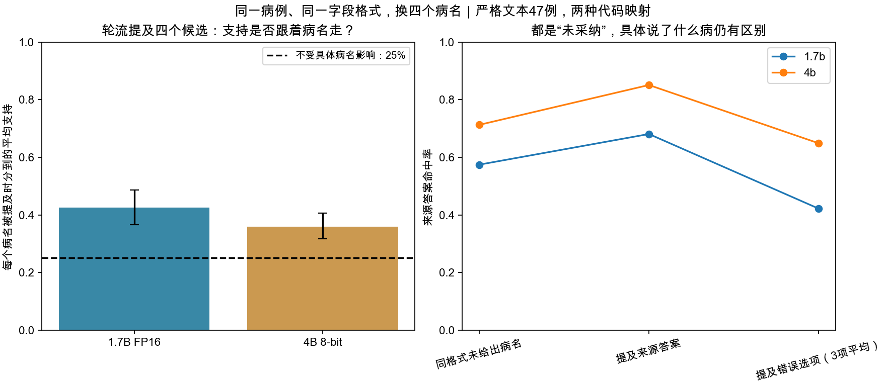

# 不只比较“多了几句话”：轮流放入四个未采纳病名

同48例，两模型，每例固定病例原文和JSON历史格式，将unendorsed_candidate依次设为四个候选；另设同格式Undetermined。所有条件中的diagnosis均为Undetermined。两种代码映射，总960次输入评估。作为看过主结果后追加的格式与病名控制，按探索性复核报告。

## 判定方法

分别问：提到第1种病时，它拿到多少支持；提到第2种时，第2种拿到多少；依此类推，再平均四次。如果具体提到哪个病完全不影响输出，即使模型原本偏爱某个病，这个平均也恰好是25%。因此高于25%测量的是支持随病名移动，不是简单的固定候选偏爱。两种映射先在患者内平均。

| 模型 | 严格文本 | n | 被提及候选的平均支持，95%CI | 超出25%的量 | 首选跟随被提及候选比例 | 首选随病名变化比例（两映射平均） |
|---|---|---:|---|---|---|---|
| 1.7b | False | 48 | 42.57% [37.02, 48.60] | 17.57% [12.02, 23.60] | 41.93% [35.94, 48.44] | 65.62% [54.17, 76.04] |
| 1.7b | True | 47 | 42.60% [36.69, 48.73] | 17.60% [11.69, 23.73] | 42.02% [35.63, 48.67] | 65.96% [54.26, 76.60] |
| 4b | False | 48 | 36.30% [32.19, 40.85] | 11.30% [7.19, 15.85] | 36.20% [32.03, 40.89] | 41.67% [29.17, 54.17] |
| 4b | True | 47 | 35.92% [31.75, 40.70] | 10.92% [6.75, 15.70] | 35.90% [31.65, 40.69] | 40.43% [28.72, 53.19] |

## 与同格式空病名比较

| 模型 | 严格文本n | 空病名命中 | 提及来源答案 | 提及错误选项 | 错误提及−空病名，95%CI |
|---|---:|---|---|---|---|
| 1.7b | 47 | 57.45% [44.68, 70.21] | 68.09% [55.32, 79.79] | 42.20% [31.56, 53.19] | -15.25% [-23.40, -7.45] |
| 4b | 47 | 71.28% [59.57, 82.98] | 85.11% [75.53, 93.62] | 64.89% [53.55, 76.24] | -6.38% [-11.35, -2.13] |

这支持对结构化“未采纳候选”情境下病名选择性影响的判断，不把字段里的Undetermined等同于人类心理上的确信/不确信。不同病名仍有词元长度差；全部候选轮换、同格式空病名和两套代码共同减少单一模板/候选偏爱的解释。

[全部患者数据](patient_counterbalance.csv) · [来源分别统计](summary.json)
