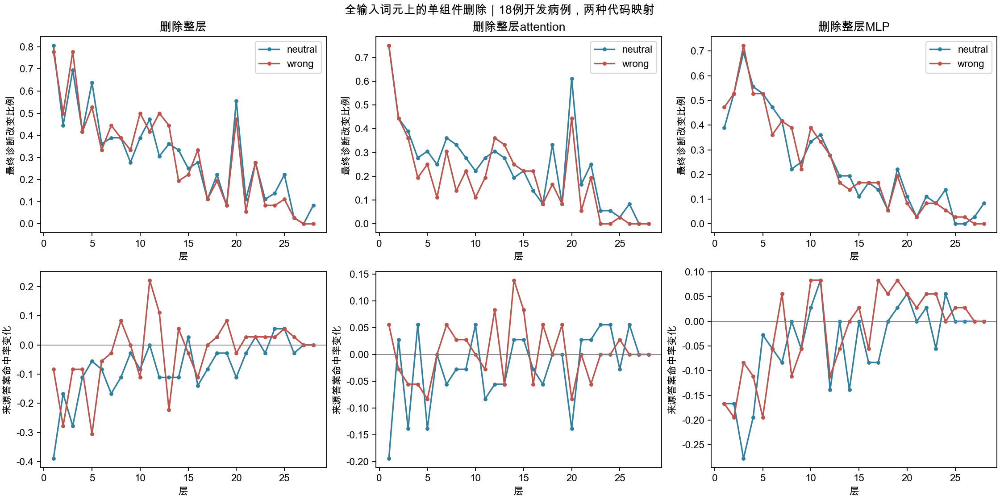
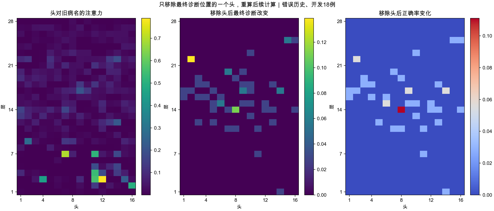
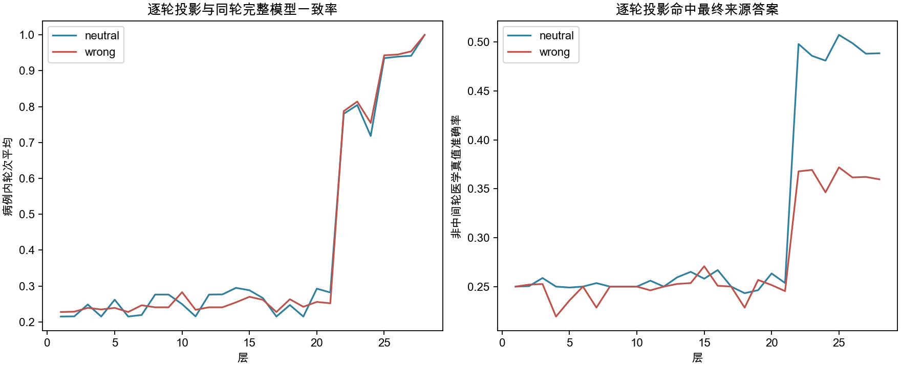

# 哪些内部计算决定最终诊断

定位使用18例开发病例、72个提示，穷尽28层×3种全序列模块删除，共6048个；另对28层×16个注意力头以及三个整体组件做诊断位置干预，共38304个，另2016个自身对照。头干预作用于最后输入位置，不等于已删除全模型的该头。

## 结果

**容易读出最终答案的位置，与对诊断有强作用的位置并不相同。** 在严格92例、521个累计前缀的既有投影中，第25层与同轮最终诊断的一致率已达93.5%（中性历史）和94.3%（错误历史）。这部分投影分析覆盖92例，组件定位仍只使用18例开发病例。

在18例组件定位中，删除第3层MLP使69.4%／72.2%的诊断改变；删除第20层注意力使61.1%／44.4%改变。相比之下，分别删除第25或26层MLP，中性条件没有改变首选，错误历史条件各改变2.8%。这些是单组件删除、两映射先在病例内平均的比例，不能推导多个部件同时删除仍无影响。

头对历史的注意力总量与删除后的分布变化只有弱的排序关联：中性0.285、错误历史0.272。该关联以448个头的均值描述，不作为患者级显著性检验。注意力图提供定位线索，实际干预检验它是否有作用。

本阶段筛出第25、26层MLP作为删除与小模块替换候选；第27整层作为整层删除候选。开发投影的提前退出95%标准没有选出第28层之前的合格位置，因此预定检验第27层，并继续在独立组合开发病例上选择。

最终答案一致、来源答案正确和删除后改变分别记录。中间轮投影命中最终来源答案不代表该轮具备唯一诊断真值。注意力/作用的相关只作描述，不把448个头当成448名独立患者。

[汇总](summary.json) · [患者级模块删除](global_deletions.csv) · [患者级头删除](anchor_head_deletions.csv) · [数值对照](numerical_controls.csv)

## 数值核查

完整手动前向与原生前向的最大候选支持误差为1.19×10⁻⁷。局部批量自身对照最大误差为0.00973，但2016次对照均未改变首选；局部头效应相对同层自身对照计算。
