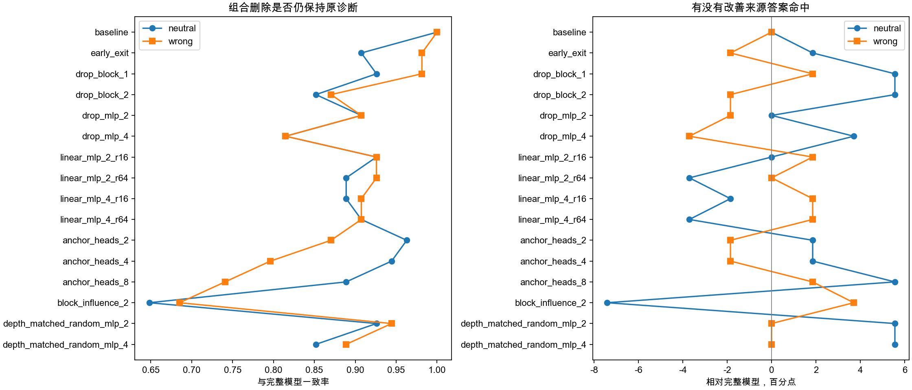

# 结构候选的开发选择

18例用于定位与小模块拟合，另27例用于组合选择。本表不是留出集结论。结构及对照均在345例检验前冻结。

## 结果

在27例组合开发中，删两个MLP保留90.7%的原诊断；对应的秩16替换保留92.6%，两种历史相同。删四个MLP的保持率降到81.5%，说明单组件影响较小，并不能保证大范围同时删除也安全。

秩64替换对原MLP向量的近似更准确：第25层相对MSE从0.332降到0.291，第26层从0.273降到0.235；但其开发诊断一致性并未超过秩16。两种秩均在留出前冻结，后续检查这个差异能否复现，不能把27例开发现象直接当作机制结论。

深度匹配随机删除两个MLP的开发一致率为92.6%／94.4%，也达到了本轮保留标准。我们的定位排名在开发集上没有表现出对这个对照的优势。

每个秩16模块69,632参数，原MLP37,748,736参数。替换两处后整模型仍有1,645,216,768参数，整体仅减少4.38%；不能把小模块自身的压缩率当作整个模型的压缩率。

| 候选 | 参数数 | 中性一致率 | 错误历史一致率 | 中性准确率变化 | 错误历史准确率变化 | 达到开发保留标准 |
|---|---:|---:|---:|---:|---:|---|
| baseline | 1,720,574,976 | 1.000 | 1.000 | +0.00 | +0.00 | True |
| early_exit | 1,670,238,976 | 0.907 | 0.981 | +1.85 | -1.85 | True |
| drop_block_1 | 1,670,238,976 | 0.926 | 0.981 | +5.56 | +1.85 | True |
| drop_block_2 | 1,619,902,976 | 0.852 | 0.870 | +5.56 | -1.85 | False |
| drop_mlp_2 | 1,645,073,408 | 0.907 | 0.907 | +0.00 | -1.85 | True |
| drop_mlp_4 | 1,569,571,840 | 0.815 | 0.815 | +3.70 | -3.70 | False |
| linear_mlp_2_r16 | 1,645,216,768 | 0.926 | 0.926 | +0.00 | +1.85 | True |
| linear_mlp_2_r64 | 1,645,609,984 | 0.889 | 0.926 | -3.70 | +0.00 | False |
| linear_mlp_4_r16 | 1,569,858,560 | 0.889 | 0.907 | -1.85 | +1.85 | False |
| linear_mlp_4_r64 | 1,570,644,992 | 0.907 | 0.907 | -3.70 | +1.85 | False |
| anchor_heads_2 | 1,720,574,976 | 0.963 | 0.870 | +1.85 | -1.85 | False |
| anchor_heads_4 | 1,720,574,976 | 0.944 | 0.796 | +1.85 | -1.85 | False |
| anchor_heads_8 | 1,720,574,976 | 0.889 | 0.741 | +5.56 | +1.85 | False |
| block_influence_2 | 1,619,902,976 | 0.648 | 0.685 | -7.41 | +3.70 | False |
| depth_matched_random_mlp_2 | 1,645,073,408 | 0.926 | 0.944 | +5.56 | +0.00 | True |
| depth_matched_random_mlp_4 | 1,569,571,840 | 0.852 | 0.889 | +5.56 | +0.00 | False |

冻结候选：baseline, early_exit, drop_mlp_2, linear_mlp_2_r16, drop_block_1, anchor_heads_8, depth_matched_random_mlp_2, block_influence_2, linear_mlp_2_r64。未达开发标准的候选仍作为失败检验保存，不因排名靠前称为有效压缩模型。

[逐病例结果](patient_results.csv) · [汇总及冻结配置](summary.json)
