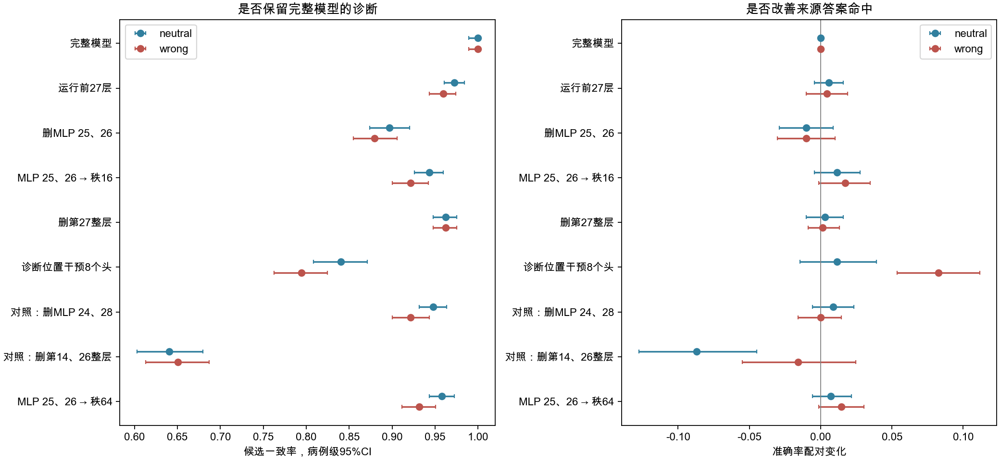
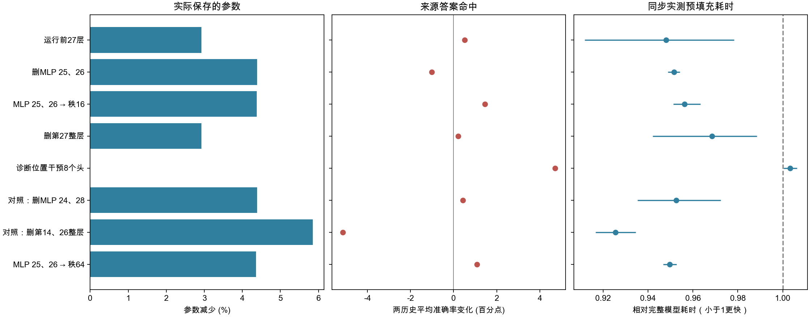

# 固定结构在345例上的留出检验

## 本阶段判断

小模块替换确实补回了直接删除所丢失的一部分诊断功能；运行前27层则保留了超过95%的原模型候选选择。8头干预在345例错误历史下提高代码选择正确率8.26个百分点，但第一批60例完整候选生成未显示提高。这三项结果分别回答结构保持、原诊断一致和抵抗错误提示，不能相互替代。

将代码结果也限制在同一批60例后，8头干预的错误历史正确率变化为+4.17个百分点，95%CI [−3.33, 11.67]；完整候选生成为−1.67个百分点，[−8.33, 5.00]。两接口干预收益的配对差为+5.83个百分点，[−4.17, 15.00]。因此这60例不足以确认接口之间的干预差异，也不能直接用345例与60例的不同数值推出机制。[同病例接口核对](matched_interface_audit.json)。

MedQA194、MedMCQA125、MMLU26。结构只由18例定位与27例组合开发确定；本轮345例不用于选择位置或拟合模块。每患者两种代码映射先平均，表中正确率不转成伪整数患者数。

| 结构 | 历史 | 来源答案命中，95%CI | 与完整模型一致，95%CI | 准确率变化，95%CI | 首词元属于代码 |
|---|---|---|---|---|---|
| baseline | neutral | 58.26% [53.62, 62.61] | 100.00% [98.94, 100.00] | 0.00% [0.00, 0.00] | 99.13% [98.26, 99.86] |
| baseline | wrong | 40.00% [35.22, 44.64] | 100.00% [98.94, 100.00] | 0.00% [0.00, 0.00] | 98.12% [96.96, 99.13] |
| early_exit | neutral | 58.84% [54.35, 63.33] | 97.25% [96.08, 98.41] | 0.58% [-0.43, 1.59] | 99.42% [98.84, 99.86] |
| early_exit | wrong | 40.43% [35.65, 45.07] | 95.94% [94.35, 97.39] | 0.43% [-1.01, 1.88] | 97.97% [96.81, 98.99] |
| drop_mlp_2 | neutral | 57.25% [52.75, 61.74] | 89.71% [87.39, 92.03] | -1.01% [-2.90, 0.87] | 98.99% [98.12, 99.71] |
| drop_mlp_2 | wrong | 38.99% [34.20, 43.62] | 87.97% [85.51, 90.58] | -1.01% [-3.04, 1.01] | 99.28% [98.55, 99.86] |
| linear_mlp_2_r16 | neutral | 59.42% [54.78, 63.91] | 94.35% [92.61, 95.94] | 1.16% [-0.43, 2.75] | 99.28% [98.41, 99.86] |
| linear_mlp_2_r16 | wrong | 41.74% [36.81, 46.52] | 92.17% [90.00, 94.20] | 1.74% [-0.14, 3.48] | 99.42% [98.84, 99.86] |
| drop_block_1 | neutral | 58.55% [54.06, 63.04] | 96.23% [94.78, 97.54] | 0.29% [-1.01, 1.59] | 98.84% [97.97, 99.57] |
| drop_block_1 | wrong | 40.14% [35.22, 44.93] | 96.23% [94.78, 97.54] | 0.14% [-0.87, 1.30] | 97.54% [96.23, 98.70] |
| anchor_heads_8 | neutral | 59.42% [54.64, 64.06] | 84.06% [80.87, 87.10] | 1.16% [-1.45, 3.91] | 99.86% [99.57, 100.00] |
| anchor_heads_8 | wrong | 48.26% [43.33, 53.04] | 79.42% [76.23, 82.46] | 8.26% [5.36, 11.16] | 99.28% [98.41, 99.86] |
| depth_matched_random_mlp_2 | neutral | 59.13% [54.64, 63.48] | 94.78% [93.19, 96.38] | 0.87% [-0.58, 2.32] | 100.00% [98.94, 100.00] |
| depth_matched_random_mlp_2 | wrong | 40.00% [35.22, 44.64] | 92.17% [90.00, 94.35] | 0.00% [-1.59, 1.45] | 99.13% [98.41, 99.71] |
| block_influence_2 | neutral | 49.57% [45.36, 53.92] | 64.06% [60.29, 67.97] | -8.70% [-12.75, -4.49] | 97.68% [96.38, 98.84] |
| block_influence_2 | wrong | 38.41% [34.35, 42.75] | 65.07% [61.30, 68.70] | -1.59% [-5.51, 2.46] | 97.39% [96.09, 98.55] |
| linear_mlp_2_r64 | neutral | 58.99% [54.35, 63.48] | 95.80% [94.35, 97.25] | 0.72% [-0.58, 2.17] | 99.28% [98.41, 99.86] |
| linear_mlp_2_r64 | wrong | 41.45% [36.52, 46.09] | 93.19% [91.16, 95.07] | 1.45% [-0.14, 3.04] | 99.42% [98.84, 99.86] |

差值百分数按百分点解释。严格首词元命中、修复/损坏与分来源区间见summary。

## 实际生成完整病名

同一留出队列按哈希每来源取20例，共60例。模型直接生成完整病名，未解析或不在原候选中的输出不计正确。

| 结构 | 历史 | 答对/60 | 相对完整模型变化，95%CI |
|---|---|---:|---|
| baseline | neutral | 37 | 0.00% [0.00, 0.00] |
| baseline | wrong | 29 | 0.00% [0.00, 0.00] |
| early_exit | neutral | 35 | -3.33% [-10.00, 3.33] |
| early_exit | wrong | 29 | 0.00% [-5.00, 5.00] |
| drop_mlp_2 | neutral | 34 | -5.00% [-11.67, 0.00] |
| drop_mlp_2 | wrong | 26 | -5.00% [-11.67, 1.67] |
| linear_mlp_2_r16 | neutral | 35 | -3.33% [-8.33, 0.00] |
| linear_mlp_2_r16 | wrong | 26 | -5.00% [-11.67, 0.00] |
| drop_block_1 | neutral | 36 | -1.67% [-8.33, 5.00] |
| drop_block_1 | wrong | 27 | -3.33% [-10.00, 3.33] |
| anchor_heads_8 | neutral | 35 | -3.33% [-10.00, 3.33] |
| anchor_heads_8 | wrong | 28 | -1.67% [-8.33, 5.00] |
| depth_matched_random_mlp_2 | neutral | 33 | -6.67% [-15.00, 0.00] |
| depth_matched_random_mlp_2 | wrong | 23 | -10.00% [-20.00, -1.67] |
| block_influence_2 | neutral | 32 | -8.33% [-21.67, 6.67] |
| block_influence_2 | wrong | 18 | -18.33% [-30.00, -8.33] |
| linear_mlp_2_r64 | neutral | 35 | -3.33% [-8.33, 0.00] |
| linear_mlp_2_r64 | wrong | 27 | -3.33% [-8.33, 0.00] |

## 实际结构与速度

| 结构 | 参数数 | 参数减少 | 相对耗时，病例级95%CI |
|---|---:|---:|---|
| baseline | 1,720,574,976 | 0.00% | 1.000 |
| early_exit | 1,670,238,976 | 2.93% | 0.948 [0.912, 0.978] |
| drop_mlp_2 | 1,645,073,408 | 4.39% | 0.952 [0.949, 0.954] |
| linear_mlp_2_r16 | 1,645,216,768 | 4.38% | 0.956 [0.951, 0.963] |
| drop_block_1 | 1,670,238,976 | 2.93% | 0.969 [0.942, 0.988] |
| anchor_heads_8 | 1,720,574,976 | 0.00% | 1.003 [1.000, 1.006] |
| depth_matched_random_mlp_2 | 1,645,073,408 | 4.39% | 0.952 [0.935, 0.972] |
| block_influence_2 | 1,619,902,976 | 5.85% | 0.925 [0.917, 0.935] |
| linear_mlp_2_r64 | 1,645,609,984 | 4.36% | 0.950 [0.947, 0.953] |

计时使用6例、两历史、3次交错配对重复，预热后同步GPU；测量预分词输入的预填充及最终词表输出头，不含模型加载、分词或持续生成。头干预保留原模型参数且增加门控计算，不把它称为模型压缩。

[全部患者代码结果](patient_code_results.csv) · [实际病名生成](patient_generation_results.csv) · [完整汇总](summary.json) · [计时](timing_results.csv)
