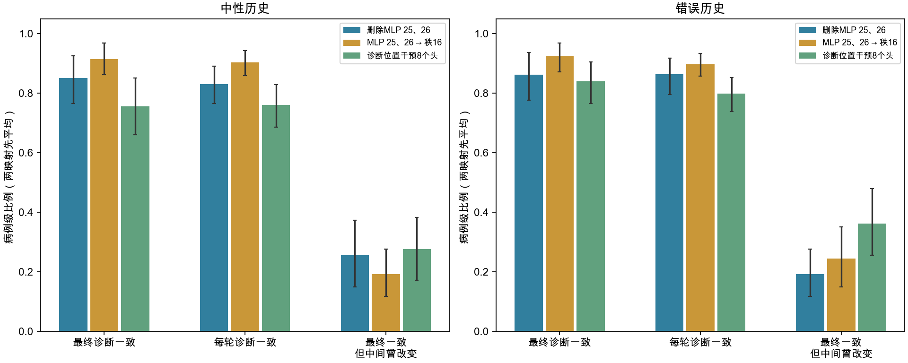
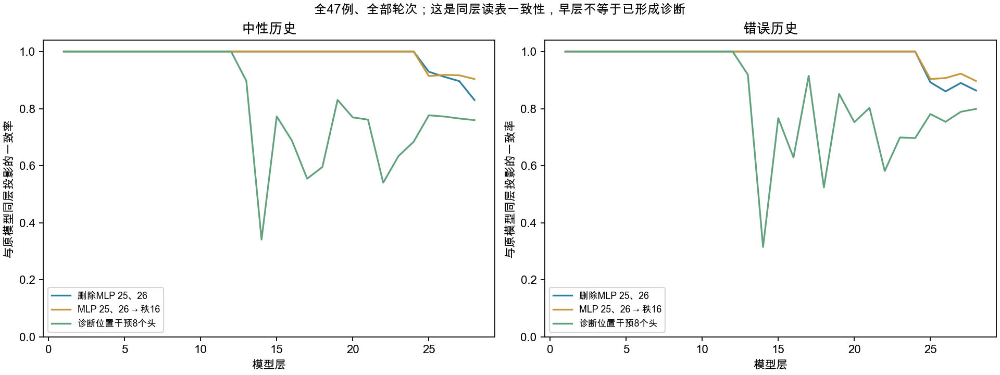
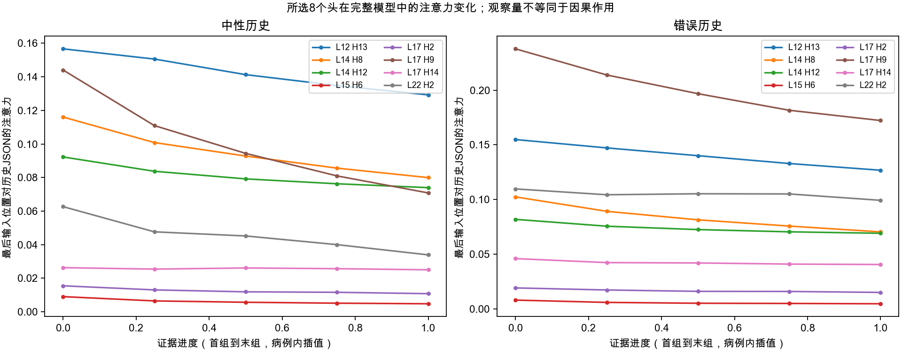

# 简化结构是否保留医学判断的更新过程

## 结果解释

**保留最终诊断，并不等于保留了证据更新过程。** 秩16替换在中性／错误历史下保留91.49%／92.55%的最终判断，但19.15%／24.47%的轨迹是“最终相同、中途至少一次不同”。这里第三项占全部病例—映射轨迹的比例，并非只在最终一致的轨迹中计算。

与直接删除相比，小模块替换在两种历史下都提高了逐轮诊断一致率，分别从83.02%到90.37%、86.35%到89.69%。它补回了部分更新行为；单看最终正确率会遗漏这些差别。

本组为MedQA15、MedMCQA16、MMLU16，共47例；与345例主验证的来源比例不同。注意力干预会改变更多判断路径，需结合来源答案命中、正确/错误历史对照判断改变的方向，不能把“变得更多”直接当成“变得更好”。

预定47例，完整累计证据轨迹。每例两历史、两代码映射，四个冻结结构。所有病例均列入图谱。

| 结构 | 历史 | 最终与原模型一致 | 所有轮次与原模型一致 | 最终一致、但中间曾改变 |
|---|---|---|---|---|
| 完整模型 | neutral | 100.00% [92.45, 100.00] | 100.00% [92.45, 100.00] | 0.00% [0.00, 0.00] |
| 完整模型 | wrong | 100.00% [92.45, 100.00] | 100.00% [92.45, 100.00] | 0.00% [0.00, 0.00] |
| 删除MLP 25、26 | neutral | 85.11% [76.60, 92.55] | 83.02% [76.53, 89.03] | 25.53% [14.89, 37.23] |
| 删除MLP 25、26 | wrong | 86.17% [77.66, 93.62] | 86.35% [79.59, 91.82] | 19.15% [11.70, 27.66] |
| MLP 25、26 → 秩16 | neutral | 91.49% [86.17, 96.81] | 90.37% [85.93, 94.38] | 19.15% [11.70, 27.66] |
| MLP 25、26 → 秩16 | wrong | 92.55% [87.23, 96.81] | 89.69% [85.68, 93.42] | 24.47% [14.89, 35.11] |
| 诊断位置干预8个头 | neutral | 75.53% [65.96, 85.11] | 75.97% [68.53, 82.95] | 27.66% [17.02, 38.30] |
| 诊断位置干预8个头 | wrong | 84.04% [76.60, 90.43] | 79.89% [73.79, 85.28] | 36.17% [25.53, 47.87] |

前两列分别统计终点与各轮平均；第三列统计每套映射中最终相同、至少一个更早轮次不同的轨迹，再在病例内平均。95%区间按病例重采样。

这张图比较同一层在结构改变前后的投影，不把早层投影当作实际诊断。原始表还提供两者代码总概率均≥0.5时的覆盖比例及一致率。

每条线对应一个已冻结的注意力头。先在每例内将首组至末组映射到0–1进度并插值，再对47例平均，因此长病例不会获得更多权重。它显示这些头怎样继续读取旧历史；因果作用由对应删除实验判断。

[全部病例与原文](CASE_ATLAS.md) · [逐病例终点/过程对照](endpoint_vs_path_patient.csv) · [逐层保持](layer_trajectory_preservation.csv) · [逐轮候选支持](all_candidate_trajectories.csv.gz)
