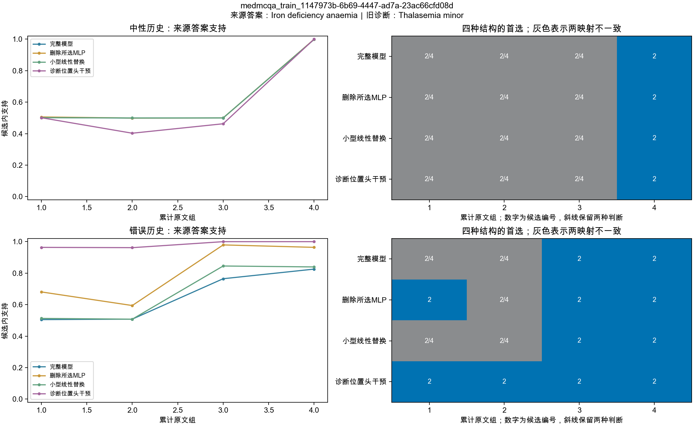
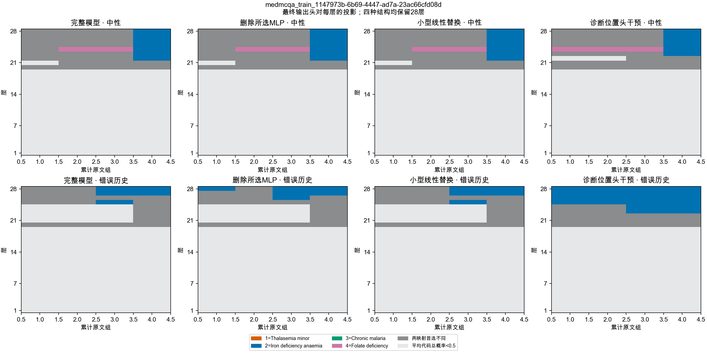

# medmcqa_train_1147973b-6b69-4447-ad7a-23ac66cfd08d

来源答案：**Iron deficiency anaemia**；固定错误历史：**Thalasemia minor**。

候选：1=Thalasemia minor；2=Iron deficiency anaemia；3=Chronic malaria；4=Folate deficiency。

曲线颜色代表四种结构，方格颜色及数字代表四个候选。曲线先平均两套代码支持；右侧方格与下表在两套代码不一致时同时列出两个候选编号，方格标灰。统计仍先各映射判定后在病例内平均。逐层图是最终输出头投影；浅灰表示代码总概率不足0.5，深灰表示两映射首选不同，未将这些格子解释为确定的疾病判断。

## 中性历史

| 轮 | 完整模型 | 删除所选MLP | 小型线性替换 | 诊断位置头干预 |
|---:|---|---|---|---|
| 1 | 2 / 4 | 2 / 4 | 2 / 4 | 2 / 4 |
| 2 | 2 / 4 | 2 / 4 | 2 / 4 | 2 / 4 |
| 3 | 2 / 4 | 2 / 4 | 2 / 4 | 2 / 4 |
| 4 | 2 | 2 | 2 | 2 |
## 错误历史

| 轮 | 完整模型 | 删除所选MLP | 小型线性替换 | 诊断位置头干预 |
|---:|---|---|---|---|
| 1 | 2 / 4 | 2 | 2 / 4 | 2 |
| 2 | 2 / 4 | 2 / 4 | 2 / 4 | 2 |
| 3 | 2 | 2 | 2 | 2 |
| 4 | 2 | 2 | 2 | 2 |

## 新增原文

1. A 25 yr old female presented with malaise and generalized weakness since 6 months.
2. Her appetite is reduced and she has giddiness and palpitations on and off.
3. There was no organomegaly.
4. Laboratory study showed normochromic to hypochromic anaemia, RDW=60, and MCV=50.
