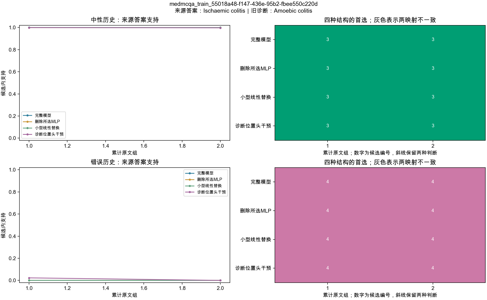
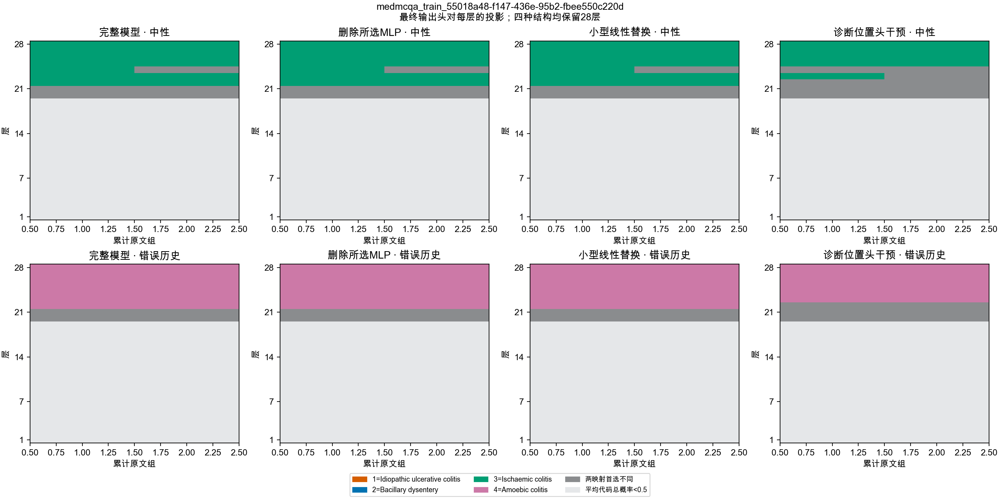

# medmcqa_train_55018a48-f147-436e-95b2-fbee550c220d

来源答案：**Ischaemic colitis**；固定错误历史：**Amoebic colitis**。

候选：1=Idiopathic ulcerative colitis；2=Bacillary dysentery；3=Ischaemic colitis；4=Amoebic colitis。

曲线颜色代表四种结构，方格颜色及数字代表四个候选。曲线先平均两套代码支持；右侧方格与下表在两套代码不一致时同时列出两个候选编号，方格标灰。统计仍先各映射判定后在病例内平均。逐层图是最终输出头投影；浅灰表示代码总概率不足0.5，深灰表示两映射首选不同，未将这些格子解释为确定的疾病判断。

## 中性历史

| 轮 | 完整模型 | 删除所选MLP | 小型线性替换 | 诊断位置头干预 |
|---:|---|---|---|---|
| 1 | 3 | 3 | 3 | 3 |
| 2 | 3 | 3 | 3 | 3 |
## 错误历史

| 轮 | 完整模型 | 删除所选MLP | 小型线性替换 | 诊断位置头干预 |
|---:|---|---|---|---|
| 1 | 4 | 4 | 4 | 4 |
| 2 | 4 | 4 | 4 | 4 |

## 新增原文

1. A 60 years old man presents with acute onset of pain in lower abdomen followed by repeated rectal bledding Examination revealed pulse rate of 100/ minute, BP 160/96 mm of Hg and a localised tenderness in the left hypochondrium.
2. Stools examination reveales only a few pus cells and sigmoidoscopy was normal.
