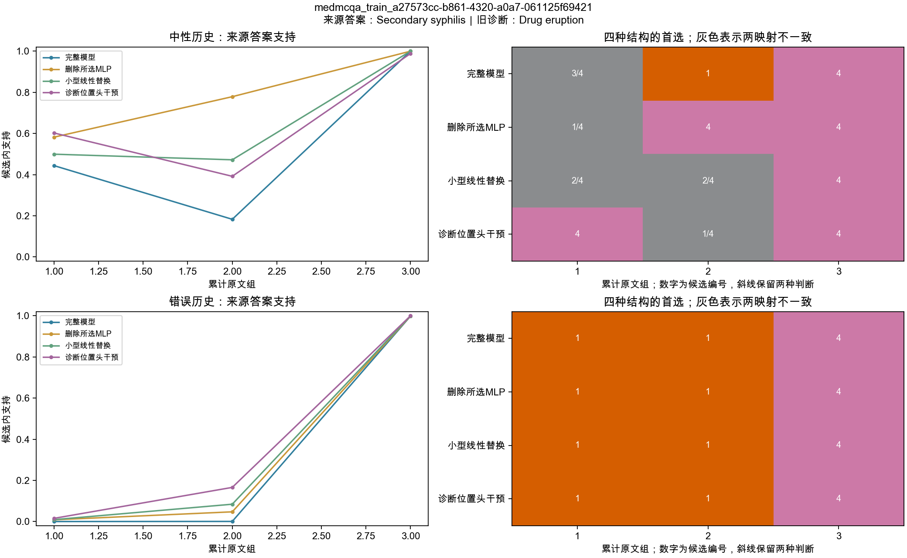
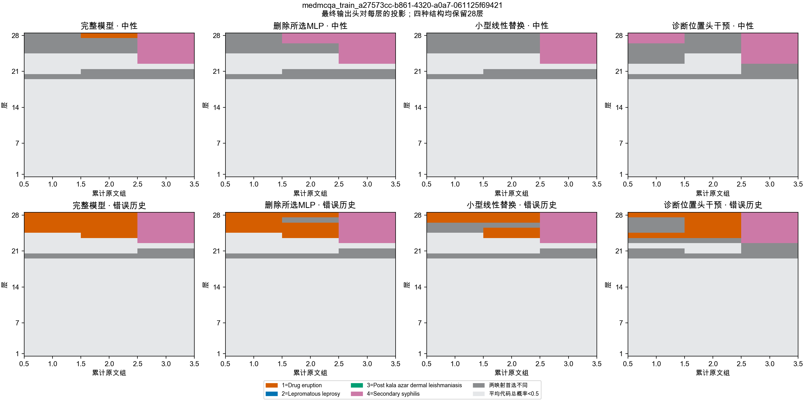

# medmcqa_train_a27573cc-b861-4320-a0a7-061125f69421

来源答案：**Secondary syphilis**；固定错误历史：**Drug eruption**。

候选：1=Drug eruption；2=Lepromatous leprosy；3=Post kala azar dermal leishmaniasis；4=Secondary syphilis。

曲线颜色代表四种结构，方格颜色及数字代表四个候选。曲线先平均两套代码支持；右侧方格与下表在两套代码不一致时同时列出两个候选编号，方格标灰。统计仍先各映射判定后在病例内平均。逐层图是最终输出头投影；浅灰表示代码总概率不足0.5，深灰表示两映射首选不同，未将这些格子解释为确定的疾病判断。

## 中性历史

| 轮 | 完整模型 | 删除所选MLP | 小型线性替换 | 诊断位置头干预 |
|---:|---|---|---|---|
| 1 | 3 / 4 | 1 / 4 | 2 / 4 | 4 |
| 2 | 1 | 4 | 2 / 4 | 1 / 4 |
| 3 | 4 | 4 | 4 | 4 |
## 错误历史

| 轮 | 完整模型 | 删除所选MLP | 小型线性替换 | 诊断位置头干预 |
|---:|---|---|---|---|
| 1 | 1 | 1 | 1 | 1 |
| 2 | 1 | 1 | 1 | 1 |
| 3 | 4 | 4 | 4 | 4 |

## 新增原文

1. A 48 year old male presents with non-itchy generalised papulo-nodular lesion of three months duration.
2. Physical examination does not show any other abnormaly.Slit smear from a nodule does not show AFB.
3. Blood VDRL is reactive 1:2 dilution.
