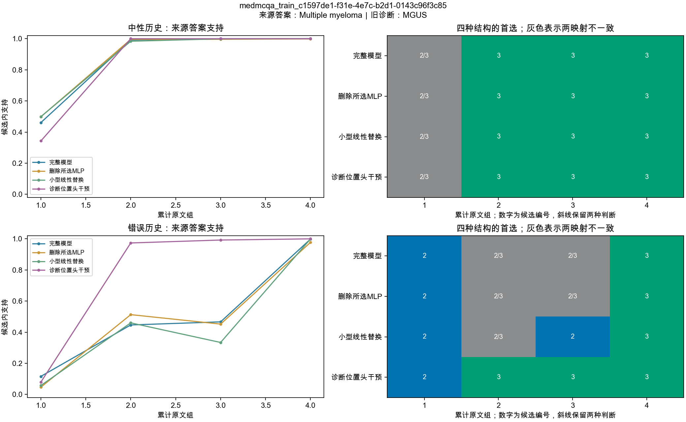
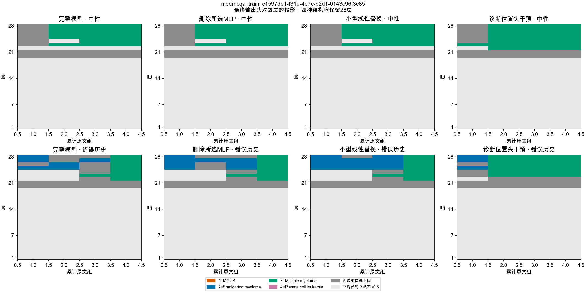

# medmcqa_train_c1597de1-f31e-4e7c-b2d1-0143c96f3c85

来源答案：**Multiple myeloma**；固定错误历史：**MGUS**。

候选：1=MGUS；2=Smoldering myeloma；3=Multiple myeloma；4=Plasma cell leukemia。

曲线颜色代表四种结构，方格颜色及数字代表四个候选。曲线先平均两套代码支持；右侧方格与下表在两套代码不一致时同时列出两个候选编号，方格标灰。统计仍先各映射判定后在病例内平均。逐层图是最终输出头投影；浅灰表示代码总概率不足0.5，深灰表示两映射首选不同，未将这些格子解释为确定的疾病判断。

## 中性历史

| 轮 | 完整模型 | 删除所选MLP | 小型线性替换 | 诊断位置头干预 |
|---:|---|---|---|---|
| 1 | 2 / 3 | 2 / 3 | 2 / 3 | 2 / 3 |
| 2 | 3 | 3 | 3 | 3 |
| 3 | 3 | 3 | 3 | 3 |
| 4 | 3 | 3 | 3 | 3 |
## 错误历史

| 轮 | 完整模型 | 删除所选MLP | 小型线性替换 | 诊断位置头干预 |
|---:|---|---|---|---|
| 1 | 2 | 2 | 2 | 2 |
| 2 | 2 / 3 | 2 / 3 | 2 / 3 | 3 |
| 3 | 2 / 3 | 2 / 3 | 2 | 3 |
| 4 | 3 | 3 | 3 | 3 |

## 新增原文

1. A patient presents with bone pain.
2. X ray reveals destructive lesions.
3. Lab investigations show shypercalcemia.
4. Serum electrophoresis shows M spike, while Bone marrow shows 35% plasma cells.
