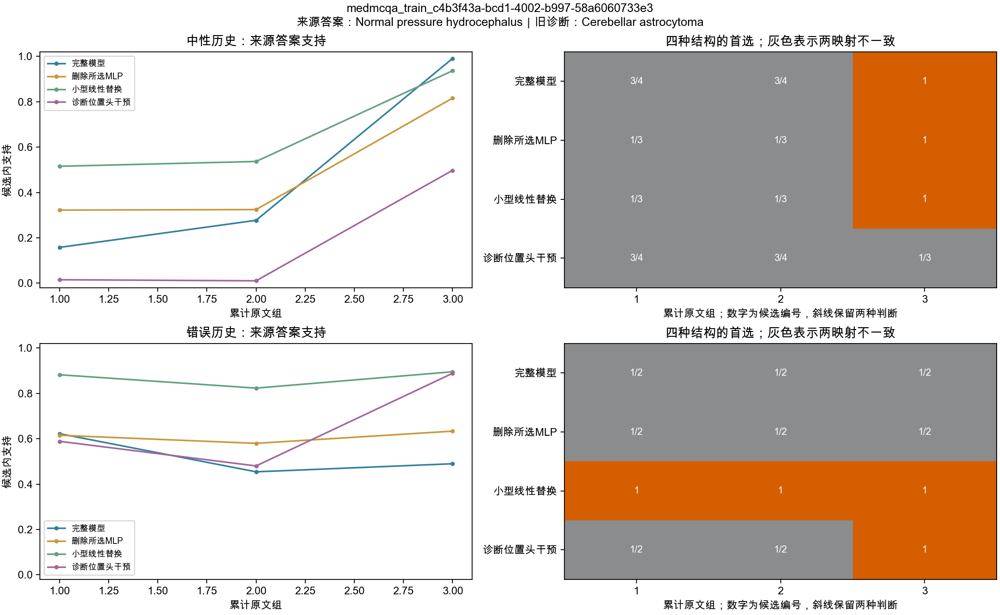
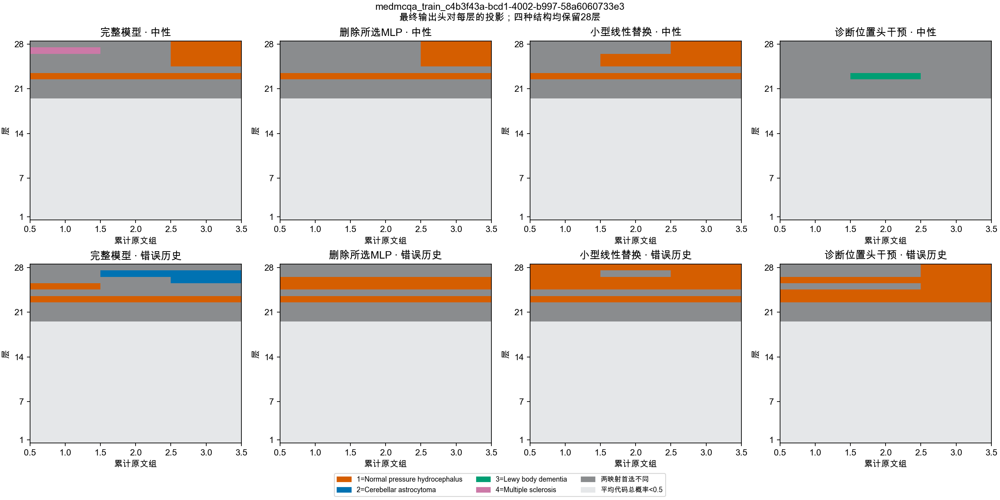

# medmcqa_train_c4b3f43a-bcd1-4002-b997-58a6060733e3

来源答案：**Normal pressure hydrocephalus**；固定错误历史：**Cerebellar astrocytoma**。

候选：1=Normal pressure hydrocephalus；2=Cerebellar astrocytoma；3=Lewy body dementia；4=Multiple sclerosis。

曲线颜色代表四种结构，方格颜色及数字代表四个候选。曲线先平均两套代码支持；右侧方格与下表在两套代码不一致时同时列出两个候选编号，方格标灰。统计仍先各映射判定后在病例内平均。逐层图是最终输出头投影；浅灰表示代码总概率不足0.5，深灰表示两映射首选不同，未将这些格子解释为确定的疾病判断。

## 中性历史

| 轮 | 完整模型 | 删除所选MLP | 小型线性替换 | 诊断位置头干预 |
|---:|---|---|---|---|
| 1 | 3 / 4 | 1 / 3 | 1 / 3 | 3 / 4 |
| 2 | 3 / 4 | 1 / 3 | 1 / 3 | 3 / 4 |
| 3 | 1 | 1 | 1 | 1 / 3 |
## 错误历史

| 轮 | 完整模型 | 删除所选MLP | 小型线性替换 | 诊断位置头干预 |
|---:|---|---|---|---|
| 1 | 1 / 2 | 1 / 2 | 1 | 1 / 2 |
| 2 | 1 / 2 | 1 / 2 | 1 | 1 / 2 |
| 3 | 1 / 2 | 1 / 2 | 1 | 1 |

## 新增原文

1. Mr X is a 70-year-old male who presents with a one-year history of progressive ataxia, urinary incontinence and memory loss.
2. He is otherwise asymptomatic.
3. He has no significant past medical history and is not on any medication.
