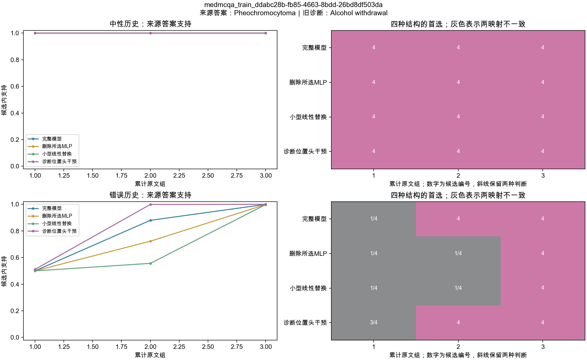
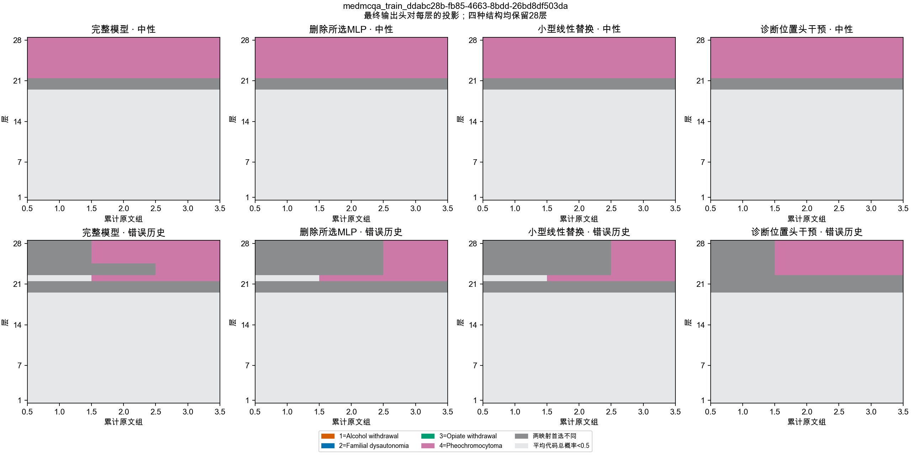

# medmcqa_train_ddabc28b-fb85-4663-8bdd-26bd8df503da

来源答案：**Pheochromocytoma**；固定错误历史：**Alcohol withdrawal**。

候选：1=Alcohol withdrawal；2=Familial dysautonomia；3=Opiate withdrawal；4=Pheochromocytoma。

曲线颜色代表四种结构，方格颜色及数字代表四个候选。曲线先平均两套代码支持；右侧方格与下表在两套代码不一致时同时列出两个候选编号，方格标灰。统计仍先各映射判定后在病例内平均。逐层图是最终输出头投影；浅灰表示代码总概率不足0.5，深灰表示两映射首选不同，未将这些格子解释为确定的疾病判断。

## 中性历史

| 轮 | 完整模型 | 删除所选MLP | 小型线性替换 | 诊断位置头干预 |
|---:|---|---|---|---|
| 1 | 4 | 4 | 4 | 4 |
| 2 | 4 | 4 | 4 | 4 |
| 3 | 4 | 4 | 4 | 4 |
## 错误历史

| 轮 | 完整模型 | 删除所选MLP | 小型线性替换 | 诊断位置头干预 |
|---:|---|---|---|---|
| 1 | 1 / 4 | 1 / 4 | 1 / 4 | 3 / 4 |
| 2 | 4 | 1 / 4 | 1 / 4 | 4 |
| 3 | 4 | 4 | 4 | 4 |

## 新增原文

1. A 28-year-old man comes to the emergency department because of a severe headache, palpitations, excessive sweating, chest pain, visual disturbances, dyspnea. paresthesias, constipation, and a sense of impending doom over the past 2 weeks.
2. These symptoms occur primarily at night.
3. His blood pressure is 130/80 mmHg while supine and 90/60 mmHg while standing; his blood sugar is 240 mg/dL.
