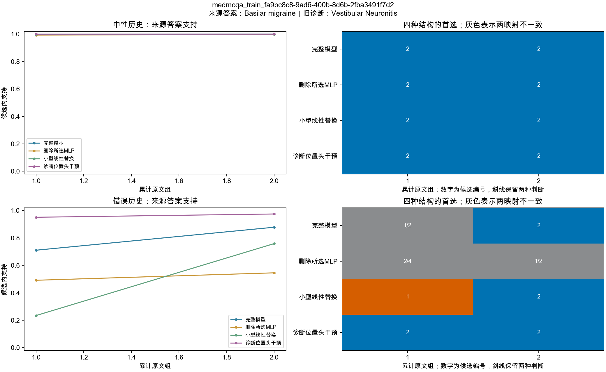
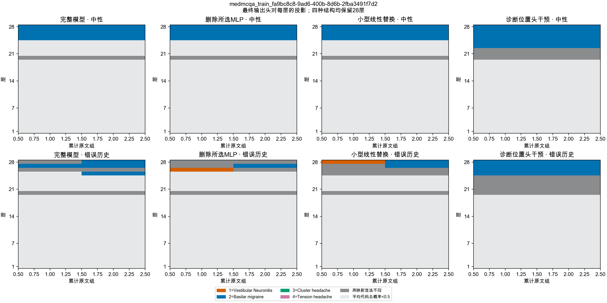

# medmcqa_train_fa9bc8c8-9ad6-400b-8d6b-2fba3491f7d2

来源答案：**Basilar migraine**；固定错误历史：**Vestibular Neuronitis**。

候选：1=Vestibular Neuronitis；2=Basilar migraine；3=Cluster headache；4=Tension headache。

曲线颜色代表四种结构，方格颜色及数字代表四个候选。曲线先平均两套代码支持；右侧方格与下表在两套代码不一致时同时列出两个候选编号，方格标灰。统计仍先各映射判定后在病例内平均。逐层图是最终输出头投影；浅灰表示代码总概率不足0.5，深灰表示两映射首选不同，未将这些格子解释为确定的疾病判断。

## 中性历史

| 轮 | 完整模型 | 删除所选MLP | 小型线性替换 | 诊断位置头干预 |
|---:|---|---|---|---|
| 1 | 2 | 2 | 2 | 2 |
| 2 | 2 | 2 | 2 | 2 |
## 错误历史

| 轮 | 完整模型 | 删除所选MLP | 小型线性替换 | 诊断位置头干预 |
|---:|---|---|---|---|
| 1 | 1 / 2 | 2 / 4 | 1 | 2 |
| 2 | 2 | 1 / 2 | 2 | 2 |

## 新增原文

1. A young girl presents with repeated episodes of throbbing occipital headache associated with ataxia and vertigo.
2. The family history is positive for similar headaches in her mother.
