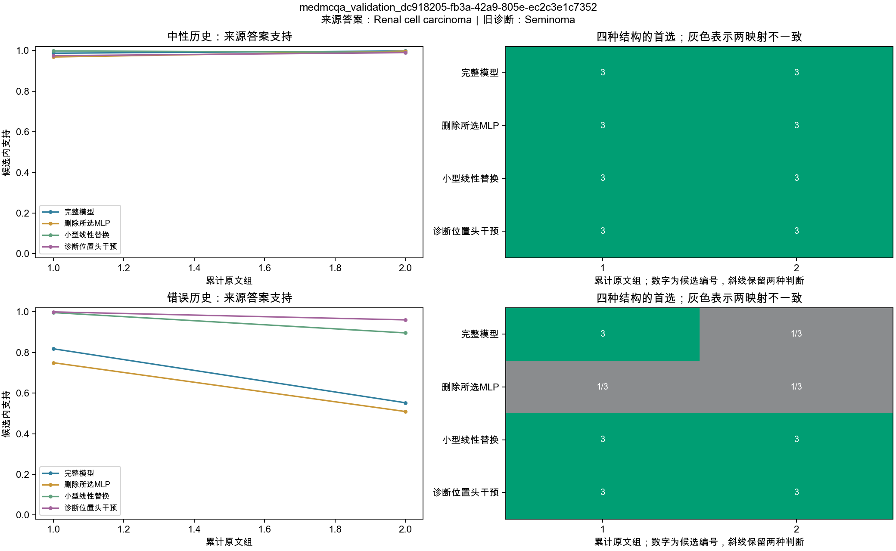
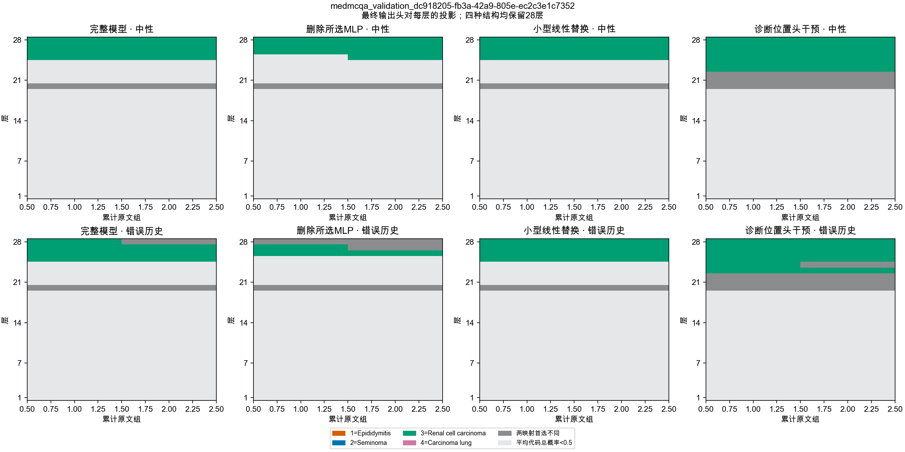

# medmcqa_validation_dc918205-fb3a-42a9-805e-ec2c3e1c7352

来源答案：**Renal cell carcinoma**；固定错误历史：**Seminoma**。

候选：1=Epididymitis；2=Seminoma；3=Renal cell carcinoma；4=Carcinoma lung。

曲线颜色代表四种结构，方格颜色及数字代表四个候选。曲线先平均两套代码支持；右侧方格与下表在两套代码不一致时同时列出两个候选编号，方格标灰。统计仍先各映射判定后在病例内平均。逐层图是最终输出头投影；浅灰表示代码总概率不足0.5，深灰表示两映射首选不同，未将这些格子解释为确定的疾病判断。

## 中性历史

| 轮 | 完整模型 | 删除所选MLP | 小型线性替换 | 诊断位置头干预 |
|---:|---|---|---|---|
| 1 | 3 | 3 | 3 | 3 |
| 2 | 3 | 3 | 3 | 3 |
## 错误历史

| 轮 | 完整模型 | 删除所选MLP | 小型线性替换 | 诊断位置头干预 |
|---:|---|---|---|---|
| 1 | 3 | 1 / 3 | 3 | 3 |
| 2 | 1 / 3 | 1 / 3 | 3 | 3 |

## 新增原文

1. A 49 years old male with 35 pack years presented with painless mass in left scrotal sac and microscopic hematuria.
2. On laboratory investigation, Alphafetoprotein and lactate dehydrogenase was negative.
