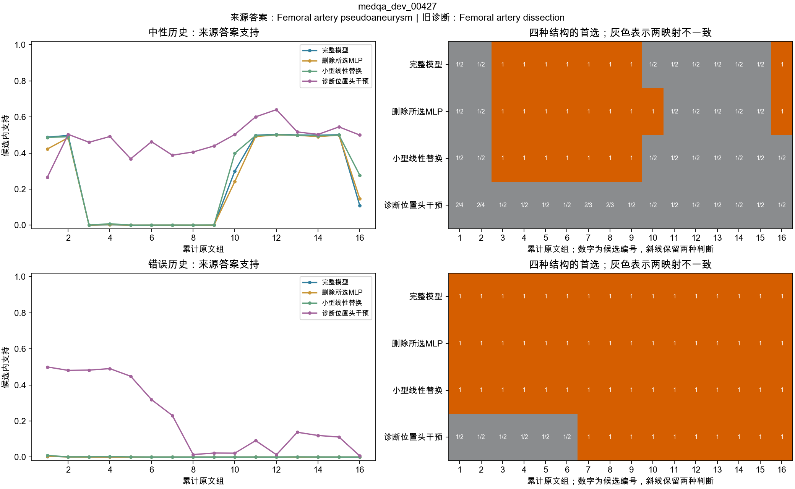
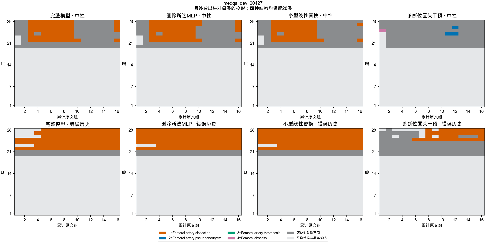

# medqa_dev_00427

来源答案：**Femoral artery pseudoaneurysm**；固定错误历史：**Femoral artery dissection**。

候选：1=Femoral artery dissection；2=Femoral artery pseudoaneurysm；3=Femoral artery thrombosis；4=Femoral abscess。

曲线颜色代表四种结构，方格颜色及数字代表四个候选。曲线先平均两套代码支持；右侧方格与下表在两套代码不一致时同时列出两个候选编号，方格标灰。统计仍先各映射判定后在病例内平均。逐层图是最终输出头投影；浅灰表示代码总概率不足0.5，深灰表示两映射首选不同，未将这些格子解释为确定的疾病判断。

## 中性历史

| 轮 | 完整模型 | 删除所选MLP | 小型线性替换 | 诊断位置头干预 |
|---:|---|---|---|---|
| 1 | 1 / 2 | 1 / 2 | 1 / 2 | 2 / 4 |
| 2 | 1 / 2 | 1 / 2 | 1 / 2 | 2 / 4 |
| 3 | 1 | 1 | 1 | 1 / 2 |
| 4 | 1 | 1 | 1 | 1 / 2 |
| 5 | 1 | 1 | 1 | 1 / 2 |
| 6 | 1 | 1 | 1 | 1 / 2 |
| 7 | 1 | 1 | 1 | 2 / 3 |
| 8 | 1 | 1 | 1 | 2 / 3 |
| 9 | 1 | 1 | 1 | 1 / 2 |
| 10 | 1 / 2 | 1 | 1 / 2 | 1 / 2 |
| 11 | 1 / 2 | 1 / 2 | 1 / 2 | 1 / 2 |
| 12 | 1 / 2 | 1 / 2 | 1 / 2 | 1 / 2 |
| 13 | 1 / 2 | 1 / 2 | 1 / 2 | 1 / 2 |
| 14 | 1 / 2 | 1 / 2 | 1 / 2 | 1 / 2 |
| 15 | 1 / 2 | 1 / 2 | 1 / 2 | 1 / 2 |
| 16 | 1 | 1 | 1 / 2 | 1 / 2 |
## 错误历史

| 轮 | 完整模型 | 删除所选MLP | 小型线性替换 | 诊断位置头干预 |
|---:|---|---|---|---|
| 1 | 1 | 1 | 1 | 1 / 2 |
| 2 | 1 | 1 | 1 | 1 / 2 |
| 3 | 1 | 1 | 1 | 1 / 2 |
| 4 | 1 | 1 | 1 | 1 / 2 |
| 5 | 1 | 1 | 1 | 1 / 2 |
| 6 | 1 | 1 | 1 | 1 / 2 |
| 7 | 1 | 1 | 1 | 1 |
| 8 | 1 | 1 | 1 | 1 |
| 9 | 1 | 1 | 1 | 1 |
| 10 | 1 | 1 | 1 | 1 |
| 11 | 1 | 1 | 1 | 1 |
| 12 | 1 | 1 | 1 | 1 |
| 13 | 1 | 1 | 1 | 1 |
| 14 | 1 | 1 | 1 | 1 |
| 15 | 1 | 1 | 1 | 1 |
| 16 | 1 | 1 | 1 | 1 |

## 新增原文

1. A 56-year-old man comes to the physician for a routine health maintenance examination.
2. He has had mild pain in his left groin for 2 weeks.
3. He was admitted to the hospital 1 month ago for myocardial infarction.
4. Cardiac catheterization and angiography showed occlusion of the left anterior descending artery and he underwent placement of 2 stents.
5. He has hypertension and hypercholesterolemia.
6. There is no family history of serious illness.
7. He has smoked 2 packs of cigarettes daily for 30 years.
8. Current medications include aspirin, clopidogrel, rosuvastatin, and enalapril.
9. His temperature is 36.7°C (98°F), pulse is 88/min, and blood pressure is 130/84 mm Hg.
10. Examination shows a 3-cm (1.2-in), tender, pulsatile mass in the left thigh, below the inguinal ligament.
11. There is mild erythema of the overlying skin.
12. A loud murmur is heard on auscultation of the mass.
13. Cardiopulmonary examination shows no abnormalities.
14. There is no edema in the lower limbs.
15. Femoral and pedal pulses are palpable bilaterally.
16. Neurologic examination shows no focal findings.
