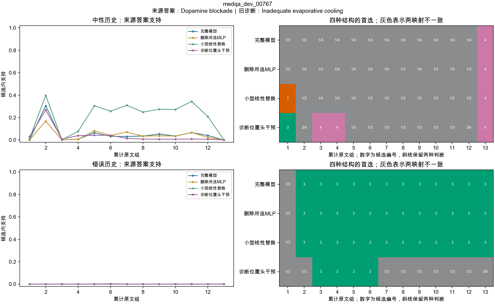
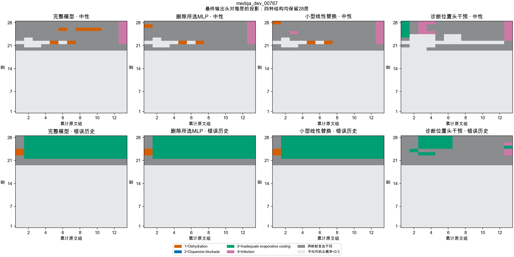

# medqa_dev_00767

来源答案：**Dopamine blockade**；固定错误历史：**Inadequate evaporative cooling**。

候选：1=Dehydration；2=Dopamine blockade；3=Inadequate evaporative cooling；4=Infection。

曲线颜色代表四种结构，方格颜色及数字代表四个候选。曲线先平均两套代码支持；右侧方格与下表在两套代码不一致时同时列出两个候选编号，方格标灰。统计仍先各映射判定后在病例内平均。逐层图是最终输出头投影；浅灰表示代码总概率不足0.5，深灰表示两映射首选不同，未将这些格子解释为确定的疾病判断。

## 中性历史

| 轮 | 完整模型 | 删除所选MLP | 小型线性替换 | 诊断位置头干预 |
|---:|---|---|---|---|
| 1 | 1 / 3 | 1 / 3 | 1 | 3 |
| 2 | 1 / 2 | 1 / 4 | 1 / 2 | 2 / 4 |
| 3 | 1 / 4 | 1 / 4 | 1 / 4 | 4 |
| 4 | 1 / 4 | 1 / 4 | 1 / 4 | 4 |
| 5 | 1 / 4 | 1 / 4 | 1 / 2 | 1 / 3 |
| 6 | 1 / 4 | 1 / 4 | 1 / 2 | 1 / 3 |
| 7 | 1 / 4 | 1 / 4 | 1 / 2 | 1 / 3 |
| 8 | 1 / 4 | 1 / 3 | 1 / 2 | 1 / 3 |
| 9 | 1 / 4 | 1 / 4 | 1 / 2 | 1 / 3 |
| 10 | 1 / 4 | 1 / 3 | 1 / 2 | 1 / 3 |
| 11 | 1 / 4 | 1 / 3 | 1 / 2 | 1 / 3 |
| 12 | 1 / 4 | 1 / 3 | 1 / 2 | 3 / 4 |
| 13 | 4 | 4 | 4 | 4 |
## 错误历史

| 轮 | 完整模型 | 删除所选MLP | 小型线性替换 | 诊断位置头干预 |
|---:|---|---|---|---|
| 1 | 1 / 3 | 1 / 3 | 1 / 3 | 1 / 3 |
| 2 | 3 | 3 | 3 | 1 / 3 |
| 3 | 3 | 3 | 3 | 3 |
| 4 | 3 | 3 | 3 | 3 |
| 5 | 3 | 3 | 3 | 3 |
| 6 | 3 | 3 | 3 | 3 |
| 7 | 3 | 3 | 3 | 1 / 3 |
| 8 | 3 | 3 | 3 | 1 / 3 |
| 9 | 3 | 3 | 3 | 1 / 3 |
| 10 | 3 | 3 | 3 | 1 / 3 |
| 11 | 3 | 3 | 3 | 1 / 3 |
| 12 | 3 | 3 | 3 | 1 / 3 |
| 13 | 3 | 3 | 3 | 3 / 4 |

## 新增原文

1. A 24-year-old man is brought to the emergency department for bowling at a local bowling alley while inappropriately dressed.
2. The patient refused to speak with police and was seen conversing with inanimate objects in the back of the police car.
3. The patient states that his clothes were contaminated by assassins who have been tracking him for years.
4. The patient refuses to answer any further questions, and continues to whisper toward someone else.
5. The patient has a past medical history of homelessness, alcohol abuse, marijuana use, and cocaine abuse.
6. Physical exam is notable for a healthy young man who seems mistrustful of all hospital personnel.
7. The patient is started on a medication and is transferred to the psychiatric inpatient unit.
8. The patient’s condition improves, but he still often speaks of a contamination that is on his clothes and skin that is coming from external parties.
9. The patient is started on a new medication.
10. He is then sent to group therapy, followed by physical activity in the yard.
11. The physician is called over when the patient is found down in the recreation yard while he was exercising.
12. The patient is not responsive, and his limbs seem to resist passive force.
13. His temperature is 104°F (40°C), pulse is 112/min, blood pressure is 140/90 mmHg, respirations are 18/min, and oxygen saturation is 95% on room air.
