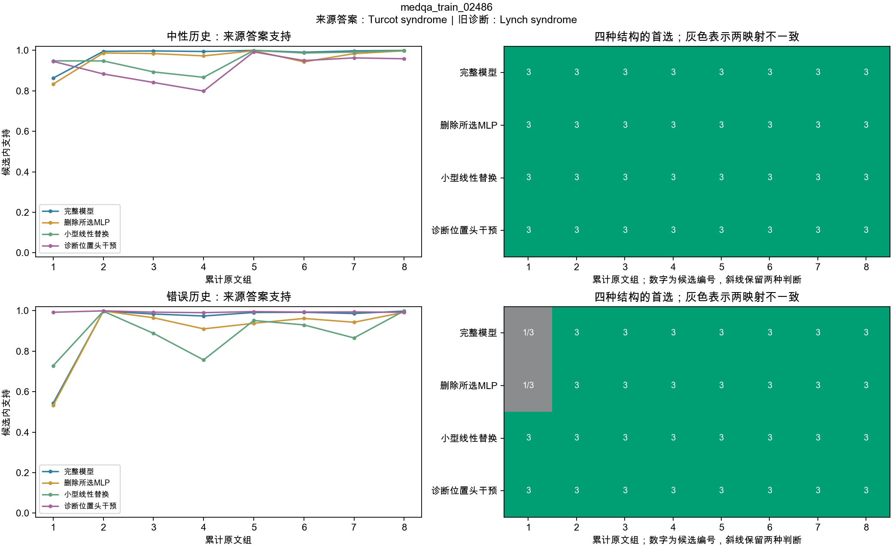
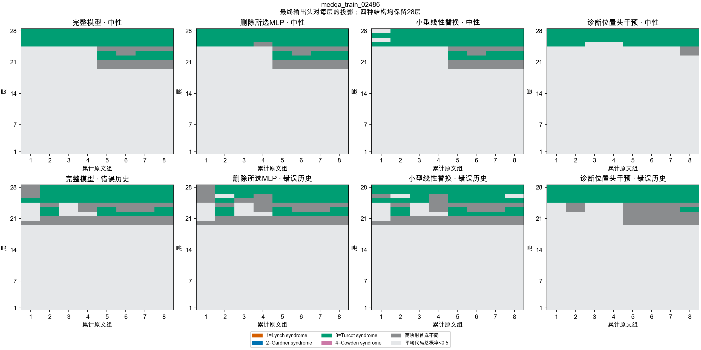

# medqa_train_02486

来源答案：**Turcot syndrome**；固定错误历史：**Lynch syndrome**。

候选：1=Lynch syndrome；2=Gardner syndrome；3=Turcot syndrome；4=Cowden syndrome。

曲线颜色代表四种结构，方格颜色及数字代表四个候选。曲线先平均两套代码支持；右侧方格与下表在两套代码不一致时同时列出两个候选编号，方格标灰。统计仍先各映射判定后在病例内平均。逐层图是最终输出头投影；浅灰表示代码总概率不足0.5，深灰表示两映射首选不同，未将这些格子解释为确定的疾病判断。

## 中性历史

| 轮 | 完整模型 | 删除所选MLP | 小型线性替换 | 诊断位置头干预 |
|---:|---|---|---|---|
| 1 | 3 | 3 | 3 | 3 |
| 2 | 3 | 3 | 3 | 3 |
| 3 | 3 | 3 | 3 | 3 |
| 4 | 3 | 3 | 3 | 3 |
| 5 | 3 | 3 | 3 | 3 |
| 6 | 3 | 3 | 3 | 3 |
| 7 | 3 | 3 | 3 | 3 |
| 8 | 3 | 3 | 3 | 3 |
## 错误历史

| 轮 | 完整模型 | 删除所选MLP | 小型线性替换 | 诊断位置头干预 |
|---:|---|---|---|---|
| 1 | 1 / 3 | 1 / 3 | 3 | 3 |
| 2 | 3 | 3 | 3 | 3 |
| 3 | 3 | 3 | 3 | 3 |
| 4 | 3 | 3 | 3 | 3 |
| 5 | 3 | 3 | 3 | 3 |
| 6 | 3 | 3 | 3 | 3 |
| 7 | 3 | 3 | 3 | 3 |
| 8 | 3 | 3 | 3 | 3 |

## 新增原文

1. A 16-year-old boy presents after suffering a tonic-clonic seizure.
2. He says it had a duration of 2 minutes and a postictal period of 10 minutes.
3. Patient denies any similar episodes in the past.
4. Past medical history is unremarkable.
5. Family history is significant for his mother and older brother who died of colorectal cancer at ages 40 and 20, respectively.
6. On physical examination, the patient is drowsy but arousable and responsive to commands.
7. Both pupils are symmetrical and responsive to light.
8. An MRI of the brain reveals an infratentorial hypointense cerebellar mass with a small cystic area.
