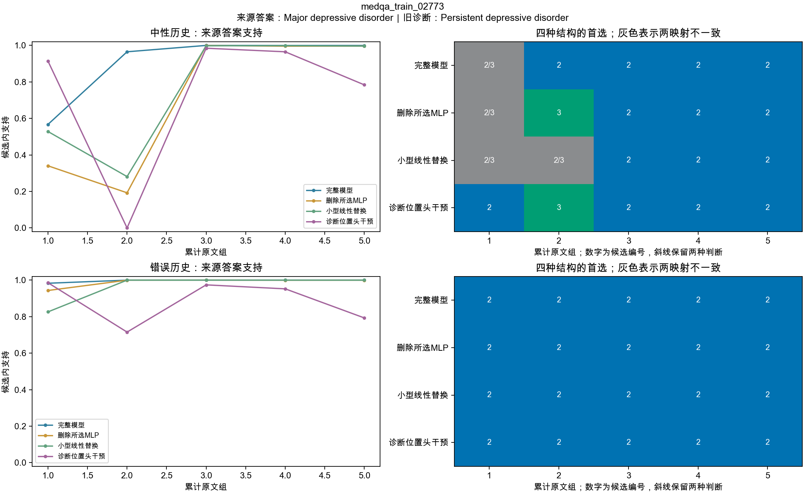
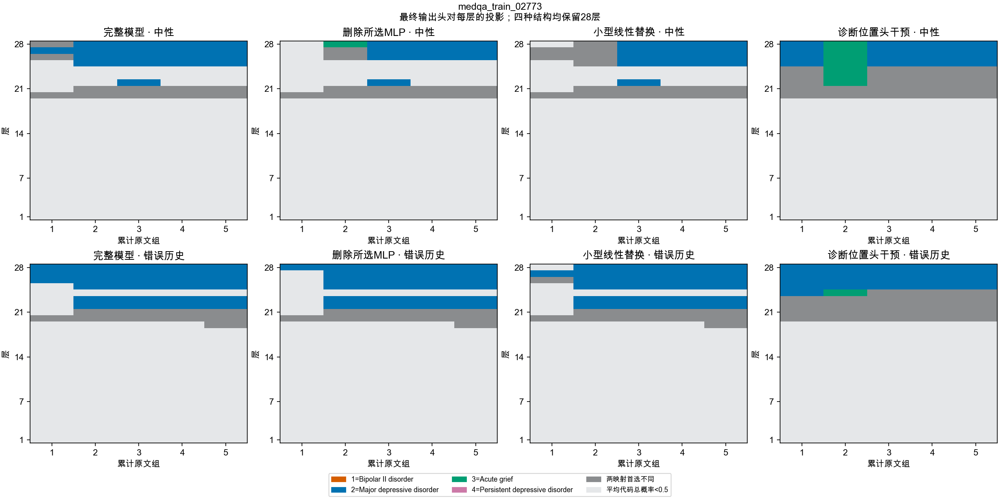

# medqa_train_02773

来源答案：**Major depressive disorder**；固定错误历史：**Persistent depressive disorder**。

候选：1=Bipolar II disorder；2=Major depressive disorder；3=Acute grief；4=Persistent depressive disorder。

曲线颜色代表四种结构，方格颜色及数字代表四个候选。曲线先平均两套代码支持；右侧方格与下表在两套代码不一致时同时列出两个候选编号，方格标灰。统计仍先各映射判定后在病例内平均。逐层图是最终输出头投影；浅灰表示代码总概率不足0.5，深灰表示两映射首选不同，未将这些格子解释为确定的疾病判断。

## 中性历史

| 轮 | 完整模型 | 删除所选MLP | 小型线性替换 | 诊断位置头干预 |
|---:|---|---|---|---|
| 1 | 2 / 3 | 2 / 3 | 2 / 3 | 2 |
| 2 | 2 | 3 | 2 / 3 | 3 |
| 3 | 2 | 2 | 2 | 2 |
| 4 | 2 | 2 | 2 | 2 |
| 5 | 2 | 2 | 2 | 2 |
## 错误历史

| 轮 | 完整模型 | 删除所选MLP | 小型线性替换 | 诊断位置头干预 |
|---:|---|---|---|---|
| 1 | 2 | 2 | 2 | 2 |
| 2 | 2 | 2 | 2 | 2 |
| 3 | 2 | 2 | 2 | 2 |
| 4 | 2 | 2 | 2 | 2 |
| 5 | 2 | 2 | 2 | 2 |

## 新增原文

1. A 61-year-old female presents to her primary care physician complaining of fatigue and feeling sad.
2. She reports that ever since her husband passed away 3 months ago, she has noticed a decrease in her energy level and reports frequently awaking at 2 in the morning and cannot fall back asleep.
3. She sometimes wakes up and hears her husband's voice, constantly thinks about how much she misses him, and has recently thought about ways to kill herself including driving through a red light.
4. She used to be an active member of her neighborhood’s bridge club but has stopped playing.
5. She has lost 15 pounds and rarely feels hungry.
