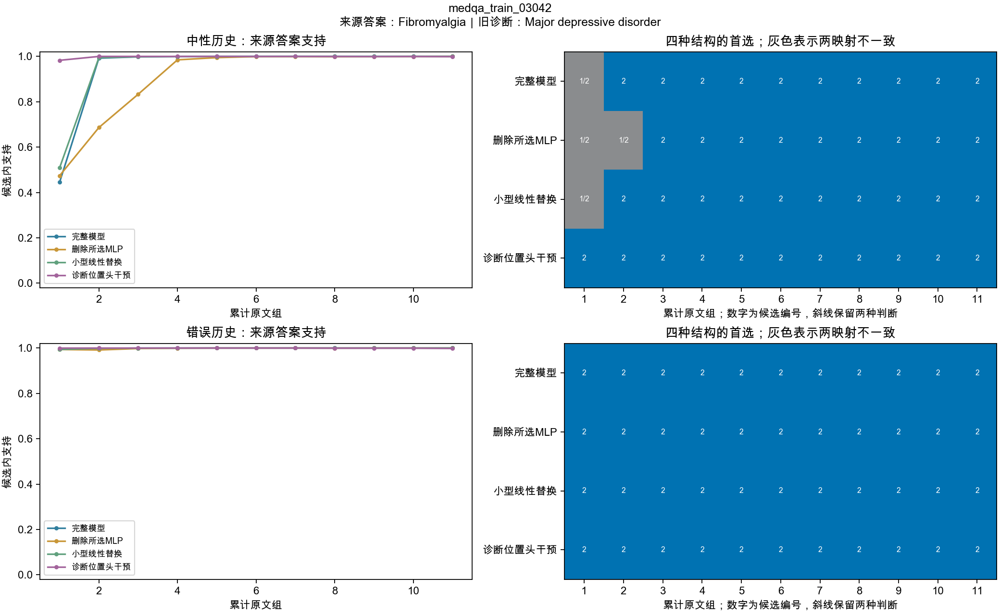
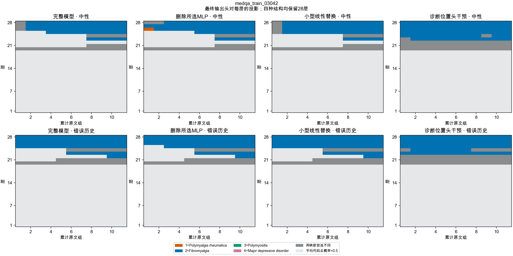

# medqa_train_03042

来源答案：**Fibromyalgia**；固定错误历史：**Major depressive disorder**。

候选：1=Polymyalgia rheumatica；2=Fibromyalgia；3=Polymyositis；4=Major depressive disorder。

曲线颜色代表四种结构，方格颜色及数字代表四个候选。曲线先平均两套代码支持；右侧方格与下表在两套代码不一致时同时列出两个候选编号，方格标灰。统计仍先各映射判定后在病例内平均。逐层图是最终输出头投影；浅灰表示代码总概率不足0.5，深灰表示两映射首选不同，未将这些格子解释为确定的疾病判断。

## 中性历史

| 轮 | 完整模型 | 删除所选MLP | 小型线性替换 | 诊断位置头干预 |
|---:|---|---|---|---|
| 1 | 1 / 2 | 1 / 2 | 1 / 2 | 2 |
| 2 | 2 | 1 / 2 | 2 | 2 |
| 3 | 2 | 2 | 2 | 2 |
| 4 | 2 | 2 | 2 | 2 |
| 5 | 2 | 2 | 2 | 2 |
| 6 | 2 | 2 | 2 | 2 |
| 7 | 2 | 2 | 2 | 2 |
| 8 | 2 | 2 | 2 | 2 |
| 9 | 2 | 2 | 2 | 2 |
| 10 | 2 | 2 | 2 | 2 |
| 11 | 2 | 2 | 2 | 2 |
## 错误历史

| 轮 | 完整模型 | 删除所选MLP | 小型线性替换 | 诊断位置头干预 |
|---:|---|---|---|---|
| 1 | 2 | 2 | 2 | 2 |
| 2 | 2 | 2 | 2 | 2 |
| 3 | 2 | 2 | 2 | 2 |
| 4 | 2 | 2 | 2 | 2 |
| 5 | 2 | 2 | 2 | 2 |
| 6 | 2 | 2 | 2 | 2 |
| 7 | 2 | 2 | 2 | 2 |
| 8 | 2 | 2 | 2 | 2 |
| 9 | 2 | 2 | 2 | 2 |
| 10 | 2 | 2 | 2 | 2 |
| 11 | 2 | 2 | 2 | 2 |

## 新增原文

1. A 39-year-old woman comes to the physician because of recurrent episodes of severe pain over her neck, back, and shoulders for the past year.
2. The pain worsens with exercise and lack of sleep.
3. Use of over-the-counter analgesics have not resolved her symptoms.
4. She also has stiffness of the shoulders and knees and tingling in her upper extremities that is worse in the morning.
5. She takes escitalopram for generalized anxiety disorder.
6. She also has tension headaches several times a month.
7. Her maternal uncle has ankylosing spondylitis.
8. Examination shows marked tenderness over the posterior neck, bilateral mid trapezius, and medial aspect of the left knee.
9. Muscle strength is normal.
10. Laboratory studies, including a complete blood count, erythrocyte sedimentation rate, and thyroid-stimulating hormone are within the reference ranges.
11. X-rays of her cervical and lumbar spine show no abnormalities.
