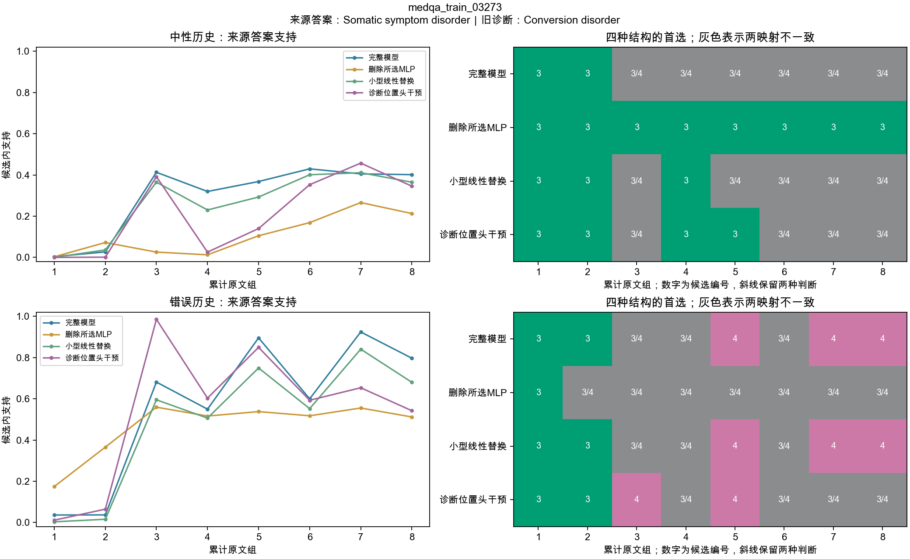
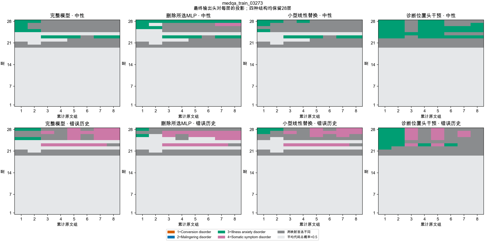

# medqa_train_03273

来源答案：**Somatic symptom disorder**；固定错误历史：**Conversion disorder**。

候选：1=Conversion disorder；2=Malingering disorder；3=Illness anxiety disorder；4=Somatic symptom disorder。

曲线颜色代表四种结构，方格颜色及数字代表四个候选。曲线先平均两套代码支持；右侧方格与下表在两套代码不一致时同时列出两个候选编号，方格标灰。统计仍先各映射判定后在病例内平均。逐层图是最终输出头投影；浅灰表示代码总概率不足0.5，深灰表示两映射首选不同，未将这些格子解释为确定的疾病判断。

## 中性历史

| 轮 | 完整模型 | 删除所选MLP | 小型线性替换 | 诊断位置头干预 |
|---:|---|---|---|---|
| 1 | 3 | 3 | 3 | 3 |
| 2 | 3 | 3 | 3 | 3 |
| 3 | 3 / 4 | 3 | 3 / 4 | 3 / 4 |
| 4 | 3 / 4 | 3 | 3 | 3 |
| 5 | 3 / 4 | 3 | 3 / 4 | 3 |
| 6 | 3 / 4 | 3 | 3 / 4 | 3 / 4 |
| 7 | 3 / 4 | 3 | 3 / 4 | 3 / 4 |
| 8 | 3 / 4 | 3 | 3 / 4 | 3 / 4 |
## 错误历史

| 轮 | 完整模型 | 删除所选MLP | 小型线性替换 | 诊断位置头干预 |
|---:|---|---|---|---|
| 1 | 3 | 3 | 3 | 3 |
| 2 | 3 | 3 / 4 | 3 | 3 |
| 3 | 3 / 4 | 3 / 4 | 3 / 4 | 4 |
| 4 | 3 / 4 | 3 / 4 | 3 / 4 | 3 / 4 |
| 5 | 4 | 3 / 4 | 4 | 4 |
| 6 | 3 / 4 | 3 / 4 | 3 / 4 | 3 / 4 |
| 7 | 4 | 3 / 4 | 4 | 3 / 4 |
| 8 | 4 | 3 / 4 | 4 | 3 / 4 |

## 新增原文

1. A 45-year-old woman repetitively visits the general surgery clinic worried that her inguinal hernia is incarcerated.
2. 2 months ago, she was seen in the emergency department where she presented with a left lower abdominal swelling.
3. The mass was easily reduced and the patient was referred to the general surgery clinic for elective surgical repair.
4. Because her condition was deemed not urgent, she was informed that she was down on the surgical waiting list.
5. Despite this, she continues to visit the clinic and the ED worried that her bowels are ‘trapped and dying.’ Each time she is reassured and any protrusion present is quickly reduced.
6. She has previously frequently visited her primary care physician for complaints of abdominal pain and inconsistent bowel habits, but no etiology could be identified.
7. She continues to intermittently have these symptoms and spends hours every day worrying about what may be going on.
8. She has no other significant past medical history.
