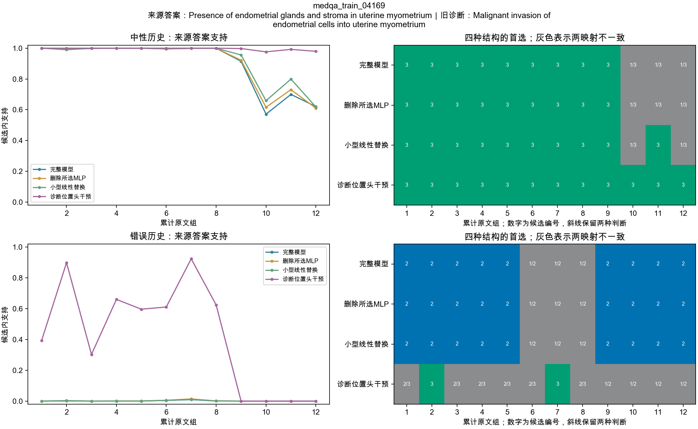
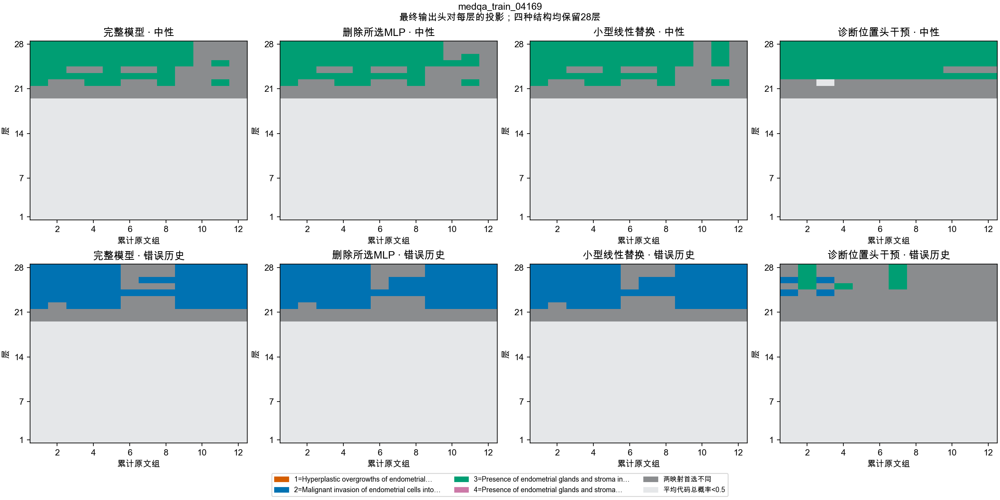

# medqa_train_04169

来源答案：**Presence of endometrial glands and stroma in uterine myometrium**；固定错误历史：**Malignant invasion of endometrial cells into uterine myometrium**。

候选：1=Hyperplastic overgrowths of endometrial glands and stroma；2=Malignant invasion of endometrial cells into uterine myometrium；3=Presence of endometrial glands and stroma in uterine myometrium；4=Presence of endometrial glands and stroma outside the uterus。

曲线颜色代表四种结构，方格颜色及数字代表四个候选。曲线先平均两套代码支持；右侧方格与下表在两套代码不一致时同时列出两个候选编号，方格标灰。统计仍先各映射判定后在病例内平均。逐层图是最终输出头投影；浅灰表示代码总概率不足0.5，深灰表示两映射首选不同，未将这些格子解释为确定的疾病判断。

## 中性历史

| 轮 | 完整模型 | 删除所选MLP | 小型线性替换 | 诊断位置头干预 |
|---:|---|---|---|---|
| 1 | 3 | 3 | 3 | 3 |
| 2 | 3 | 3 | 3 | 3 |
| 3 | 3 | 3 | 3 | 3 |
| 4 | 3 | 3 | 3 | 3 |
| 5 | 3 | 3 | 3 | 3 |
| 6 | 3 | 3 | 3 | 3 |
| 7 | 3 | 3 | 3 | 3 |
| 8 | 3 | 3 | 3 | 3 |
| 9 | 3 | 3 | 3 | 3 |
| 10 | 1 / 3 | 1 / 3 | 1 / 3 | 3 |
| 11 | 1 / 3 | 1 / 3 | 3 | 3 |
| 12 | 1 / 3 | 1 / 3 | 1 / 3 | 3 |
## 错误历史

| 轮 | 完整模型 | 删除所选MLP | 小型线性替换 | 诊断位置头干预 |
|---:|---|---|---|---|
| 1 | 2 | 2 | 2 | 2 / 3 |
| 2 | 2 | 2 | 2 | 3 |
| 3 | 2 | 2 | 2 | 2 / 3 |
| 4 | 2 | 2 | 2 | 2 / 3 |
| 5 | 2 | 2 | 2 | 2 / 3 |
| 6 | 1 / 2 | 1 / 2 | 1 / 2 | 2 / 3 |
| 7 | 1 / 2 | 1 / 2 | 1 / 2 | 3 |
| 8 | 1 / 2 | 1 / 2 | 1 / 2 | 2 / 3 |
| 9 | 2 | 2 | 2 | 1 / 2 |
| 10 | 2 | 2 | 2 | 1 / 2 |
| 11 | 2 | 2 | 2 | 1 / 2 |
| 12 | 2 | 2 | 2 | 1 / 2 |

## 新增原文

1. A 44-year-old G2P2 African American woman presents to her gynecologist for dysmenorrhea.
2. She reports that for the past few months, she has been having severe pain during her menses.
3. She also endorses menstrual bleeding that has been heavier than usual.
4. The patient reports that her cycles are regular and occur every 30 days, and she denies both dyspareunia and spotting between her periods.
5. Her last menstrual period was two weeks ago.
6. In terms of her obstetric history, the patient had two uncomplicated pregnancies, and she had no difficulty becoming pregnant.
7. She has never had an abnormal pap smear.
8. Her past medical history is otherwise significant for hyperlipidemia and asthma.
9. On physical exam, the patient’s uterus is tender, soft, and enlarged to the size of a pregnant uterus at 10 weeks of gestation.
10. She is non-tender during vaginal exam, without cervical motion tenderness or adnexal masses.
11. Her BMI is 24 kg/m2.
12. A urine pregnancy test is negative.
