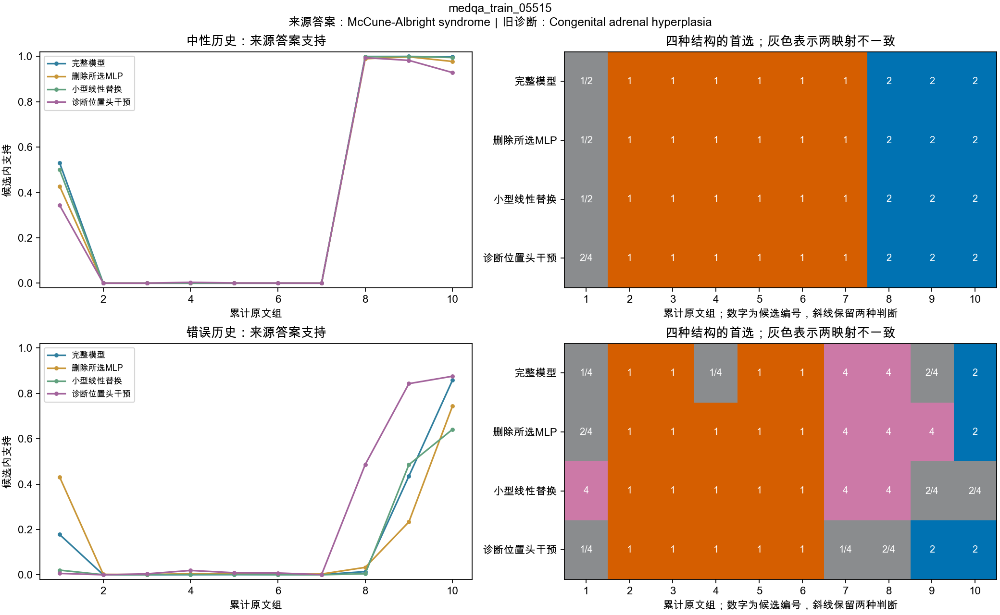
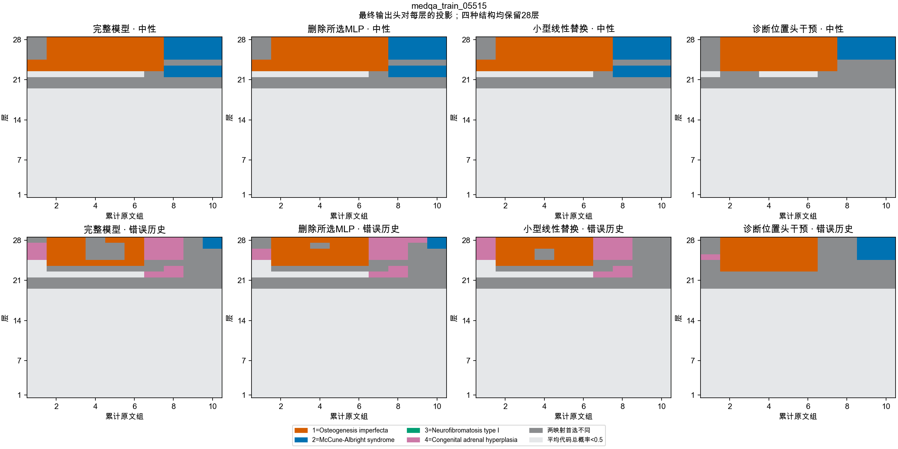

# medqa_train_05515

来源答案：**McCune-Albright syndrome**；固定错误历史：**Congenital adrenal hyperplasia**。

候选：1=Osteogenesis imperfecta；2=McCune-Albright syndrome；3=Neurofibromatosis type I；4=Congenital adrenal hyperplasia。

曲线颜色代表四种结构，方格颜色及数字代表四个候选。曲线先平均两套代码支持；右侧方格与下表在两套代码不一致时同时列出两个候选编号，方格标灰。统计仍先各映射判定后在病例内平均。逐层图是最终输出头投影；浅灰表示代码总概率不足0.5，深灰表示两映射首选不同，未将这些格子解释为确定的疾病判断。

## 中性历史

| 轮 | 完整模型 | 删除所选MLP | 小型线性替换 | 诊断位置头干预 |
|---:|---|---|---|---|
| 1 | 1 / 2 | 1 / 2 | 1 / 2 | 2 / 4 |
| 2 | 1 | 1 | 1 | 1 |
| 3 | 1 | 1 | 1 | 1 |
| 4 | 1 | 1 | 1 | 1 |
| 5 | 1 | 1 | 1 | 1 |
| 6 | 1 | 1 | 1 | 1 |
| 7 | 1 | 1 | 1 | 1 |
| 8 | 2 | 2 | 2 | 2 |
| 9 | 2 | 2 | 2 | 2 |
| 10 | 2 | 2 | 2 | 2 |
## 错误历史

| 轮 | 完整模型 | 删除所选MLP | 小型线性替换 | 诊断位置头干预 |
|---:|---|---|---|---|
| 1 | 1 / 4 | 2 / 4 | 4 | 1 / 4 |
| 2 | 1 | 1 | 1 | 1 |
| 3 | 1 | 1 | 1 | 1 |
| 4 | 1 / 4 | 1 | 1 | 1 |
| 5 | 1 | 1 | 1 | 1 |
| 6 | 1 | 1 | 1 | 1 |
| 7 | 4 | 4 | 4 | 1 / 4 |
| 8 | 4 | 4 | 4 | 2 / 4 |
| 9 | 2 / 4 | 4 | 2 / 4 | 2 |
| 10 | 2 | 2 | 2 / 4 | 2 |

## 新增原文

1. A 7-year-old girl is brought to the physician by her parents for the evaluation of pubic hair development.
2. She has a history of a fracture in each leg and one fracture in her right arm.
3. Her performance at school is good.
4. There is no family history of serious illness.
5. She takes no medications.
6. Vital signs are within normal limits.
7. Genital examination shows coarse, dark hair along the labia.
8. The breast glands are enlarged and the breast bud extends beyond the areolar diameter.
9. There are several hyperpigmented macules with rough, serpiginous borders of different sizes on the lower and upper extremities.
10. The remainder of the examination shows no abnormalities.
