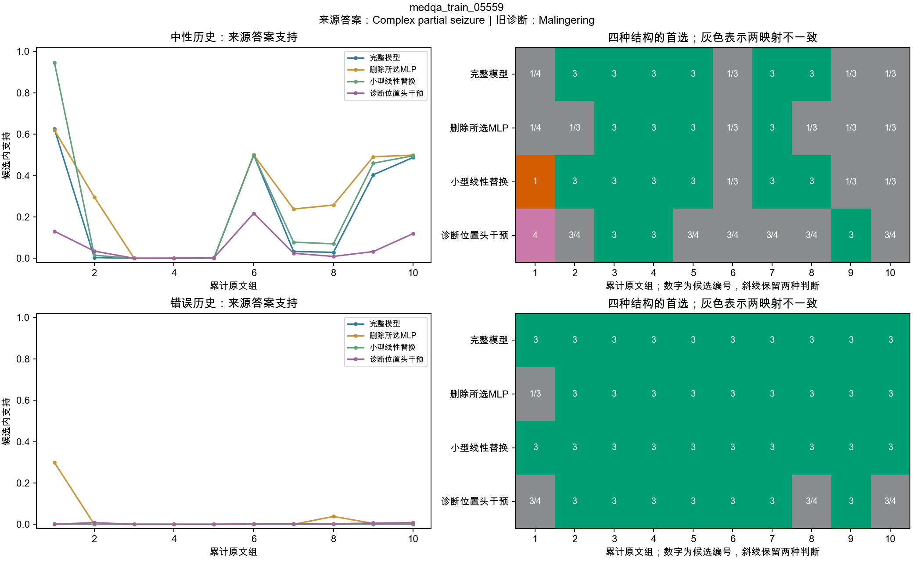
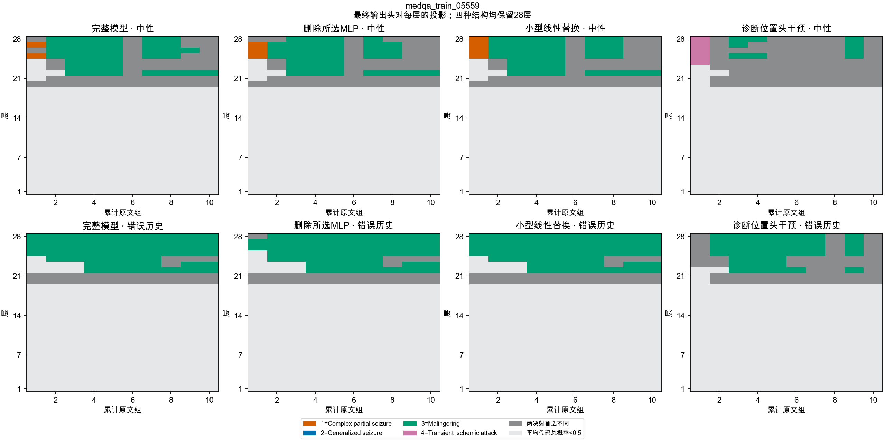

# medqa_train_05559

来源答案：**Complex partial seizure**；固定错误历史：**Malingering**。

候选：1=Complex partial seizure；2=Generalized seizure；3=Malingering；4=Transient ischemic attack。

曲线颜色代表四种结构，方格颜色及数字代表四个候选。曲线先平均两套代码支持；右侧方格与下表在两套代码不一致时同时列出两个候选编号，方格标灰。统计仍先各映射判定后在病例内平均。逐层图是最终输出头投影；浅灰表示代码总概率不足0.5，深灰表示两映射首选不同，未将这些格子解释为确定的疾病判断。

## 中性历史

| 轮 | 完整模型 | 删除所选MLP | 小型线性替换 | 诊断位置头干预 |
|---:|---|---|---|---|
| 1 | 1 / 4 | 1 / 4 | 1 | 4 |
| 2 | 3 | 1 / 3 | 3 | 3 / 4 |
| 3 | 3 | 3 | 3 | 3 |
| 4 | 3 | 3 | 3 | 3 |
| 5 | 3 | 3 | 3 | 3 / 4 |
| 6 | 1 / 3 | 1 / 3 | 1 / 3 | 3 / 4 |
| 7 | 3 | 3 | 3 | 3 / 4 |
| 8 | 3 | 1 / 3 | 3 | 3 / 4 |
| 9 | 1 / 3 | 1 / 3 | 1 / 3 | 3 |
| 10 | 1 / 3 | 1 / 3 | 1 / 3 | 3 / 4 |
## 错误历史

| 轮 | 完整模型 | 删除所选MLP | 小型线性替换 | 诊断位置头干预 |
|---:|---|---|---|---|
| 1 | 3 | 1 / 3 | 3 | 3 / 4 |
| 2 | 3 | 3 | 3 | 3 |
| 3 | 3 | 3 | 3 | 3 |
| 4 | 3 | 3 | 3 | 3 |
| 5 | 3 | 3 | 3 | 3 |
| 6 | 3 | 3 | 3 | 3 |
| 7 | 3 | 3 | 3 | 3 |
| 8 | 3 | 3 | 3 | 3 / 4 |
| 9 | 3 | 3 | 3 | 3 |
| 10 | 3 | 3 | 3 | 3 / 4 |

## 新增原文

1. A 27-year-old man is brought into the emergency department by ambulance.
2. The patient was at an appointment to receive welfare when he began acting abnormally.
3. The patient was denied welfare.
4. Shortly afterwards, he no longer responded to questions and stared blankly off into space, not responding to verbal stimuli.
5. Other than odd lip-smacking behavior, he was motionless.
6. Several minutes later, he became responsive but seemed confused.
7. The patient has a past medical history of drug abuse and homelessness and is not currently taking any medications.
8. His temperature is 98.9°F (37.2°C), blood pressure is 124/78 mmHg, pulse is 90/min, respirations are 14/min, and oxygen saturation is 99% on room air.
9. Physical exam reveals cranial nerves II-XII as grossly intact with 5/5 strength in the upper and lower extremities and a stable gait.
10. The patient seems confused when answering questions and has trouble remembering the episode.
