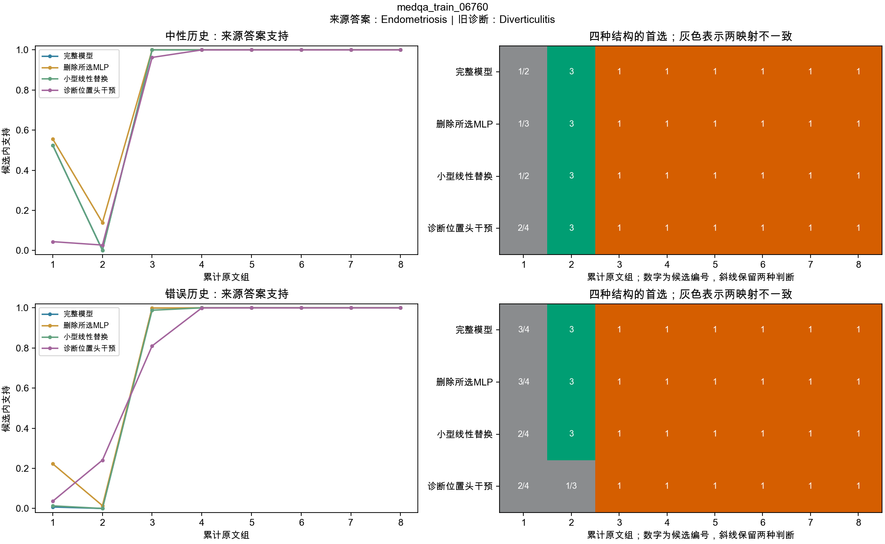
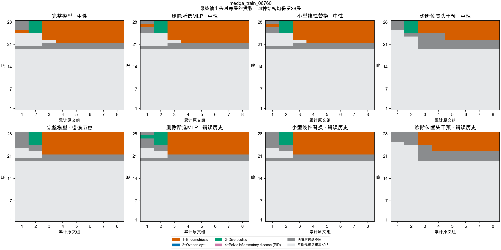

# medqa_train_06760

来源答案：**Endometriosis**；固定错误历史：**Diverticulitis**。

候选：1=Endometriosis；2=Ovarian cyst；3=Diverticulitis；4=Pelvic inflammatory disease (PID)。

曲线颜色代表四种结构，方格颜色及数字代表四个候选。曲线先平均两套代码支持；右侧方格与下表在两套代码不一致时同时列出两个候选编号，方格标灰。统计仍先各映射判定后在病例内平均。逐层图是最终输出头投影；浅灰表示代码总概率不足0.5，深灰表示两映射首选不同，未将这些格子解释为确定的疾病判断。

## 中性历史

| 轮 | 完整模型 | 删除所选MLP | 小型线性替换 | 诊断位置头干预 |
|---:|---|---|---|---|
| 1 | 1 / 2 | 1 / 3 | 1 / 2 | 2 / 4 |
| 2 | 3 | 3 | 3 | 3 |
| 3 | 1 | 1 | 1 | 1 |
| 4 | 1 | 1 | 1 | 1 |
| 5 | 1 | 1 | 1 | 1 |
| 6 | 1 | 1 | 1 | 1 |
| 7 | 1 | 1 | 1 | 1 |
| 8 | 1 | 1 | 1 | 1 |
## 错误历史

| 轮 | 完整模型 | 删除所选MLP | 小型线性替换 | 诊断位置头干预 |
|---:|---|---|---|---|
| 1 | 3 / 4 | 3 / 4 | 2 / 4 | 2 / 4 |
| 2 | 3 | 3 | 3 | 1 / 3 |
| 3 | 1 | 1 | 1 | 1 |
| 4 | 1 | 1 | 1 | 1 |
| 5 | 1 | 1 | 1 | 1 |
| 6 | 1 | 1 | 1 | 1 |
| 7 | 1 | 1 | 1 | 1 |
| 8 | 1 | 1 | 1 | 1 |

## 新增原文

1. A 32-year-old woman visits her family physician for a routine health check-up.
2. During the consult, she complains about recent-onset constipation, painful defecation, and occasional pain with micturition for the past few months.
3. Her menstrual cycles have always been regular with moderate pelvic pain during menses, which is relieved with pain medication.
4. However, in the last 6 months, she has noticed that her menses are “heavier” with severe lower abdominal cramps that linger for 4–5 days after the last day of menstruation.
5. She and her husband are trying to conceive a second child, but lately, she has been unable to have sexual intercourse due to pain during sexual intercourse.
6. During the physical examination, she has tenderness in the lower abdomen with no palpable mass.
7. Pelvic examination reveals a left-deviated tender cervix, a tender retroverted uterus, and a left adnexal mass.
8. During the rectovaginal examination, nodules are noted.
