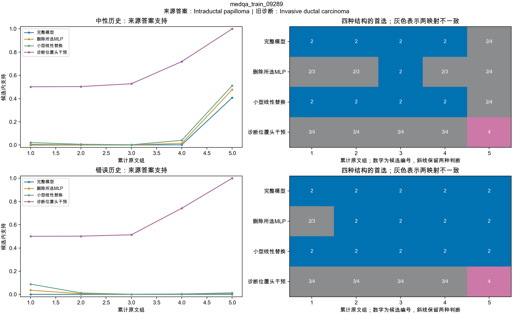
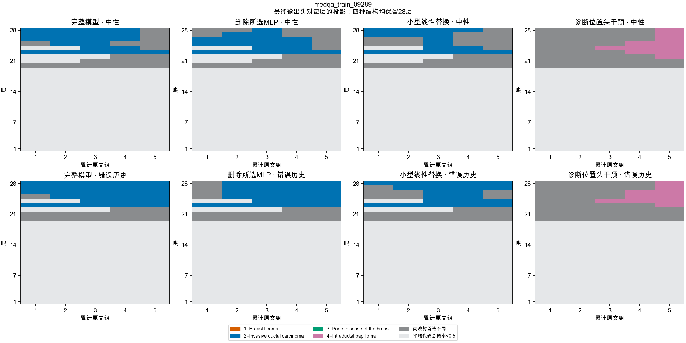

# medqa_train_09289

来源答案：**Intraductal papilloma**；固定错误历史：**Invasive ductal carcinoma**。

候选：1=Breast lipoma；2=Invasive ductal carcinoma；3=Paget disease of the breast；4=Intraductal papilloma。

曲线颜色代表四种结构，方格颜色及数字代表四个候选。曲线先平均两套代码支持；右侧方格与下表在两套代码不一致时同时列出两个候选编号，方格标灰。统计仍先各映射判定后在病例内平均。逐层图是最终输出头投影；浅灰表示代码总概率不足0.5，深灰表示两映射首选不同，未将这些格子解释为确定的疾病判断。

## 中性历史

| 轮 | 完整模型 | 删除所选MLP | 小型线性替换 | 诊断位置头干预 |
|---:|---|---|---|---|
| 1 | 2 | 2 / 3 | 2 | 3 / 4 |
| 2 | 2 | 2 / 3 | 2 | 3 / 4 |
| 3 | 2 | 2 | 2 | 3 / 4 |
| 4 | 2 | 2 / 3 | 2 | 3 / 4 |
| 5 | 2 / 4 | 2 / 4 | 2 / 4 | 4 |
## 错误历史

| 轮 | 完整模型 | 删除所选MLP | 小型线性替换 | 诊断位置头干预 |
|---:|---|---|---|---|
| 1 | 2 | 2 / 3 | 2 | 3 / 4 |
| 2 | 2 | 2 | 2 | 3 / 4 |
| 3 | 2 | 2 | 2 | 3 / 4 |
| 4 | 2 | 2 | 2 | 3 / 4 |
| 5 | 2 | 2 | 2 | 4 |

## 新增原文

1. A 38-year-old woman comes to the physician for a 3-month history of bloody discharge from the right nipple.
2. Her mother died of breast cancer at the age of 69 years.
3. Mammography 6 months ago did not show any abnormalities.
4. Examination of the breast shows expression of a small amount of serosanguinous fluid from the right nipple; there are no palpable breast masses or axillary lymphadenopathy.
5. Ultrasonography of the right breast shows a single dilated duct.
