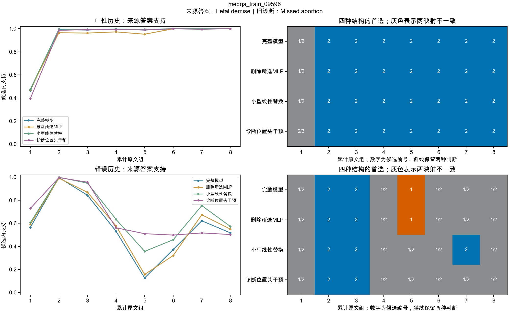
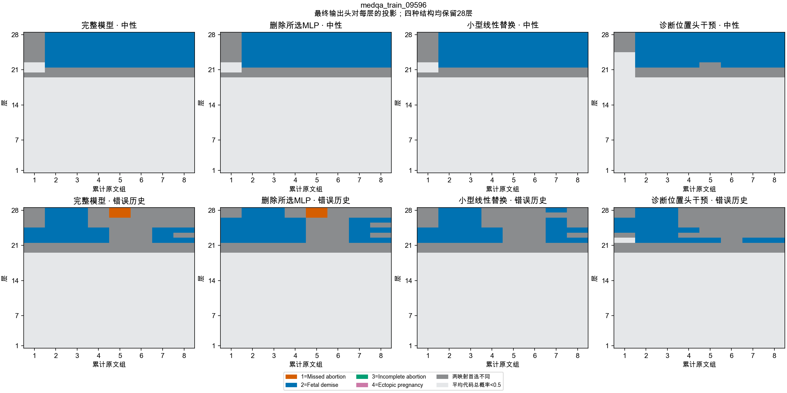

# medqa_train_09596

来源答案：**Fetal demise**；固定错误历史：**Missed abortion**。

候选：1=Missed abortion；2=Fetal demise；3=Incomplete abortion；4=Ectopic pregnancy。

曲线颜色代表四种结构，方格颜色及数字代表四个候选。曲线先平均两套代码支持；右侧方格与下表在两套代码不一致时同时列出两个候选编号，方格标灰。统计仍先各映射判定后在病例内平均。逐层图是最终输出头投影；浅灰表示代码总概率不足0.5，深灰表示两映射首选不同，未将这些格子解释为确定的疾病判断。

## 中性历史

| 轮 | 完整模型 | 删除所选MLP | 小型线性替换 | 诊断位置头干预 |
|---:|---|---|---|---|
| 1 | 1 / 2 | 1 / 2 | 1 / 2 | 2 / 3 |
| 2 | 2 | 2 | 2 | 2 |
| 3 | 2 | 2 | 2 | 2 |
| 4 | 2 | 2 | 2 | 2 |
| 5 | 2 | 2 | 2 | 2 |
| 6 | 2 | 2 | 2 | 2 |
| 7 | 2 | 2 | 2 | 2 |
| 8 | 2 | 2 | 2 | 2 |
## 错误历史

| 轮 | 完整模型 | 删除所选MLP | 小型线性替换 | 诊断位置头干预 |
|---:|---|---|---|---|
| 1 | 1 / 2 | 1 / 2 | 1 / 2 | 1 / 2 |
| 2 | 2 | 2 | 2 | 2 |
| 3 | 2 | 2 | 2 | 2 |
| 4 | 1 / 2 | 1 / 2 | 1 / 2 | 1 / 2 |
| 5 | 1 | 1 | 1 / 2 | 1 / 2 |
| 6 | 1 / 2 | 1 / 2 | 1 / 2 | 1 / 2 |
| 7 | 1 / 2 | 1 / 2 | 2 | 1 / 2 |
| 8 | 1 / 2 | 1 / 2 | 1 / 2 | 1 / 2 |

## 新增原文

1. A 30-year-old primigravida schedules an appointment with her obstetrician for a regular check-up.
2. She says that everything is fine, although she reports that her baby has stopped moving as much as previously.
3. She is 22 weeks gestation.
4. She denies any pain or vaginal bleeding.
5. The obstetrician performs an ultrasound and also orders routine blood and urine tests.
6. On ultrasound, there is no fetal cardiac activity or movement.
7. The patient is asked to wait for 1 hour, after which the scan is to be repeated.
8. The second scan shows the same findings.
