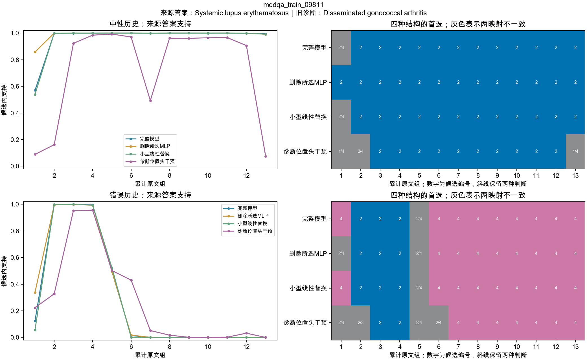
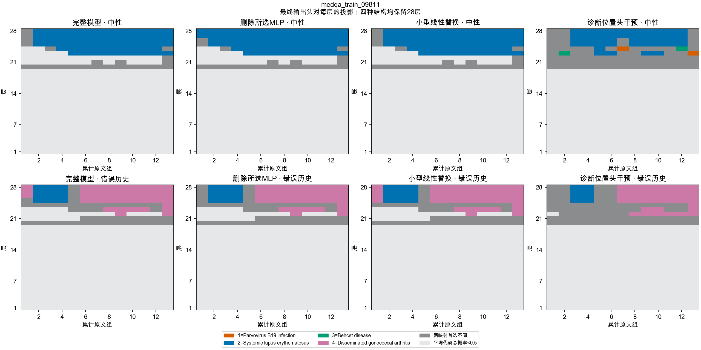

# medqa_train_09811

来源答案：**Systemic lupus erythematosus**；固定错误历史：**Disseminated gonococcal arthritis**。

候选：1=Parvovirus B19 infection；2=Systemic lupus erythematosus；3=Behcet disease；4=Disseminated gonococcal arthritis。

曲线颜色代表四种结构，方格颜色及数字代表四个候选。曲线先平均两套代码支持；右侧方格与下表在两套代码不一致时同时列出两个候选编号，方格标灰。统计仍先各映射判定后在病例内平均。逐层图是最终输出头投影；浅灰表示代码总概率不足0.5，深灰表示两映射首选不同，未将这些格子解释为确定的疾病判断。

## 中性历史

| 轮 | 完整模型 | 删除所选MLP | 小型线性替换 | 诊断位置头干预 |
|---:|---|---|---|---|
| 1 | 2 / 4 | 2 | 2 / 4 | 1 / 4 |
| 2 | 2 | 2 | 2 | 3 / 4 |
| 3 | 2 | 2 | 2 | 2 |
| 4 | 2 | 2 | 2 | 2 |
| 5 | 2 | 2 | 2 | 2 |
| 6 | 2 | 2 | 2 | 2 |
| 7 | 2 | 2 | 2 | 2 |
| 8 | 2 | 2 | 2 | 2 |
| 9 | 2 | 2 | 2 | 2 |
| 10 | 2 | 2 | 2 | 2 |
| 11 | 2 | 2 | 2 | 2 |
| 12 | 2 | 2 | 2 | 2 |
| 13 | 2 | 2 | 2 | 1 / 4 |
## 错误历史

| 轮 | 完整模型 | 删除所选MLP | 小型线性替换 | 诊断位置头干预 |
|---:|---|---|---|---|
| 1 | 4 | 2 / 4 | 4 | 2 / 4 |
| 2 | 2 | 2 | 2 | 2 / 3 |
| 3 | 2 | 2 | 2 | 2 |
| 4 | 2 | 2 | 2 | 2 |
| 5 | 2 / 4 | 2 / 4 | 2 / 4 | 2 / 4 |
| 6 | 4 | 4 | 4 | 2 / 4 |
| 7 | 4 | 4 | 4 | 4 |
| 8 | 4 | 4 | 4 | 4 |
| 9 | 4 | 4 | 4 | 4 |
| 10 | 4 | 4 | 4 | 4 |
| 11 | 4 | 4 | 4 | 4 |
| 12 | 4 | 4 | 4 | 4 |
| 13 | 4 | 4 | 4 | 4 |

## 新增原文

1. A 33-year-old African American woman presents to the clinic complaining of pain and swelling of her hands and wrists for the past 5 months.
2. The symptoms are worse in the morning and are associated with stiffness that lasts about 15 minutes.
3. She also complains of profound fatigue and decreased appetite.
4. She is sexually active with one partner in a monogamous relationship.
5. Past medical history is unremarkable and she is taking oral contraceptives.
6. She smokes 1–2 cigarettes per day and drinks alcohol socially on the weekends.
7. Temperature is 37.2°C (99.1°F), blood pressure is 130/82 mm Hg, pulse is 76/min, and respirations are 12/min.
8. Physical examination reveals wrists that are tender to palpation, warm, and mildly swollen.
9. Several metacarpophalangeal and proximal interphalangeal joints on both hands are also tender.
10. Hand and wrist strength is 5/5 bilaterally.
11. A non-tender ulcer on the buccal mucosa is also noted.
12. When asked about it, the patient reports that it has been there for several months and does not bother her.
13. Laboratory results are as follows:; Complete blood count; Hemoglobin 10.3 g/dL; Platelets 90,000/mm3; Leukocytes 6,700/mm3; Blood urea nitrogen 16 mg/dL; Creatinine 2.1 mg/dL; Urinalysis; Blood 10–20 red blood cells/hpf; Protein 2+ protein; B-HCG Negative
