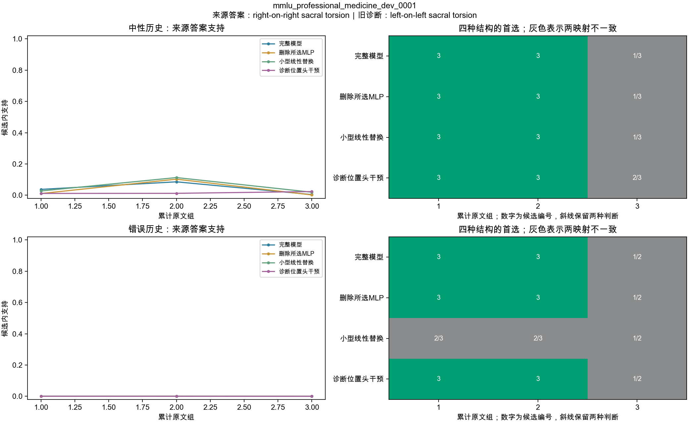
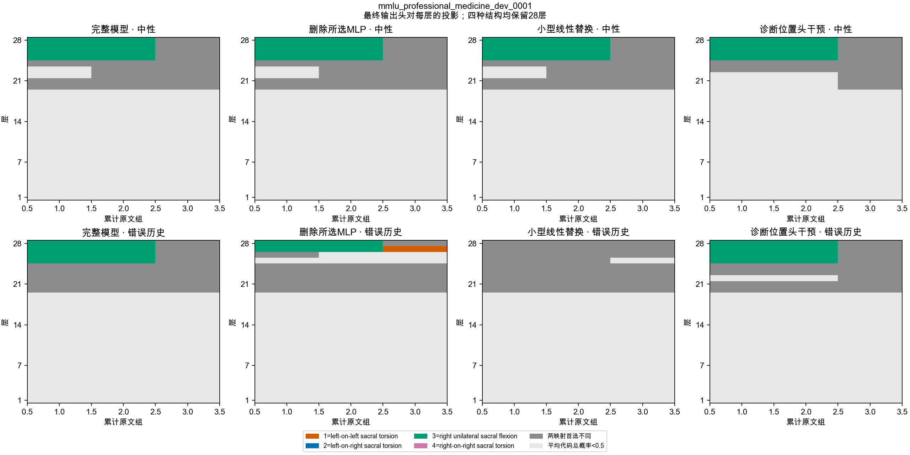

# mmlu_professional_medicine_dev_0001

来源答案：**right-on-right sacral torsion**；固定错误历史：**left-on-left sacral torsion**。

候选：1=left-on-left sacral torsion；2=left-on-right sacral torsion；3=right unilateral sacral flexion；4=right-on-right sacral torsion。

曲线颜色代表四种结构，方格颜色及数字代表四个候选。曲线先平均两套代码支持；右侧方格与下表在两套代码不一致时同时列出两个候选编号，方格标灰。统计仍先各映射判定后在病例内平均。逐层图是最终输出头投影；浅灰表示代码总概率不足0.5，深灰表示两映射首选不同，未将这些格子解释为确定的疾病判断。

## 中性历史

| 轮 | 完整模型 | 删除所选MLP | 小型线性替换 | 诊断位置头干预 |
|---:|---|---|---|---|
| 1 | 3 | 3 | 3 | 3 |
| 2 | 3 | 3 | 3 | 3 |
| 3 | 1 / 3 | 1 / 3 | 1 / 3 | 2 / 3 |
## 错误历史

| 轮 | 完整模型 | 删除所选MLP | 小型线性替换 | 诊断位置头干预 |
|---:|---|---|---|---|
| 1 | 3 | 3 | 2 / 3 | 3 |
| 2 | 3 | 3 | 2 / 3 | 3 |
| 3 | 1 / 2 | 1 / 2 | 1 / 2 | 1 / 2 |

## 新增原文

1. A 36-year-old male presents to the office with a 3-week history of low back pain.
2. He denies any recent trauma but says that he climbs in and out of his truck numerous times a day for his job.
3. Examination of the patient in the prone position reveals a deep sacral sulcus on the left, a posterior inferior lateral angle on the right, and a lumbosacral junction that springs freely on compression.
