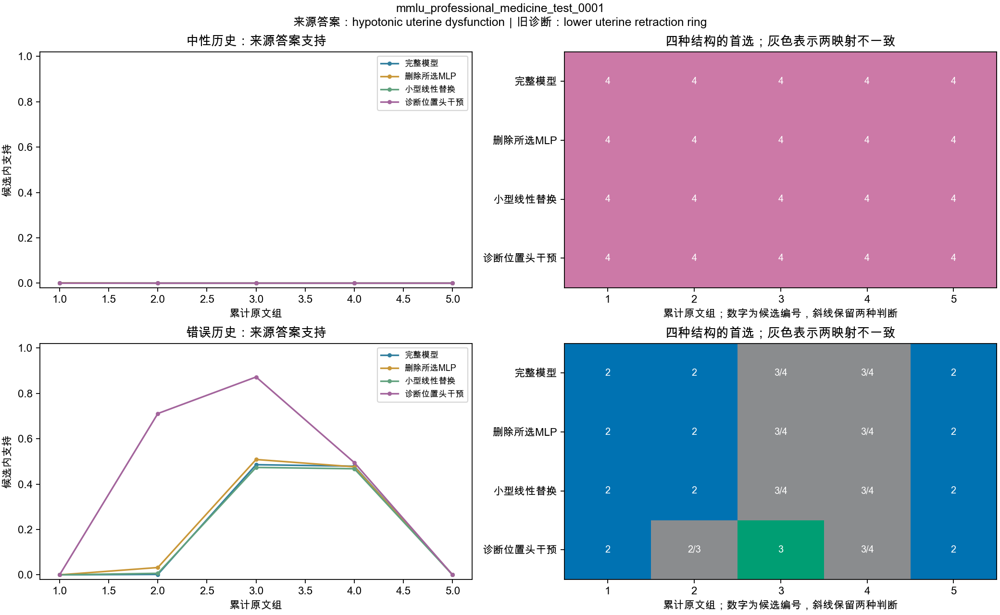
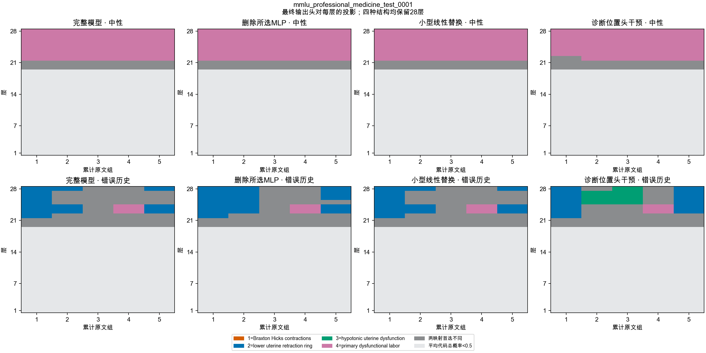

# mmlu_professional_medicine_test_0001

来源答案：**hypotonic uterine dysfunction**；固定错误历史：**lower uterine retraction ring**。

候选：1=Braxton Hicks contractions；2=lower uterine retraction ring；3=hypotonic uterine dysfunction；4=primary dysfunctional labor。

曲线颜色代表四种结构，方格颜色及数字代表四个候选。曲线先平均两套代码支持；右侧方格与下表在两套代码不一致时同时列出两个候选编号，方格标灰。统计仍先各映射判定后在病例内平均。逐层图是最终输出头投影；浅灰表示代码总概率不足0.5，深灰表示两映射首选不同，未将这些格子解释为确定的疾病判断。

## 中性历史

| 轮 | 完整模型 | 删除所选MLP | 小型线性替换 | 诊断位置头干预 |
|---:|---|---|---|---|
| 1 | 4 | 4 | 4 | 4 |
| 2 | 4 | 4 | 4 | 4 |
| 3 | 4 | 4 | 4 | 4 |
| 4 | 4 | 4 | 4 | 4 |
| 5 | 4 | 4 | 4 | 4 |
## 错误历史

| 轮 | 完整模型 | 删除所选MLP | 小型线性替换 | 诊断位置头干预 |
|---:|---|---|---|---|
| 1 | 2 | 2 | 2 | 2 |
| 2 | 2 | 2 | 2 | 2 / 3 |
| 3 | 3 / 4 | 3 / 4 | 3 / 4 | 3 |
| 4 | 3 / 4 | 3 / 4 | 3 / 4 | 3 / 4 |
| 5 | 2 | 2 | 2 | 2 |

## 新增原文

1. A 25-year-old gravida 3 para 2 female is admitted to the hospital at 39 weeks' gestation in active labor.
2. She had been having regular contractions every 4 minutes, but is now having only a few intermittent, weak contractions.
3. She has received medication for pain twice in the past 6 hours.
4. Examination shows no reason for obstructed labor.
5. The fetal head is engaged, the membranes are intact, the fetal heart tones are normal, and the cervix is 100% effaced and 7 cm dilated.
