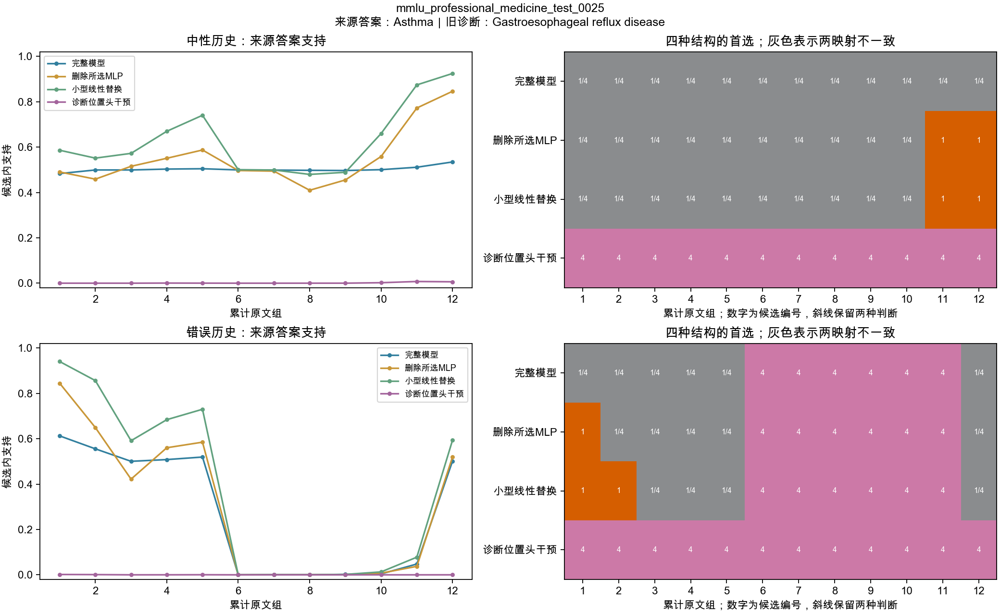
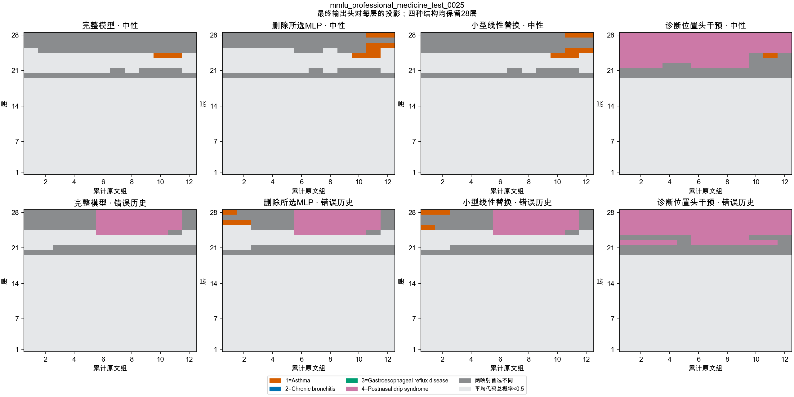

# mmlu_professional_medicine_test_0025

来源答案：**Asthma**；固定错误历史：**Gastroesophageal reflux disease**。

候选：1=Asthma；2=Chronic bronchitis；3=Gastroesophageal reflux disease；4=Postnasal drip syndrome。

曲线颜色代表四种结构，方格颜色及数字代表四个候选。曲线先平均两套代码支持；右侧方格与下表在两套代码不一致时同时列出两个候选编号，方格标灰。统计仍先各映射判定后在病例内平均。逐层图是最终输出头投影；浅灰表示代码总概率不足0.5，深灰表示两映射首选不同，未将这些格子解释为确定的疾病判断。

## 中性历史

| 轮 | 完整模型 | 删除所选MLP | 小型线性替换 | 诊断位置头干预 |
|---:|---|---|---|---|
| 1 | 1 / 4 | 1 / 4 | 1 / 4 | 4 |
| 2 | 1 / 4 | 1 / 4 | 1 / 4 | 4 |
| 3 | 1 / 4 | 1 / 4 | 1 / 4 | 4 |
| 4 | 1 / 4 | 1 / 4 | 1 / 4 | 4 |
| 5 | 1 / 4 | 1 / 4 | 1 / 4 | 4 |
| 6 | 1 / 4 | 1 / 4 | 1 / 4 | 4 |
| 7 | 1 / 4 | 1 / 4 | 1 / 4 | 4 |
| 8 | 1 / 4 | 1 / 4 | 1 / 4 | 4 |
| 9 | 1 / 4 | 1 / 4 | 1 / 4 | 4 |
| 10 | 1 / 4 | 1 / 4 | 1 / 4 | 4 |
| 11 | 1 / 4 | 1 | 1 | 4 |
| 12 | 1 / 4 | 1 | 1 | 4 |
## 错误历史

| 轮 | 完整模型 | 删除所选MLP | 小型线性替换 | 诊断位置头干预 |
|---:|---|---|---|---|
| 1 | 1 / 4 | 1 | 1 | 4 |
| 2 | 1 / 4 | 1 / 4 | 1 | 4 |
| 3 | 1 / 4 | 1 / 4 | 1 / 4 | 4 |
| 4 | 1 / 4 | 1 / 4 | 1 / 4 | 4 |
| 5 | 1 / 4 | 1 / 4 | 1 / 4 | 4 |
| 6 | 4 | 4 | 4 | 4 |
| 7 | 4 | 4 | 4 | 4 |
| 8 | 4 | 4 | 4 | 4 |
| 9 | 4 | 4 | 4 | 4 |
| 10 | 4 | 4 | 4 | 4 |
| 11 | 4 | 4 | 4 | 4 |
| 12 | 1 / 4 | 1 / 4 | 1 / 4 | 4 |

## 新增原文

1. A previously healthy 17-year-old girl comes to the physician because of a 2-month history of exercise-induced cough and nasal congestion.
2. She plays field hockey and has noticed she coughs when running up and down the field.
3. The cough is nonproductive and resolves with rest.
4. She has not had chest pain or palpitations.
5. She takes no medications and does not smoke.
6. Her sister has asthma.
7. The patient appears well.
8. Her pulse is 68/min, respirations are 16/min, and blood pressure is 100/75 mm Hg.
9. Pulse oximetry on room air shows an oxygen saturation of 99%.
10. Cardiopulmonary examination shows no abnormalities.
11. An x-ray of the chest shows no abnormalities.
12. Spirometry shows an FEV1:FVC ratio of 90% and an FEV1 of 90% of predicted.
