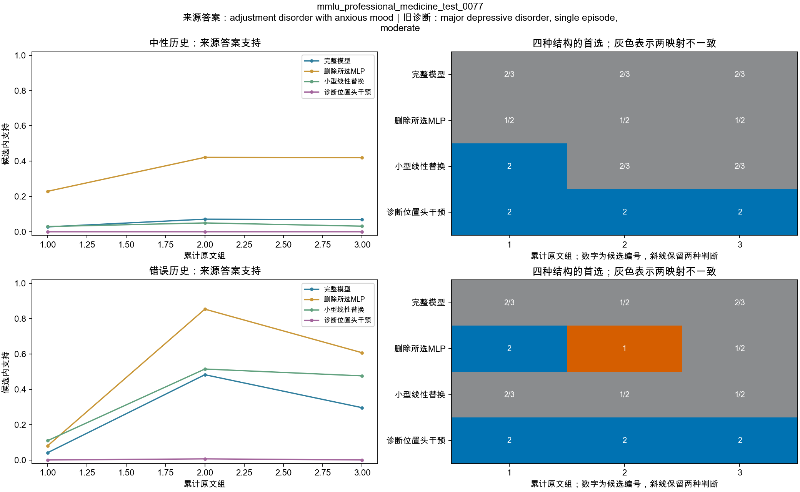
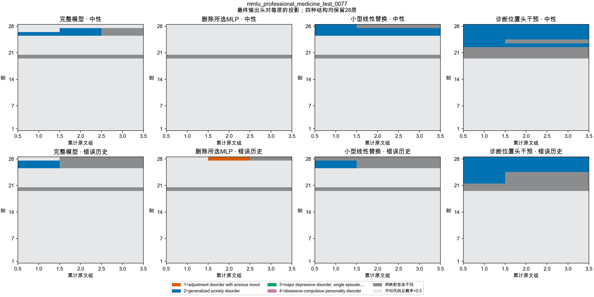

# mmlu_professional_medicine_test_0077

来源答案：**adjustment disorder with anxious mood**；固定错误历史：**major depressive disorder, single episode, moderate**。

候选：1=adjustment disorder with anxious mood；2=generalized anxiety disorder；3=major depressive disorder, single episode, moderate；4=obsessive-compulsive personality disorder。

曲线颜色代表四种结构，方格颜色及数字代表四个候选。曲线先平均两套代码支持；右侧方格与下表在两套代码不一致时同时列出两个候选编号，方格标灰。统计仍先各映射判定后在病例内平均。逐层图是最终输出头投影；浅灰表示代码总概率不足0.5，深灰表示两映射首选不同，未将这些格子解释为确定的疾病判断。

## 中性历史

| 轮 | 完整模型 | 删除所选MLP | 小型线性替换 | 诊断位置头干预 |
|---:|---|---|---|---|
| 1 | 2 / 3 | 1 / 2 | 2 | 2 |
| 2 | 2 / 3 | 1 / 2 | 2 / 3 | 2 |
| 3 | 2 / 3 | 1 / 2 | 2 / 3 | 2 |
## 错误历史

| 轮 | 完整模型 | 删除所选MLP | 小型线性替换 | 诊断位置头干预 |
|---:|---|---|---|---|
| 1 | 2 / 3 | 2 | 2 / 3 | 2 |
| 2 | 1 / 2 | 1 | 1 / 2 | 2 |
| 3 | 2 / 3 | 1 / 2 | 1 / 2 | 2 |

## 新增原文

1. A 29-year-old male presents to the office with the complaints of a pounding heart, poor sleep, and a generalized feeling of restlessness.
2. He relocated 2 months ago to take a promotion and has found himself unable to concentrate on his new duties.
3. He worries about his ability to adapt to his increase in responsibility at work and states that he has called in sick 3 days within the past 2 weeks.
