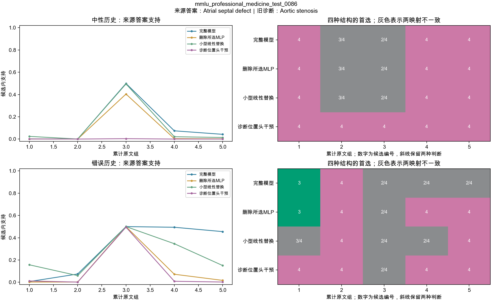
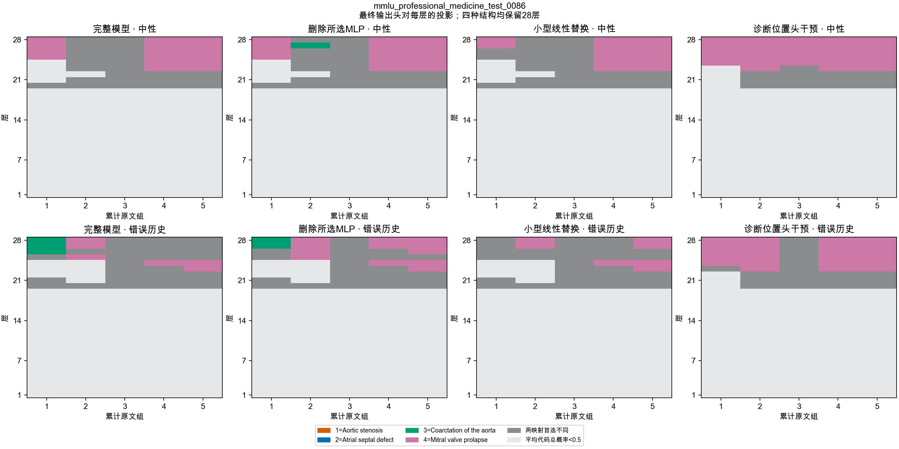

# mmlu_professional_medicine_test_0086

来源答案：**Atrial septal defect**；固定错误历史：**Aortic stenosis**。

候选：1=Aortic stenosis；2=Atrial septal defect；3=Coarctation of the aorta；4=Mitral valve prolapse。

曲线颜色代表四种结构，方格颜色及数字代表四个候选。曲线先平均两套代码支持；右侧方格与下表在两套代码不一致时同时列出两个候选编号，方格标灰。统计仍先各映射判定后在病例内平均。逐层图是最终输出头投影；浅灰表示代码总概率不足0.5，深灰表示两映射首选不同，未将这些格子解释为确定的疾病判断。

## 中性历史

| 轮 | 完整模型 | 删除所选MLP | 小型线性替换 | 诊断位置头干预 |
|---:|---|---|---|---|
| 1 | 4 | 4 | 4 | 4 |
| 2 | 3 / 4 | 3 / 4 | 3 / 4 | 4 |
| 3 | 2 / 4 | 2 / 4 | 2 / 4 | 4 |
| 4 | 4 | 4 | 4 | 4 |
| 5 | 4 | 4 | 4 | 4 |
## 错误历史

| 轮 | 完整模型 | 删除所选MLP | 小型线性替换 | 诊断位置头干预 |
|---:|---|---|---|---|
| 1 | 3 | 3 | 3 / 4 | 4 |
| 2 | 4 | 4 | 4 | 4 |
| 3 | 2 / 4 | 2 / 4 | 2 / 4 | 2 / 4 |
| 4 | 2 / 4 | 4 | 2 / 4 | 4 |
| 5 | 2 / 4 | 4 | 4 | 4 |

## 新增原文

1. A healthy 4-year-old girl is brought for a well-child examination.
2. A grade 2/6 systolic ejection murmur is heard along the upper left sternal border.
3. S2 is widely split and does not vary with respiration.
4. A soft mid-diastolic murmur is heard along the lower left sternal border.
5. Examination shows no other abnormalities.
