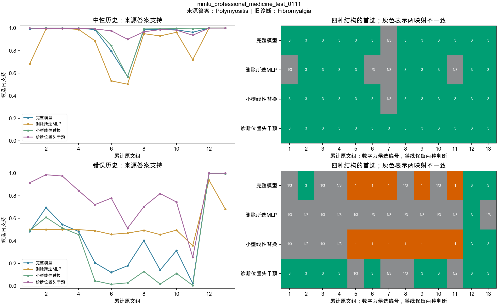
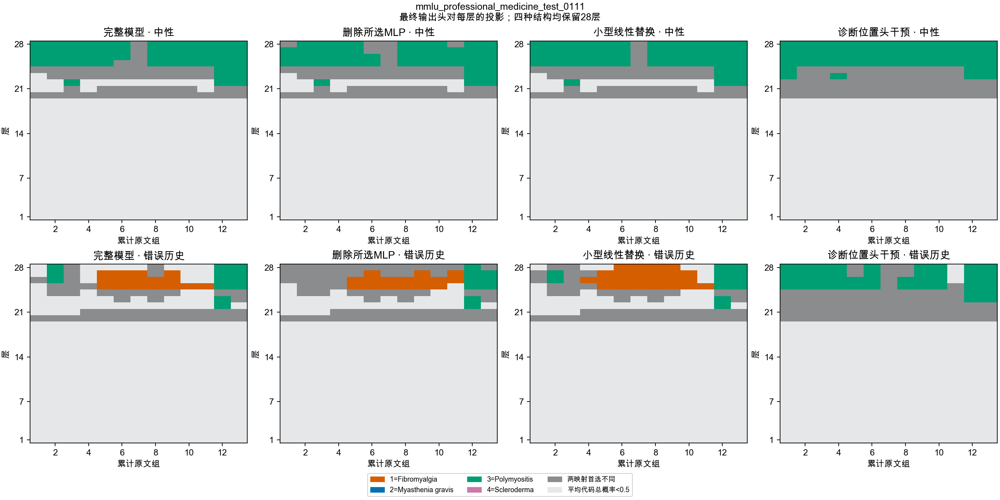

# mmlu_professional_medicine_test_0111

来源答案：**Polymyositis**；固定错误历史：**Fibromyalgia**。

候选：1=Fibromyalgia；2=Myasthenia gravis；3=Polymyositis；4=Scleroderma。

曲线颜色代表四种结构，方格颜色及数字代表四个候选。曲线先平均两套代码支持；右侧方格与下表在两套代码不一致时同时列出两个候选编号，方格标灰。统计仍先各映射判定后在病例内平均。逐层图是最终输出头投影；浅灰表示代码总概率不足0.5，深灰表示两映射首选不同，未将这些格子解释为确定的疾病判断。

## 中性历史

| 轮 | 完整模型 | 删除所选MLP | 小型线性替换 | 诊断位置头干预 |
|---:|---|---|---|---|
| 1 | 3 | 1 / 3 | 3 | 3 |
| 2 | 3 | 3 | 3 | 3 |
| 3 | 3 | 3 | 3 | 3 |
| 4 | 3 | 3 | 3 | 3 |
| 5 | 3 | 3 | 3 | 3 |
| 6 | 3 | 1 / 3 | 3 | 3 |
| 7 | 1 / 3 | 1 / 3 | 1 / 3 | 3 |
| 8 | 3 | 3 | 3 | 3 |
| 9 | 3 | 3 | 3 | 3 |
| 10 | 3 | 3 | 3 | 3 |
| 11 | 3 | 1 / 3 | 3 | 3 |
| 12 | 3 | 3 | 3 | 3 |
| 13 | 3 | 3 | 3 | 3 |
## 错误历史

| 轮 | 完整模型 | 删除所选MLP | 小型线性替换 | 诊断位置头干预 |
|---:|---|---|---|---|
| 1 | 1 / 3 | 1 / 3 | 1 / 3 | 3 |
| 2 | 3 | 1 / 3 | 1 / 3 | 3 |
| 3 | 1 / 3 | 1 / 3 | 1 / 3 | 3 |
| 4 | 1 / 3 | 1 / 3 | 1 / 3 | 3 |
| 5 | 1 | 1 / 3 | 1 | 1 / 3 |
| 6 | 1 | 1 / 3 | 1 | 3 |
| 7 | 1 | 1 / 3 | 1 | 1 / 3 |
| 8 | 1 / 3 | 1 / 3 | 1 | 1 / 3 |
| 9 | 1 | 1 / 3 | 1 | 3 |
| 10 | 1 / 3 | 1 / 3 | 1 | 3 |
| 11 | 1 | 1 / 3 | 1 | 1 / 2 |
| 12 | 3 | 3 | 3 | 3 |
| 13 | 3 | 1 / 3 | 3 | 3 |

## 新增原文

1. A 40-year-old female secretary comes to the office because of a 2-month history of fatigue, and generalized aching and weakness of the proximal muscles of all four extremities.
2. The patient initially noticed the weakness only while she was getting in and out of her car, but during the past 2 weeks, the weakness has progressed, so that she now has difficulty combing her hair.
3. Since the symptoms began, she also has had aching of the joints in her hands that has responded partially to ibuprofen.
4. She was adopted and family history is unknown.
5. She has two teenaged children who are well.
6. She appears uncomfortable.
7. She is 170 cm (5 ft 7 in) tall and weighs 68 kg(150 lb); BMI is 24 kg/m2 .
8. Vital signs are temperature 37.7°C (99.8°F), pulse 90/min, respirations 20/min, and blood pressure 110/70 mm Hg.
9. The patient is alert and fully oriented.
10. Physical examination discloses cracking of the skin of both hands that involves the tips and lateral sides of several fingers.
11. The muscles of the upper arms and legs are somewhat tender to pressure.
12. Results of serum laboratory studies show a creatine kinase concentration of 600 U/L and a lactate dehydrogenase concentration of 800 U/L.
13. Results of complete blood count are within the reference ranges.
