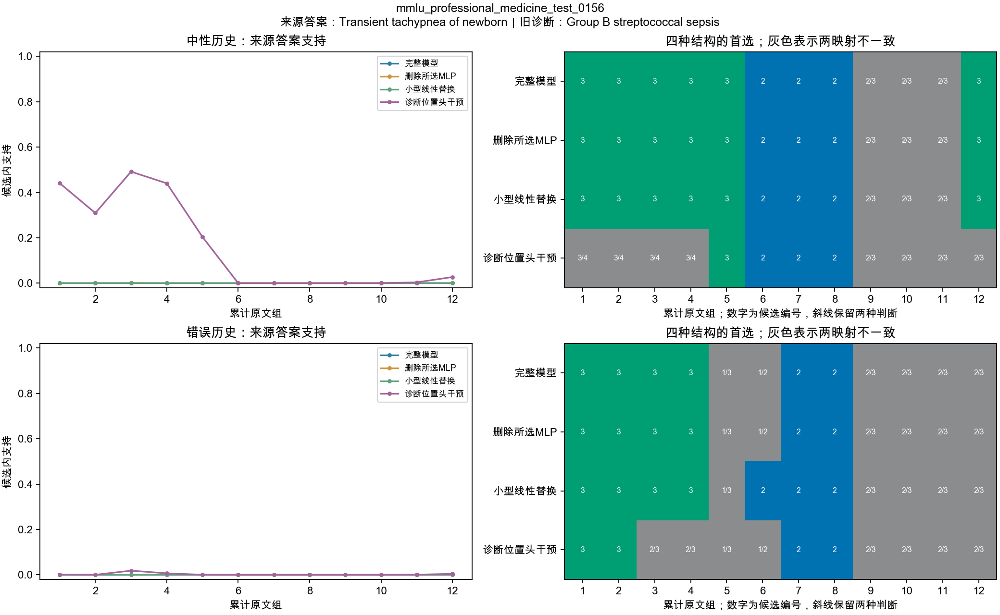
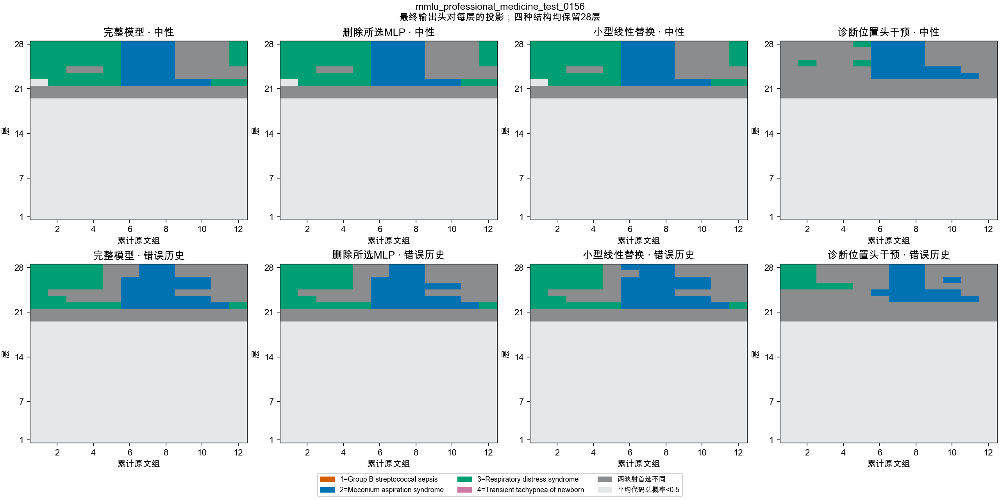

# mmlu_professional_medicine_test_0156

来源答案：**Transient tachypnea of newborn**；固定错误历史：**Group B streptococcal sepsis**。

候选：1=Group B streptococcal sepsis；2=Meconium aspiration syndrome；3=Respiratory distress syndrome；4=Transient tachypnea of newborn。

曲线颜色代表四种结构，方格颜色及数字代表四个候选。曲线先平均两套代码支持；右侧方格与下表在两套代码不一致时同时列出两个候选编号，方格标灰。统计仍先各映射判定后在病例内平均。逐层图是最终输出头投影；浅灰表示代码总概率不足0.5，深灰表示两映射首选不同，未将这些格子解释为确定的疾病判断。

## 中性历史

| 轮 | 完整模型 | 删除所选MLP | 小型线性替换 | 诊断位置头干预 |
|---:|---|---|---|---|
| 1 | 3 | 3 | 3 | 3 / 4 |
| 2 | 3 | 3 | 3 | 3 / 4 |
| 3 | 3 | 3 | 3 | 3 / 4 |
| 4 | 3 | 3 | 3 | 3 / 4 |
| 5 | 3 | 3 | 3 | 3 |
| 6 | 2 | 2 | 2 | 2 |
| 7 | 2 | 2 | 2 | 2 |
| 8 | 2 | 2 | 2 | 2 |
| 9 | 2 / 3 | 2 / 3 | 2 / 3 | 2 / 3 |
| 10 | 2 / 3 | 2 / 3 | 2 / 3 | 2 / 3 |
| 11 | 2 / 3 | 2 / 3 | 2 / 3 | 2 / 3 |
| 12 | 3 | 3 | 3 | 2 / 3 |
## 错误历史

| 轮 | 完整模型 | 删除所选MLP | 小型线性替换 | 诊断位置头干预 |
|---:|---|---|---|---|
| 1 | 3 | 3 | 3 | 3 |
| 2 | 3 | 3 | 3 | 3 |
| 3 | 3 | 3 | 3 | 2 / 3 |
| 4 | 3 | 3 | 3 | 2 / 3 |
| 5 | 1 / 3 | 1 / 3 | 1 / 3 | 1 / 3 |
| 6 | 1 / 2 | 1 / 2 | 2 | 1 / 2 |
| 7 | 2 | 2 | 2 | 2 |
| 8 | 2 | 2 | 2 | 2 |
| 9 | 2 / 3 | 2 / 3 | 2 / 3 | 2 / 3 |
| 10 | 2 / 3 | 2 / 3 | 2 / 3 | 2 / 3 |
| 11 | 2 / 3 | 2 / 3 | 2 / 3 | 2 / 3 |
| 12 | 2 / 3 | 2 / 3 | 2 / 3 | 2 / 3 |

## 新增原文

1. A male neonate, who was born at 36 weeks' gestation 2 hours ago in the labor and delivery unit of the hospital, now shows signs of respiratory difficulty.
2. The mother, an 18-year-old primigravid woman, smoked one pack of cigarettes daily throughout her pregnancy.
3. She received prenatal care during most of the pregnancy.
4. One episode of chlamydial cervicitis was detected during the last trimester and treated with azithromycin.
5. The neonate was born via cesarean delivery due to fetal heart rate decelerations.
6. The amniotic fluid was stained with light particulate meconium.
7. Apgar scores were 9 and 9 at 1 and 5 minutes, respectively.
8. The patient is 50 cm (20 in; 50th percentile) long and weighs 3005 g (6 lb 10 oz; 50th percentile); head circumference is 35 cm (14 in; 50th percentile).
9. The infant's vital signs now are temperature 36.6°C (97.8°F), pulse 150/min, and respirations 70/min.
10. Pulse oximetry on room air shows an oxygen saturation of 95%.
11. Physical examination discloses mild subcostal and intercostal retractions.
12. Chest x-ray shows prominent pulmonary vascular markings and fluid in the intralobar fissures.
