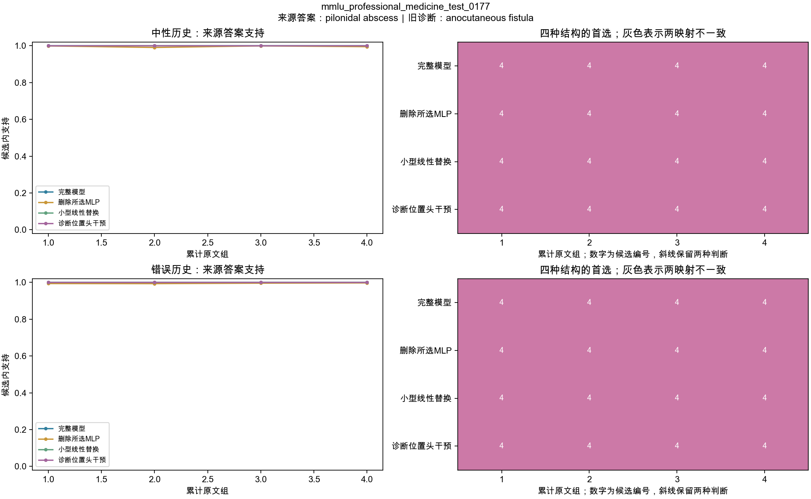
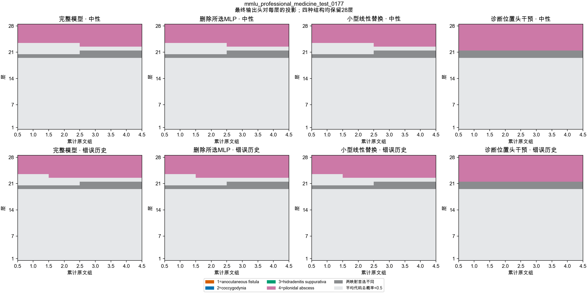

# mmlu_professional_medicine_test_0177

来源答案：**pilonidal abscess**；固定错误历史：**anocutaneous fistula**。

候选：1=anocutaneous fistula；2=coccygodynia；3=hidradenitis suppurativa；4=pilonidal abscess。

曲线颜色代表四种结构，方格颜色及数字代表四个候选。曲线先平均两套代码支持；右侧方格与下表在两套代码不一致时同时列出两个候选编号，方格标灰。统计仍先各映射判定后在病例内平均。逐层图是最终输出头投影；浅灰表示代码总概率不足0.5，深灰表示两映射首选不同，未将这些格子解释为确定的疾病判断。

## 中性历史

| 轮 | 完整模型 | 删除所选MLP | 小型线性替换 | 诊断位置头干预 |
|---:|---|---|---|---|
| 1 | 4 | 4 | 4 | 4 |
| 2 | 4 | 4 | 4 | 4 |
| 3 | 4 | 4 | 4 | 4 |
| 4 | 4 | 4 | 4 | 4 |
## 错误历史

| 轮 | 完整模型 | 删除所选MLP | 小型线性替换 | 诊断位置头干预 |
|---:|---|---|---|---|
| 1 | 4 | 4 | 4 | 4 |
| 2 | 4 | 4 | 4 | 4 |
| 3 | 4 | 4 | 4 | 4 |
| 4 | 4 | 4 | 4 | 4 |

## 新增原文

1. A 15-year-old male is brought to the office with a 2-day history of painful swelling over the sacral prominence that began after a fall during a high school wrestling match.
2. The patient has a low-grade fever.
3. Examination reveals an erythematous, fluctuant, elevated mass with 3 midline pores.
4. Rectal examination reveals no induration or pain.
