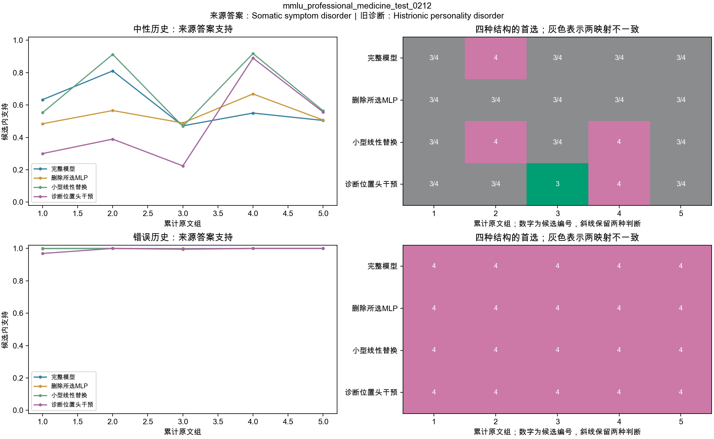
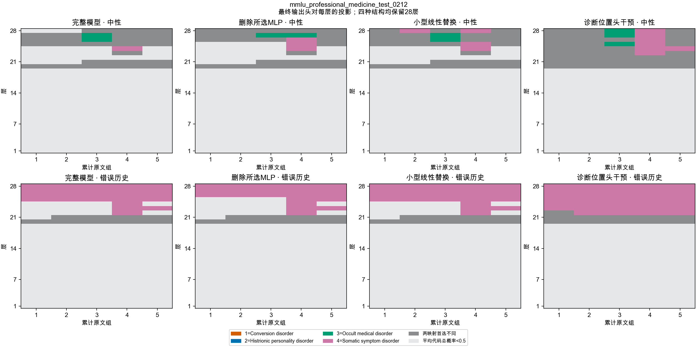

# mmlu_professional_medicine_test_0212

来源答案：**Somatic symptom disorder**；固定错误历史：**Histrionic personality disorder**。

候选：1=Conversion disorder；2=Histrionic personality disorder；3=Occult medical disorder；4=Somatic symptom disorder。

曲线颜色代表四种结构，方格颜色及数字代表四个候选。曲线先平均两套代码支持；右侧方格与下表在两套代码不一致时同时列出两个候选编号，方格标灰。统计仍先各映射判定后在病例内平均。逐层图是最终输出头投影；浅灰表示代码总概率不足0.5，深灰表示两映射首选不同，未将这些格子解释为确定的疾病判断。

## 中性历史

| 轮 | 完整模型 | 删除所选MLP | 小型线性替换 | 诊断位置头干预 |
|---:|---|---|---|---|
| 1 | 3 / 4 | 3 / 4 | 3 / 4 | 3 / 4 |
| 2 | 4 | 3 / 4 | 4 | 3 / 4 |
| 3 | 3 / 4 | 3 / 4 | 3 / 4 | 3 |
| 4 | 3 / 4 | 3 / 4 | 4 | 4 |
| 5 | 3 / 4 | 3 / 4 | 3 / 4 | 3 / 4 |
## 错误历史

| 轮 | 完整模型 | 删除所选MLP | 小型线性替换 | 诊断位置头干预 |
|---:|---|---|---|---|
| 1 | 4 | 4 | 4 | 4 |
| 2 | 4 | 4 | 4 | 4 |
| 3 | 4 | 4 | 4 | 4 |
| 4 | 4 | 4 | 4 | 4 |
| 5 | 4 | 4 | 4 | 4 |

## 新增原文

1. A 50-year-old woman comes to the office for the first time because of recurrent abdominal pain.
2. Review of her extensive medical chart, which she has brought with her, discloses that she has a long history of varying physical symptoms.
3. Definitive causes for these symptoms have not been found despite extensive diagnostic studies, consultations with many physicians, and several surgical explorations.
4. She gives dramatic and exaggerated descriptions of her present and past symptoms, and she makes conflicting statements about her history.
5. She has been hospitalized at least 23 times since age 18 years.
