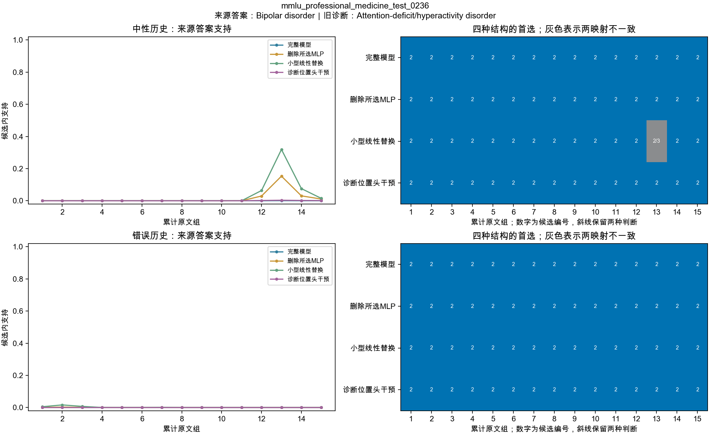
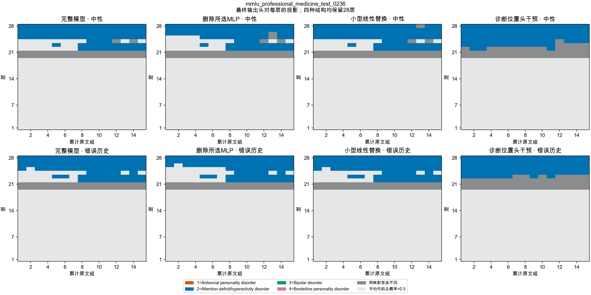

# mmlu_professional_medicine_test_0236

来源答案：**Bipolar disorder**；固定错误历史：**Attention-deficit/hyperactivity disorder**。

候选：1=Antisocial personality disorder；2=Attention-deficit/hyperactivity disorder；3=Bipolar disorder；4=Borderline personality disorder。

曲线颜色代表四种结构，方格颜色及数字代表四个候选。曲线先平均两套代码支持；右侧方格与下表在两套代码不一致时同时列出两个候选编号，方格标灰。统计仍先各映射判定后在病例内平均。逐层图是最终输出头投影；浅灰表示代码总概率不足0.5，深灰表示两映射首选不同，未将这些格子解释为确定的疾病判断。

## 中性历史

| 轮 | 完整模型 | 删除所选MLP | 小型线性替换 | 诊断位置头干预 |
|---:|---|---|---|---|
| 1 | 2 | 2 | 2 | 2 |
| 2 | 2 | 2 | 2 | 2 |
| 3 | 2 | 2 | 2 | 2 |
| 4 | 2 | 2 | 2 | 2 |
| 5 | 2 | 2 | 2 | 2 |
| 6 | 2 | 2 | 2 | 2 |
| 7 | 2 | 2 | 2 | 2 |
| 8 | 2 | 2 | 2 | 2 |
| 9 | 2 | 2 | 2 | 2 |
| 10 | 2 | 2 | 2 | 2 |
| 11 | 2 | 2 | 2 | 2 |
| 12 | 2 | 2 | 2 | 2 |
| 13 | 2 | 2 | 2 / 3 | 2 |
| 14 | 2 | 2 | 2 | 2 |
| 15 | 2 | 2 | 2 | 2 |
## 错误历史

| 轮 | 完整模型 | 删除所选MLP | 小型线性替换 | 诊断位置头干预 |
|---:|---|---|---|---|
| 1 | 2 | 2 | 2 | 2 |
| 2 | 2 | 2 | 2 | 2 |
| 3 | 2 | 2 | 2 | 2 |
| 4 | 2 | 2 | 2 | 2 |
| 5 | 2 | 2 | 2 | 2 |
| 6 | 2 | 2 | 2 | 2 |
| 7 | 2 | 2 | 2 | 2 |
| 8 | 2 | 2 | 2 | 2 |
| 9 | 2 | 2 | 2 | 2 |
| 10 | 2 | 2 | 2 | 2 |
| 11 | 2 | 2 | 2 | 2 |
| 12 | 2 | 2 | 2 | 2 |
| 13 | 2 | 2 | 2 | 2 |
| 14 | 2 | 2 | 2 | 2 |
| 15 | 2 | 2 | 2 | 2 |

## 新增原文

1. A 32-year-old man comes to the physician because he has had difficulty focusing on tasks at work and at home during the past 2 months.
2. He works as an automobile mechanic.
3. He has had a lot of energy for work but often is distracted to the point that he does not complete assigned tasks.
4. He frequently stops working on his own tasks to attempt to develop greater efficiency in his shop.
5. He states that he is delighted with his newfound energy and reports that he now needs only 4 hours of sleep nightly.
6. He has no history of psychiatric illness.
7. He always performed well in school.
8. He has a history of drinking alcohol excessively and using methamphetamines and cocaine during his 20s, but he has not consumed alcohol or used illicit drugs for the past 3 years.
9. His temperature is 37°C (98.6°F), pulse is 60/min, and blood pressure is 125/80 mm Hg.
10. Physical examination shows no abnormalities.
11. On mental status examination, he describes his mood as "good." He has a labile affect.
12. His speech is rapid in rate but normal in rhythm, and his thought process is organized.
13. Short- and long-term memory are intact.
14. Attention and concentration are fair; he makes no errors when performing serial sevens, and he can repeat seven digits forward and five in reverse sequence.
15. He has had no delusions or hallucinations.
