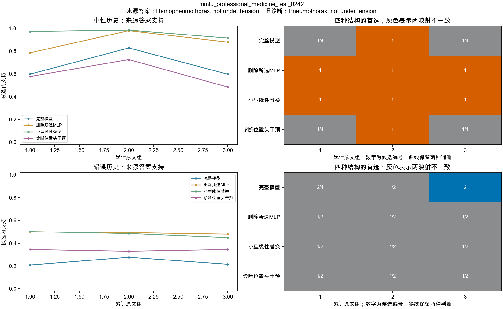
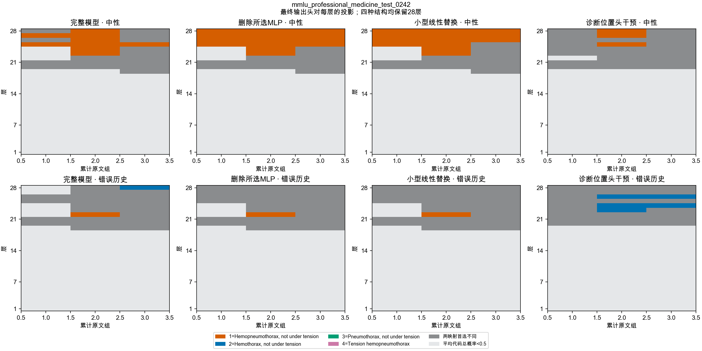

# mmlu_professional_medicine_test_0242

来源答案：**Hemopneumothorax, not under tension**；固定错误历史：**Pneumothorax, not under tension**。

候选：1=Hemopneumothorax, not under tension；2=Hemothorax, not under tension；3=Pneumothorax, not under tension；4=Tension hemopneumothorax。

曲线颜色代表四种结构，方格颜色及数字代表四个候选。曲线先平均两套代码支持；右侧方格与下表在两套代码不一致时同时列出两个候选编号，方格标灰。统计仍先各映射判定后在病例内平均。逐层图是最终输出头投影；浅灰表示代码总概率不足0.5，深灰表示两映射首选不同，未将这些格子解释为确定的疾病判断。

## 中性历史

| 轮 | 完整模型 | 删除所选MLP | 小型线性替换 | 诊断位置头干预 |
|---:|---|---|---|---|
| 1 | 1 / 4 | 1 | 1 | 1 / 4 |
| 2 | 1 | 1 | 1 | 1 |
| 3 | 1 / 4 | 1 | 1 | 1 / 4 |
## 错误历史

| 轮 | 完整模型 | 删除所选MLP | 小型线性替换 | 诊断位置头干预 |
|---:|---|---|---|---|
| 1 | 2 / 4 | 1 / 3 | 1 / 2 | 1 / 2 |
| 2 | 1 / 2 | 1 / 2 | 1 / 2 | 1 / 2 |
| 3 | 2 | 1 / 2 | 1 / 2 | 1 / 2 |

## 新增原文

1. A 16-year-old boy is admitted to the emergency department because of a knife wound to the left side of his chest.
2. An x-ray of the chest shows an air-fluid level in the left side of the chest, partial collapse of the left lung, and elevation of the stomach bubble.
3. The mediastinum is in the midline.
