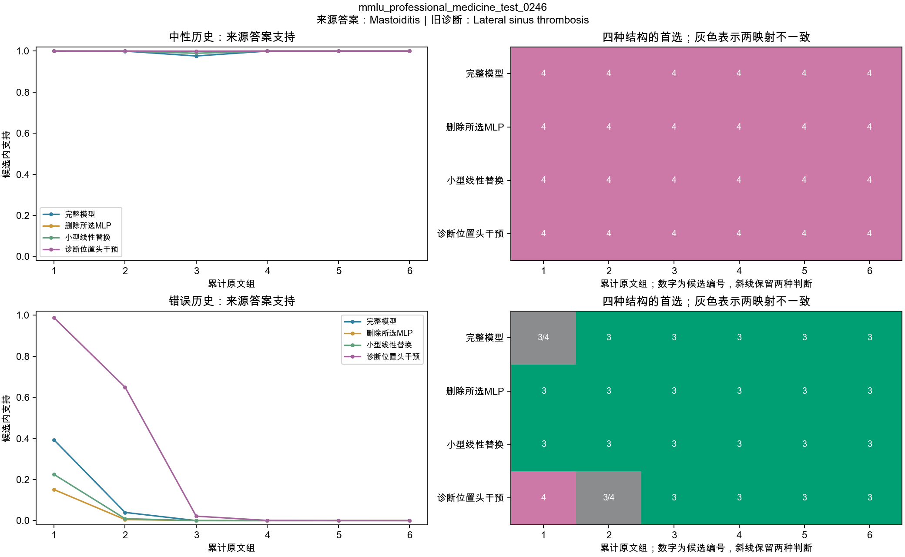
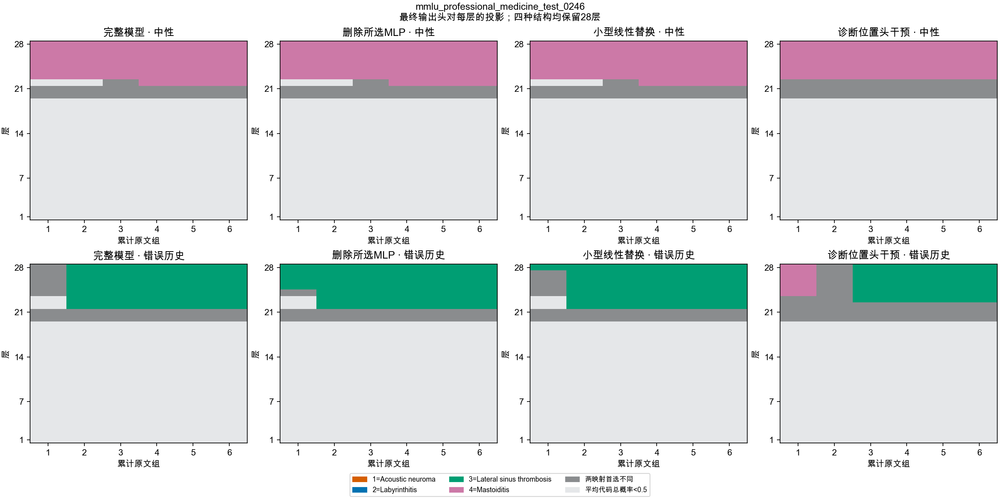

# mmlu_professional_medicine_test_0246

来源答案：**Mastoiditis**；固定错误历史：**Lateral sinus thrombosis**。

候选：1=Acoustic neuroma；2=Labyrinthitis；3=Lateral sinus thrombosis；4=Mastoiditis。

曲线颜色代表四种结构，方格颜色及数字代表四个候选。曲线先平均两套代码支持；右侧方格与下表在两套代码不一致时同时列出两个候选编号，方格标灰。统计仍先各映射判定后在病例内平均。逐层图是最终输出头投影；浅灰表示代码总概率不足0.5，深灰表示两映射首选不同，未将这些格子解释为确定的疾病判断。

## 中性历史

| 轮 | 完整模型 | 删除所选MLP | 小型线性替换 | 诊断位置头干预 |
|---:|---|---|---|---|
| 1 | 4 | 4 | 4 | 4 |
| 2 | 4 | 4 | 4 | 4 |
| 3 | 4 | 4 | 4 | 4 |
| 4 | 4 | 4 | 4 | 4 |
| 5 | 4 | 4 | 4 | 4 |
| 6 | 4 | 4 | 4 | 4 |
## 错误历史

| 轮 | 完整模型 | 删除所选MLP | 小型线性替换 | 诊断位置头干预 |
|---:|---|---|---|---|
| 1 | 3 / 4 | 3 | 3 | 4 |
| 2 | 3 | 3 | 3 | 3 / 4 |
| 3 | 3 | 3 | 3 | 3 |
| 4 | 3 | 3 | 3 | 3 |
| 5 | 3 | 3 | 3 | 3 |
| 6 | 3 | 3 | 3 | 3 |

## 新增原文

1. A 3-year-old girl is brought to the physician because of fever and left ear pain for 3 days.
2. She has been treated with amoxicillin for the past 5 days for left otitis media.
3. Her temperature is 38.5°C (101.3°F), pulse is 100/min, respirations are 20/min, and blood pressure is 80/60 mm Hg.
4. Examination shows the left ear displaced forward and laterally from the head.
5. There is edema and tenderness behind the left ear.
6. Otoscopic examination shows a red, dull, left tympanic membrane that does not move.
