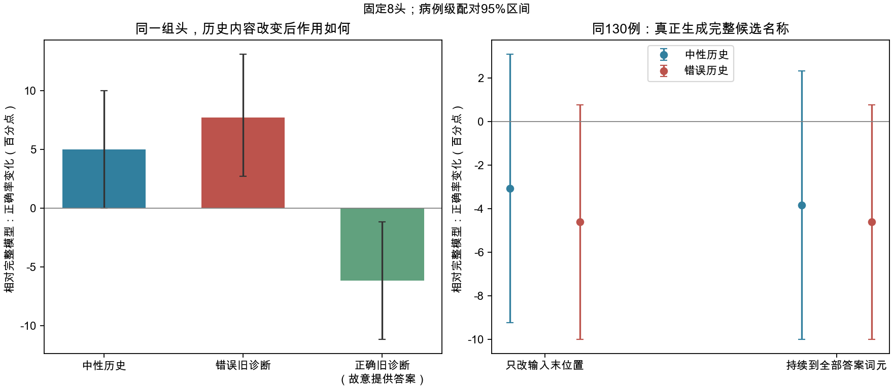

# 同一批病例：历史方向与实际生成

左图在同一批130例上改变历史内容；正确旧诊断明确写入来源答案，仅为机制对照。右图实际生成完整候选，比较只干预首步与持续干预每个答案词元。

## 接口与干预持续时间的配对比较

| 历史 | 代码收益减去首步生成收益 | 代码收益减去持续生成收益 | 持续生成减去首步生成的正确率 |
|---|---|---|---|
| 中性 | 8.08% [1.15, 15.38] | 8.85% [1.54, 16.54] | -0.77% [-3.85, 1.54] |
| 错误旧诊断 | 12.31% [5.38, 20.00] | 12.31% [5.38, 20.00] | 0.00% [0.00, 0.00] |

数值为百分点及病例级95%区间。比较使用同130例；代码结果先平均两映射，名称生成使用原候选顺序，因此接口差异也包含编码与顺序设计差异。此分析在冻结结构后解释结果，没有用它重新挑头。[全部结果](RESULTS.md) · [可复算配对统计](paired_interface_contrasts.json)。
